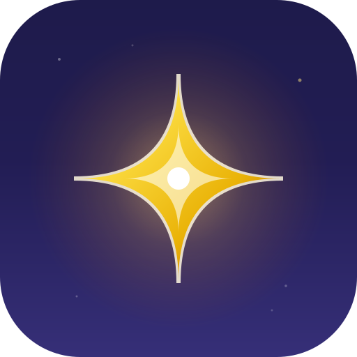
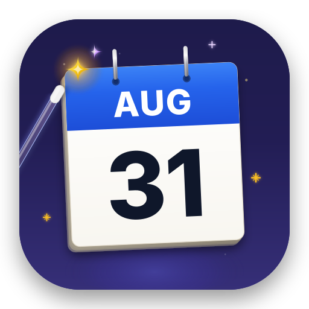
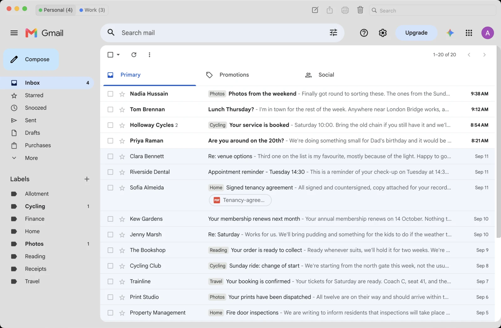
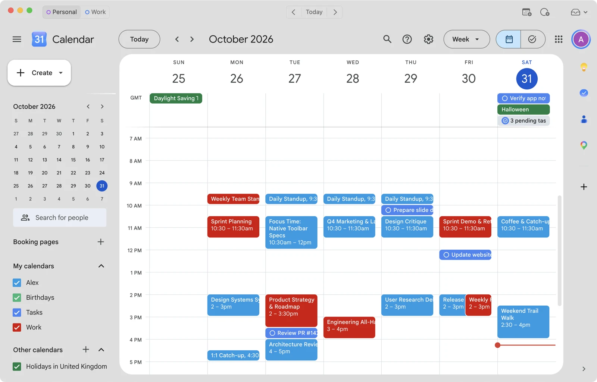

<div align="center">
  
  <h1>Magic Apps</h1>
  <p><strong>Mac + Google = 🪄 Magic</strong></p>
  <p>
    Gmail and Google Calendar apps that feel like they came with your Mac. Use all your accounts
    without switching tabs or profiles.
  </p>
  <p><a href="https://macmagic.app">Website</a> &middot; <a href="https://macmagic.app/help/">Help</a> &middot; <a href="docs/">Docs</a></p>
</div>

Both apps are in active development. Requires macOS 14 (Sonoma) or later on Apple silicon.

|                                                                                   **Magimail**                                                                                   |                                                                                          **Magical**                                                                                           |
| :------------------------------------------------------------------------------------------------------------------------------------------------------------------------------: | :--------------------------------------------------------------------------------------------------------------------------------------------------------------------------------------------: |
|           |                                              |
|                                                                      Tame your inbox with a little sorcery.                                                                      |                                                                                 Put a spell on your calendar.                                                                                  |
|  |  |

## 📦 Installation

Requires macOS 14 (Sonoma) or later on Apple silicon.

### Via Homebrew

Install either app directly using our official tap:

```sh
# Install Magimail (Gmail client)
brew install --cask alxhslm/tap/magimail

# Install Magical (Google Calendar client)
brew install --cask alxhslm/tap/magical
```

Or tap the repository first:

```sh
brew tap alxhslm/tap
brew install --cask magimail magical
```

### Direct Download

Download the signed and notarised `.dmg` disk images:

- **Magimail**: [Download Magimail.dmg](https://updates.macmagic.app/magimail/Magimail.dmg) or view [GitHub Releases](https://github.com/alxhslm/magic-apps/releases)
- **Magical**: [Download Magical.dmg](https://updates.macmagic.app/magical/Magical.dmg) or view [GitHub Releases](https://github.com/alxhslm/magic-apps/releases)

## 🧩 One architecture, built for the Mac

Both apps share the same foundations.

- **Isolated account sessions.** Every account runs in its own sandboxed session with its own accent
  colour, so switching accounts is instant and there is no signing in and out.
- **Native system integration.** Translucent sidebars blend with your desktop, and the menu bar
  popover, desktop widgets, Focus filters and customisable toolbars are real AppKit controls.
- **Direct and private.** Data, sync and notifications move straight between your Mac and Google
  with no intermediate servers. Both apps are open source, so you can read the code that does it.

## 🐛 Bugs and feature requests

Both go through [GitHub Issues](https://github.com/alxhslm/magic-apps/issues). Search before
opening one, then use the matching issue template.

A security problem does not go in a public issue. Report it privately; see
[SECURITY.md](SECURITY.md).

## 🛠️ Building from source

The apps build and run locally with `pnpm`. See [CONTRIBUTING.md](CONTRIBUTING.md) for the
prerequisites, the Swift helper build and packaging a full `.app`, and the
[developer guidelines](docs/developer-guidelines/README.md) for the architecture and coding rules.

## 📚 Documentation

The documentation is in [`docs/`](docs/). It covers both apps and the shared concepts, and says
which document owns each part.

## 📄 Licence & Distribution

The **source code** for Magic Apps is open-source software under the [Mozilla Public License 2.0](LICENSE). You can clone, inspect, compile, run and modify it locally under MPL 2.0 terms.

Official prebuilt, notarized application packages and releases distributed by Alex Haslam at [macmagic.app](https://macmagic.app) and via app stores may be subject to separate distribution and licensing terms.

"Magic Apps", "Magimail", "Magical", and their respective icons and artwork are trademarks of Alex Haslam.

Magic Apps is an independent project and is not affiliated with, endorsed by, or sponsored by Google LLC. Gmail, Google Calendar, Google Workspace, Google Tasks, Google Meet and Google Drive are trademarks of Google LLC. macOS, Mac, Apple, Finder, Safari, Mail and Messages are trademarks of Apple Inc.
