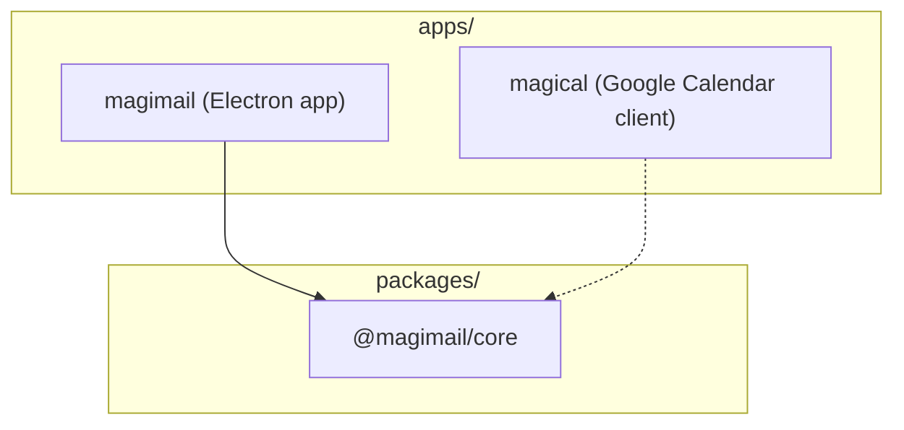

# Coding standards

## Stack and workspace

| Layer           | Technology                                                       |
| :-------------- | :--------------------------------------------------------------- |
| Runtime         | Electron 44 (Chromium + Node.js)                                 |
| Language        | TypeScript 5.7, strict mode                                      |
| Validation      | zod 4 (a schema defines the shape; the type is inferred from it) |
| Build           | tsup (ESM + CJS dual output, DTS generation)                     |
| Package manager | pnpm 11 with workspaces                                          |
| Tests           | Vitest                                                           |
| Lint / format   | ESLint 9 (typescript-eslint), Prettier                           |
| CI              | GitHub Actions (macOS runner)                                    |
| Packaging       | electron-builder (DMG, arm64)                                    |

## Where code belongs

**`packages/core`** stays clean, reusable and free of direct DOM manipulation in host processes. It
imports nothing from the Electron main process and holds what both apps use unchanged:

- Page-level DOM primitives through `DOM_DRIVE_PREAMBLE` (`resolveOrdered`, `waitUntil` with
  `MutationObserver` quietness, `clickAndConfirm`, `findAction`), evaluated inside guest views.
- Session partition naming (`persist:magimail_<accountId>`), user agent normalisation, IPC protocol
  constants, theme definitions, and unread title regex parsers.
- Shared types, constants, CSS injection, session configuration and window option factories.

**`apps/`** owns everything that reaches Electron or the OS: window lifecycle (`BrowserWindow` /
`WebContentsView`), the AppKit toolbar bridge, the Swift process supervisor (`swift-helper.ts`) and
Gmail DOM CSS injection.

## CSS injection

- Inject baseline layout and dark-mode styling through `session.webRequest` or
  `webContents.insertCSS` on `did-navigate`.
- Never wait for `dom-ready`. Injecting critical structural CSS that late gives an unstyled white
  flash.
- Scope every selector. Before hiding a Gmail header or sidebar, verify the child hierarchy or the
  container attributes. An unscoped selector hides the main navigation, Gemini panels or settings
  modals along with its target.

## Native macOS integration

The N-API addon and the Swift helper are the two native processes, and their mechanics are in
[`../shared/process-model-and-ipc.md`](../shared/process-model-and-ipc.md). Two rules apply when you
edit them:

- Keep the Objective-C++ methods in `native/src/magimail_addon.mm` minimal and non-blocking, and
  dispatch user clicks through `ThreadSafeFunction`. The addon runs in-process on the main thread,
  because it attaches `NSToolbar` to the real `NSWindow*`.
- Format Swift files with `swiftformat` before committing.

## Code integrity

- Preserve existing comments, docstrings and architectural rationale when editing files.
- Do not delete the non-obvious request headers or partition arguments in `session.ts`.
- Never pin a browser version by hand. Derive it from `process.versions.chrome`, so the identity the
  sign-in flow checks cannot fall behind the engine running. If you add a value the headers state,
  check the JavaScript reports the same thing, or the page will not load.
