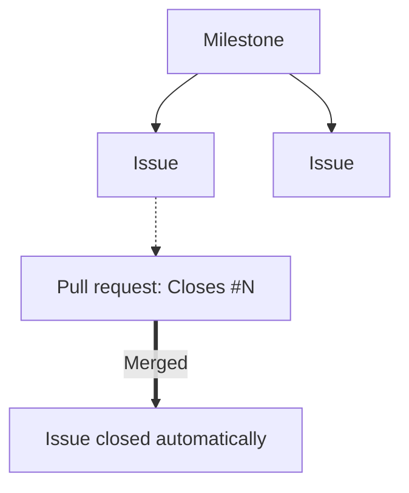

# Engineering workflow

All work is tracked in GitHub Issues.



## Issues

An issue is one executable unit of work. Every issue carries:

1. A clear problem statement and technical acceptance criteria.
2. A milestone naming the target phase.
3. Labels from the taxonomy below.

## Milestones

Both apps ship together, so the milestones cover the project rather than either app. Each names a
release, and an issue takes one when the work is planned for it. A closed issue keeps the milestone of
the release it shipped in, and merged PRs follow their issue.

## Specs

For complex new functionality, or a change big enough that the approach is not obvious, write the spec
before the code and commit it under `specs/<app>/`. The spec records the approach, what it does not
cover, and any major decision whose reason is not obvious.

Open the spec as its own pull request and get it reviewed before implementation starts. Agreeing the
design first is cheaper than reviewing code written to a design nobody else settled on, and an agent
implementing the change works from the agreed spec rather than from the issue prose.

[`../../specs/README.md`](../../specs/README.md) indexes the specs. When the subsystem ships, its spec
is rewritten into the living docs and deleted; the `writing-docs` skill defines the rules for how to write a spec.

## Label taxonomy

Tag issues and PRs with at least one label from each relevant category:

| Category | Labels                                                               | Description                    |
| :------- | :------------------------------------------------------------------- | :----------------------------- |
| **Type** | `bug`, `enhancement`, `documentation`, `ci`, `infra`, `dependencies` | What kind of work this is.     |
| **Area** | `swift`, `notifications`, `performance`, `security`                  | Subsystem affected.            |
| **App**  | `magimail`, `magical`, `core`, `website`                             | Workspace the work belongs to. |

Labels are flat, with no `type:` or `area:` prefix. `dependencies` is GitHub's built-in label for
pull requests that update a dependency file, and Dependabot applies it.

`help wanted` and `good first issue` sit outside this taxonomy: they mark work you want someone
else to pick up, rather than describing the work itself.

## Pull requests and branching

Always branch off the latest `main`:

- Bug fixes: `fix/<issue-number>-<short-description>`
- Features and enhancements: `feat/<issue-number>-<short-description>`
- Chores, CI and docs: `docs/<issue-number>-<short-description>` or
  `chore/<issue-number>-<short-description>`

Link the target issue in the PR description with GitHub's closing keyword:

```markdown
Fixes right-sidebar CSS selector scoping to prevent hiding main navigation.

Closes #<issue-number>
```

The [pull request template](../../.github/pull_request_template.md) defines the expected format.

Never close an issue by hand when a PR resolves it. GitHub closes the issue automatically as
soon as the PR merges into `main`.

## Merging into main

`main` is protected by the `Protect main` ruleset. It is active with no bypass actors, so the same
rules apply to the repository owner: nothing reaches `main` except through a pull request.

| Rule                             | Effect                                               |
| :------------------------------- | :--------------------------------------------------- |
| Pull request required            | No direct pushes; every change lands as one PR       |
| Squash merge only                | The other merge methods are disabled repository-wide |
| Linear history                   | `main` stays a single line of squash commits         |
| No force push, no deletion       | History cannot be rewritten or the branch removed    |
| Required check: `Detect Changes` | CI's path filter must pass                           |
| Branch must be up to date        | Merge `main` in before merging, as above             |
| Delete branch on merge           | The head branch goes automatically                   |

The PR title becomes the squash commit subject and the PR body becomes its message, so both are
written for the log rather than for the reviewer mid-review. Auto-merge is enabled: a green PR can
be queued rather than watched.

No approving review is required, because the repository has one maintainer and a self-review would
be theatre. The gate is CI plus reading your own diff before merging.
