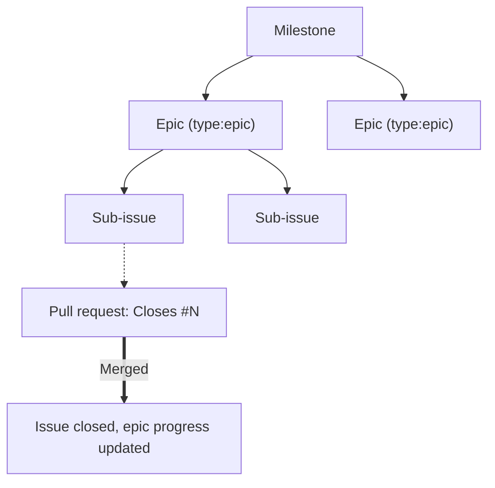

# Engineering workflow

All work is tracked in GitHub Issues and GitHub's native sub-issues.



## Epics

An Epic is a parent tracking issue for a large feature theme or architectural initiative. It holds no
code of its own; break the work into child sub-issues with GitHub's native sub-issues, and GitHub
recalculates the epic's percentage complete as they close.

- Label it `type:epic`.
- Title it with the initiative's emoji and theme: `🎨 Epic: <Theme Name>`, `⚡ Epic: <Theme Name>`,
  `🍎 Epic: <Theme Name>`.

## Issues

A sub-issue is one executable unit of work, linked to a parent Epic. A standalone issue is a discrete
bug or self-contained task that belongs to no Epic. Every issue carries:

1. A clear problem statement and technical acceptance criteria.
2. A milestone naming the target phase.
3. Labels from the taxonomy below.

## Milestones

Both apps ship together, so the milestones cover the project rather than either app. Each names a
release, and an issue takes one when the work is planned for it. A closed issue keeps the milestone of
the release it shipped in, and merged PRs follow their issue.

## Specs

For complex new functionality, or a change big enough that the approach is not obvious, write the spec
before the code and commit it under `specs/<app>/`. The spec records the approach, what it does not
cover, and any major decision whose reason is not obvious.

Open the spec as its own pull request and get it reviewed before implementation starts. Agreeing the
design first is cheaper than reviewing code written to a design nobody else settled on, and an agent
implementing the change works from the agreed spec rather than from the issue prose.

[`../../specs/README.md`](../../specs/README.md) indexes the specs. When the subsystem ships, its spec
is rewritten into the living docs and deleted; the `writing-docs` skill defines the rules for how to write a spec.

## Label taxonomy

Tag issues and PRs with at least one label from each relevant category:

| Category     | Labels                                                                                                                                                                                      | Description                           |
| :----------- | :------------------------------------------------------------------------------------------------------------------------------------------------------------------------------------------ | :------------------------------------ |
| **Type**     | `type:epic`, `type:feature`, `type:bug`, `type:infra`, `type:ci`, `type:research`, `type:docs`                                                                                              | What kind of work this is.            |
| **Area**     | `area:css-theming`, `area:native-swift`, `area:memory-perf`, `area:extensions`, `area:compose`, `area:search`, `area:licensing`, `area:notifications`, `area:security`, `area:distribution` | Subsystem affected.                   |
| **App**      | `app:magimail`, `app:magical`, `app:core`                                                                                                                                                   | Target application or shared package. |
| **Priority** | `priority:p1-urgent`, `priority:p2-important`, `priority:p3-normal`                                                                                                                         | Urgency and scheduling order.         |

## Pull requests and branching

Always branch off the latest `main`:

- Bug fixes: `fix/<issue-number>-<short-description>`
- Features and enhancements: `feat/<issue-number>-<short-description>`
- Chores, CI and docs: `docs/<issue-number>-<short-description>` or
  `chore/<issue-number>-<short-description>`

Link the target issue in the PR description with GitHub's closing keyword:

```markdown
Fixes right-sidebar CSS selector scoping to prevent hiding main navigation.

Closes #<issue-number>
```

The [pull request template](../../.github/pull_request_template.md) defines the expected format.

Never close an issue by hand when a PR resolves it. GitHub closes the issue and advances the
epic's progress automatically as soon as the PR merges into `main`.
