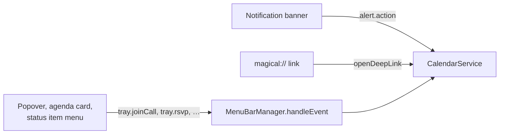

# Acting on an event, an invitation or a task

Magical acts on Google Calendar by driving Calendar's own controls in the account's live view, and it
renders no action UI of its own. Joining a call, answering an invitation, revealing an event, ticking
a task off, quick-adding an event and raising the window each start on a surface the helper draws and
end in one method in the main process. The invitation pile is [`rsvp.md`](rsvp.md), resolving a join
URL and opening it is [`conference-links.md`](conference-links.md), and a tick's journey through
Google Tasks is [`google-tasks.md`](google-tasks.md).

## Action set

| Action                    | What it does                                               | Lands in                               |
| :------------------------ | :--------------------------------------------------------- | :------------------------------------- |
| Join a conference link    | Opens the meeting in its desktop client or the browser     | `CalendarService.joinCall`             |
| Answer an invitation      | Accepts, tentatively accepts or declines                   | `CalendarService.deliverRsvp`          |
| Reveal an event           | Routes its account's view to the event and opens its panel | `AccountsManager.revealEvent`          |
| Delete an event           | Deletes it through Calendar's own controls                 | `CalendarService.deleteEvent`          |
| Complete or reopen a task | Ticks a task off, or back open, in Google Tasks            | `CalendarService.setTaskCompleted`     |
| Quick add                 | Opens the Quick Add HUD                                    | `MenuBarManager`'s `tray.openQuickAdd` |
| Open                      | Raises the main window, creating it if the app has none    | `MenuBarManager`'s `tray.openApp`      |

## How an action travels

Three routes reach the main process. The tray RPC carries every press made on a surface the helper
draws; a notification action and a `magical://` link arrive from outside the helper.

### Tray RPC

The status item, its popover and its right-click menu are all drawn in the Swift helper, so every
press they make is a newline-delimited JSON-RPC message over the helper's `stdin`/`stdout`. The same
channel carries the whole tray state the other way.

| RPC method                   | Direction     | Payload                                                                                                                                                                              | Description                                                                                                                                                                    |
| :--------------------------- | :------------ | :----------------------------------------------------------------------------------------------------------------------------------------------------------------------------------- | :----------------------------------------------------------------------------------------------------------------------------------------------------------------------------- |
| `tray.create`                | Main → Helper | None                                                                                                                                                                                 | Puts the status item in the menu bar.                                                                                                                                          |
| `tray.destroy`               | Main → Helper | None                                                                                                                                                                                 | Takes it out again when the user hides it.                                                                                                                                     |
| `tray.update`                | Main → Helper | `{ accounts, activeAccountId?, calendars, events, isCalendarCollapsed, hiddenCalendars, isOffline, lastSyncedAt?, menuBarDisplayMode, showMenuBarAccountColor, showCompletedTasks }` | The whole tray state, pushed on every poll and on any setting it draws from.                                                                                                   |
| `tray.openApp`               | Helper → Main | None                                                                                                                                                                                 | Raises the main window, creating it if the app has none.                                                                                                                       |
| `tray.search`                | Helper → Main | `{ query, accountId? }`                                                                                                                                                              | Runs a search in the chosen account and raises the main window; see [`menu-bar.md`'s Search field](menu-bar.md#search-field).                                                  |
| `tray.showAccount`           | Helper → Main | `{ accountId }`                                                                                                                                                                      | Switches to an account and raises the window.                                                                                                                                  |
| `tray.openQuickAdd`          | Helper → Main | `{ accountId? }`                                                                                                                                                                     | Opens the Quick Add HUD.                                                                                                                                                       |
| `tray.openSettings`          | Helper → Main | None                                                                                                                                                                                 | Asks for the settings window, which comes back as `settings.show`; see [`menu-bar.md`'s Header](menu-bar.md#header).                                                           |
| `tray.quit`                  | Helper → Main | None                                                                                                                                                                                 | Quits Magical.                                                                                                                                                                 |
| `tray.joinCall`              | Helper → Main | `{ url }`                                                                                                                                                                            | Opens a conference link in the Zoom or Teams desktop client; see [`conference-links.md`'s Opening in the browser instead](conference-links.md#opening-in-the-browser-instead). |
| `tray.focusEvent`            | Helper → Main | `{ accountId, eventId }`                                                                                                                                                             | Reveals the event in its account's view; see [Revealing an event](#revealing-an-event).                                                                                        |
| `tray.rsvp`                  | Helper → Main | `{ accountId, eventId, response }`                                                                                                                                                   | Answers an invitation. `response` is `yes`, `no` or `maybe`.                                                                                                                   |
| `tray.deleteEvent`           | Helper → Main | `{ accountId, eventId }`                                                                                                                                                             | Deletes the event through Calendar's own controls.                                                                                                                             |
| `tray.setTaskCompleted`      | Helper → Main | `{ accountId, eventId, completed }`                                                                                                                                                  | Ticks a task off, or back open, through the button in its own panel; see [`google-tasks.md`](google-tasks.md).                                                                 |
| `tray.ensureRange`           | Helper → Main | `{ targetDateMs }`                                                                                                                                                                   | Fetches the part of ±60 days around a scrolled-to date the poll misses, once.                                                                                                  |
| `tray.setCalendarCollapsed`  | Helper → Main | `{ isCollapsed }`                                                                                                                                                                    | Persists whether the mini-month grid is open.                                                                                                                                  |
| `tray.setShowCompletedTasks` | Helper → Main | `{ showCompletedTasks }`                                                                                                                                                             | Persists whether completed tasks are visible.                                                                                                                                  |
| `tray.setHiddenCalendars`    | Helper → Main | `{ hiddenCalendars }`                                                                                                                                                                | Persists which calendars the filter has hidden.                                                                                                                                |
| `tray.popoverOpened`         | Helper → Main | None                                                                                                                                                                                 | Re-polls if the cache is stale, so opening the popover never shows yesterday.                                                                                                  |
| `tray.refresh`               | Helper → Main | None                                                                                                                                                                                 | Polls straight away.                                                                                                                                                           |

`MenuBarManager.handleEvent` dispatches each method and returns `false` for one it does not
recognise, so a helper new enough to ask for something this build does not know cannot fail silently.

### Notification banner

The helper posts every banner, and what the user presses comes back as an `alert.action` event.
`action` is one of `open`, `join`, `snooze`, `rsvp:yes`, `rsvp:maybe` or `rsvp:no`, and the event
carries the alert's `key`, the `accountId`, the `eventId`, the event's `deepLink` and, when there is
one, its `conferenceUrl`.

`CalendarService.onAlertAction` routes each one to the same method the tray RPC reaches:

- `join` calls `joinCall` with the `conferenceUrl`.
- `snooze` re-arms the alert from the fired record, through `AlertScheduler.snooze(key, 5)`.
- `rsvp:yes`, `rsvp:maybe` and `rsvp:no` answer through `sendRsvp`, which is keyed by the invitation.
- `open`, and anything unrecognised, calls `openDeepLink` with the event's `deepLink`, which is a
  reveal.

The categories and the actions on them are in [`notifications.md`](notifications.md).

### `magical://` links

A link reaches the same methods a banner and a popover row use, so a Focus Filter, a script or a
Shortcut can act on a named event without one. Clicking an event in the popover is the other producer:
it builds the event's link and hands it to `CalendarService.openDeepLink`.

`event-links.ts` builds the event forms (`magical://event` and fallback `magical://date`), while `main.ts`
dispatches search (`magical://search`) and widget shortcuts (`magical://quick-add`, `magical://open`).
The full route taxonomy, parameters and cold-launch queueing are documented in [`deep-links.md`](deep-links.md).

`action` names what to do with the event, and defaults to `reveal`. An event link also takes `yes`,
`no`, `maybe` and `delete`, the buttons a meeting banner carries; a date link takes only `reveal`.
Answering and deleting bring `openDeepLink` to `actOnLinkedEvent`, which finds the cached event by
`eid` and runs it through `answerRsvp` or `deleteEvent`. An event outside the polled window drives
the view directly instead. A link whose `eid` cannot be resolved still opens Magical on the right day
through `resolveToCalendarUrl`.

A closed window is built for a link, on the account the link names. Only a link that reveals or
navigates brings it forward.

## Video calls

A right-click or control-click on the status item opens a native `NSMenu` in the helper, not the
popover. The first item is a bold **Join “…”** naming the next meeting when `nextEvent(within: nil)`
has a conference link, with its countdown and times beneath it as a disabled item. Then **Open
Calendar**, **New Event**, **Refresh Calendars** and **Show Completed Tasks**, and after a separator
**Preferences…** and **Quit Magical**. Each sends the same message the popover's own control does:
`tray.joinCall`, `tray.openApp`, `tray.openQuickAdd`, `tray.refresh`, `tray.setShowCompletedTasks`,
`tray.openSettings` and `tray.quit`.

The menu is handed to the `NSStatusItem` and shown with `button.performClick(nil)`, rather than popped
up at a point, which is what gets the button's own highlight and the menu bar's placement.
`performClick` blocks until tracking ends, so clearing `item.menu` on the line after restores the
left-click action.

Every join goes through `CalendarService.joinCall`, so `alwaysJoinInBrowser` is honoured wherever the
press came from; [`conference-links.md`](conference-links.md) owns the resolution and the native
scheme.

## Answering an invitation

Answering goes through `CalendarActionDriver`, which tries Google's internal `sync.sync` write
first and falls back to driving Google's own controls in the account's view. `CalendarService.deliverRsvp`
resolves the invitation to an `eid` and `AccountsManager.performRsvp` routes it through the driver.

Driving the page is `DomCalendarActionDriver` (`calendar-actions/dom-driver.ts`), which holds every
page interaction — the toolbar controls, the event chip, the RSVP, delete and complete controls, the
recurring-event modal and the reveal. What it cannot own is the lifetime of the view it drives, so
`AccountsManager` answers a small host interface for it: whether the account is signed in, which
account is on screen, the mode its view was last in, the lock that keeps two actions off one page, and
waking a suspended account and putting it back afterwards.

### Writing directly

`SyncCalendarActionDriver` posts to the same `POST /calendar/u/<i>/sync.sync` the page uses for
delta reads; a read and a write differ only in the change slot.

A write needs the sync state the account's own view is holding, so `calendar-sync-state.ts` records
the latest `sync.sync` request that view made and the driver reuses its envelope, swapping only the
token and the change list. The token advances with every sync, so the driver posts a read first and
writes the change against the token that read returned.

Each change names one calendar and one event. A delete marks the event deleted; an RSVP sets the
attendee's response with the occurrence's own times and zone, and is addressed to the occurrence
rather than to the series, which is what makes it "this event". `tests/calendar-sync-write.test.ts`
pins both shapes.

Google's eid for the **primary** calendar is a short form (`user@m`); the id the endpoint accepts is
the account's own address, so the driver substitutes it. A secondary calendar's eid is already full.

A **task** is not a calendar change at all. Its completion, reopening and deletion go to Google Tasks'
own `TasksApiService/Sync` over the same authenticated RPC the read uses, carrying a mutation against
the task rather than the event; [`google-tasks.md`](google-tasks.md#writing-a-task) has the mechanism.
That write needs the Tasks id rather than the Calendar event id the eid carries, so it is resolved
from a Tasks sync read first — the same read-then-write shape a calendar change uses for its token,
which is why the two sit in one driver.

The write answers `200` with a `syncaction.sr` envelope whether or not it did anything, so a 200 is
not proof; the actions were verified by reading the event back through the Calendar API. Anything the
driver cannot do — no captured state yet, no end time or zone to build the RSVP block, a rejected
request — returns `failed`, and the fallback driver drives the view instead.

### Entry points

The surfaces know different things. A banner and the toolbar dropdown hold the invitation's key and
come through `sendRsvp`; the menu bar popover knows only an account and an event and comes through
`answerRsvp`, which derives the key from the cached event. The key is derived rather than looked up in
the pile, so an invitation the poller has never reported is still answered. Both entry points land in
`deliverRsvp`.

### A recurring invitation asks first

A recurring invitation is not answered by the control itself. Calendar raises an "RSVP to recurring
event" modal, offering the occurrence and the series, and that modal's OK is what sends the change; a
click on the control alone sends nothing and leaves the page looking as though it had.

`confirmScopeDialog` answers it, and takes the occurrence: it is the narrower of the two and the one a
banner's button promises. The dialog opens on whichever option was answered last, so the occurrence is
selected rather than assumed. The modal's absence is what tells a one-off event from a recurring one,
so the wait is sized to the modal appearing rather than to the action.

Deleting one occurrence of a recurring event raises the same modal, and both paths reach the one
helper. So does the read of the live region and the detail panel that the confirmation is measured
against, which has to happen before the click: read afterwards, the panel has already gone and the
region has already spoken, and there is nothing left for a change to differ from.

### Outcomes

`performRsvp` returns one of three outcomes.

- **`ok`**: the watcher resolves the key and the Dock badge drops straight away, rather than waiting
  for the next poll.
- **`busy`**: the user is mid-edit, and answering would navigate out from under them. The intent is
  queued and retried every `HELD_RETRY_MS` (5 seconds), expiring after `HELD_EXPIRY_MS` (15 minutes).
- **`failed`**: the event opens in front of the user rather than the response being dropped silently.

An invitation with no resolvable `eid` cannot be addressed at all, so it opens the event instead of
pretending the answer was sent.

### Holding an action until the editor closes

Answering and deleting both refuse to run while the user is on the editor route, under the discard
alert, or in a dialog holding a field they can type into, and both are then queued on one clock.
Revealing is not held, because it asks to look at something now and arriving late is worse than not
arriving.

An event's own detail popup does not count as mid-edit. It is a `[role="dialog"]` like the
quick-create overlay, and reveal opens one deliberately. What separates the two is whether the dialog
holds an editable field, measured on a live account: the detail popup for an event and for a task
hold none, quick-create holds nine. `data-chips-dialog` is not the discriminator it appears to be,
because Calendar puts it on quick-create too. The full editor is caught by the route instead.

### Waking a sleeping account

Hiding the window releases the account on screen too, so an action can arrive with no renderer behind
it. Every entry point that drives a view therefore goes through `wakeAccountForAction`, the contract
`performRsvp`, `deleteEvent` and `setTaskCompleted` share; `triggerCalendarAction`, `openInAccount`
and a system resume's `reloadActive` wake the same way. Magical supplies the sign-in page and the
readiness wait, a rendered chip or grid; the pool owns the rest (see
[`../shared/window-lifecycle.md`'s Waking a suspended account for an action](../shared/window-lifecycle.md#waking-a-suspended-account-for-an-action)).

A background account is not sized by `updateLayout`, so `attachForBackgroundAction` gives it the
account on screen's bounds at the bottom of the stack for the length of the action and keeps it
hidden, so it lays out at the window's size without being drawn. If the event chip is already rendered
in the current view (`hasEventChip`), `performRsvp` skips routing and clicks the chip in place.

Creating an event reports a failure when the Create control is not found, rather than falling back to
loading `/r/eventedit`: a fallback navigation reports success on a view that never attached, so
nothing opens and nothing says so.

### Routing to the event

`routeTo` pushes state and waits until the DOM is still. It calls `history.pushState` and dispatches a
`popstate` event, which Calendar's router answers without a page load. Returning as soon as the state
is pushed loses clicks: Calendar keeps the outgoing view's nodes for about 270 ms, so a chip found in
that window belongs to the render being torn down, and clicking it does nothing. `routeTo` waits with a
`MutationObserver` until nothing has changed for 250 ms. A route that never renders is reported as
failed rather than clicked into.

The path is `/calendar/u/<n>/r/<mode>/<y>/<m>/<d>`, and the mode is reused from what the view already
shows, so a link moves the user in time rather than out of their view. `pathForDate` reads the mode
from the current path, or from `data-viewkey` when the path names none, which is how an account woken
by a link resumes (`/calendar/u/<n>/r`). Year and schedule are the exception and fall back to a day:
both render no `data-eventid` chips at all.

Full-screen Tasks draws no chip either, and no RSVP, delete or complete control. Reveal, RSVP, delete,
complete and the toolbar's New Event therefore read the route first and leave `/r/tasks` for the
calendar root (`leaveTasksIfNeeded`) before any of this routing runs. The grid's own default view is
read from the root, so the user lands in the week or month they work in, and a reveal then routes on
to the event's day. **New Task is the exception**: it writes where the user is, using the Create
menu's Task item on the grid or the Tasks page's own "Add a task" entry, so it never routes.
`< Today >` and Search are dimmed in Tasks mode for the same reason the others route out: neither has
anything to act on there.

Measured against a live Calendar, a route redraws in bursts ending at 262 ms (week to day), 254 ms
(day to day) and 488 ms (month to day), with the longest gap inside one transition at 190 ms; an idle
page mutates not at all.

### Driving Calendar's controls

Synthetic clicks without feedback risk racing route restoration while network requests are in flight.
Shared driving primitives live in `@magimail/core` through `DOM_DRIVE_PREAMBLE`: `resolveOrdered`,
`waitUntil`, `clickAndConfirm` and `findAction`, which resolves a named action from the locale map
(see [`../shared/dom-labels.md`](../shared/dom-labels.md)). `triggerCalendarAction` drives Create, the Event and Task menu items, Search, Today, the day arrows,
Back and the event-dialog Close through map actions, so no control is found by an English label or
text. `triggerNewTask` reuses the same map for the Tasks page's "Add a task" entry, which is a
localised label action. `clickRsvpControl` finds the response button through
the map's `rsvpYes` / `rsvpNo` / `rsvpMaybe` actions, clicks it with a trusted input event, and confirms
through `waitUntil`: the response controls disappear, `aria-checked` or `aria-selected` reports the
state, live regions differ from their pre-click state, or the detail panel closes after being open.
Delete and complete routes follow the same pattern. For recurring events and recurring tasks, any
resulting scope dialog ("This event" / "This task") is confirmed by explicitly selecting the first
radio option (the single instance) before submitting OK.

The chip is clicked as an element, not a point. `clickEventChip` scrolls the chip into view, checks
that `elementFromPoint` returns the chip, focuses the view, and sends mouse events through
`sendInputEvent`. Calendar acts on trusted input only, so `button.click()` is ignored. A point outside
the viewport is refused rather than clicked, because a grid that scrolls puts chips at coordinates no
click could reach. `[data-eventid]` is a wrapper in day view and carries `role="button"` itself in
week view, so the button is looked for in both positions. A task's chip is prefixed `ttb_` or named
`tasks_<taskId>`, and a working location's is composed from `_WL_` and the entry's times and ids;
`chipSelector` matches every form.

An event's own detail panel carries its id too, so the panel answers a chip lookup as well as the chip
does — and it sits over the chip it belongs to, where `elementFromPoint` returns the panel and the click
is refused. An event whose panel is already open is therefore acted on through that panel: its controls
are already the ones the action is about to look for. `openPanelFor` is that decision, and the delete,
RSVP and task paths all reach the page through it.

Both confirmation checks are compared against what was true before the click. Calendar parks the text
`Loading...` in its first `[role="status"]` and leaves it there, so asking whether a status region
holds text answers yes on an idle page; and asking whether no dialog is open answers yes wherever no
panel was open to begin with.

### Serialising actions per account

`withAccountActionLock` queues background actions (`performRsvp`, `deleteEvent`, `completeTask`) per
account id, so concurrent responses or deep links on the same account run in order rather than
interleaving view attachment and route restoration. Route restoration only restores the previous path
if the view still displays the path it routed to, so a user who navigated away in the meantime keeps
their new location.

## Revealing an event

A reveal puts the event in front of the user inside its account's view. `tray.focusEvent` builds the
event's `magical://` link and hands it to `CalendarService.openDeepLink`, which routes to
`AccountsManager.revealEvent`. The account is switched and the window raised before revealing, because
a background view is not laid out at the size its own rects describe. `revealEvent` preserves the view
mode, routes the document with `pushState` and clicks the event's chip, so the detail panel opens over
the view the user already works in. `/r/eventedit/<eid>` is never used for a reveal.

How far it got is reported rather than reduced to success or failure. `revealed` means the panel
opened; `routed` means the view is on the event's day but the panel did not open; `busy` means an
editor is open. An event with no `at` names the event but not where it sits; the cache is asked, and
asking it is what keeps such a link working rather than dropping the user on today.

Open, by contrast, raises the main window and nothing else: `tray.openApp` shows and focuses the
window, creating it if the app has none. Revealing from the tray raises the window too:
`tray.focusEvent` hands the link over and then calls `app.focus({ steal: true })` with `show()` and
`focus()`, because those two alone order windows within Magical and do not take focus from the app
that has it.

## Reconciling the event cache

A triage action changes the app's own copies before the next poll arrives, and the surfaces that
count or draw from them have to agree at once.

- **An answer drops the invitation, not the event.** On success `deliverRsvp` calls `invites.resolve`
  and `publishPending`, so the Dock badge and the dropdown reflect the answer straight away. The event
  cache still reports `needsAction` until the next read; see [`rsvp.md`](rsvp.md).
- **A tick is written into the event, then corrected.** `setTaskCompleted` sets `isCompleted` and
  `completedAt` on the cached event, persists `event-cache.json` and pushes an update, without
  removing the event the way a delete does. The Tasks poller corrects the write on the next sync that
  names the task; `COMPLETION_GRACE_MS` (30 seconds) keeps a sync that disagrees from overruling the
  write before Google has recorded it. See [`google-tasks.md`](google-tasks.md).
- **A delete takes the event out at once.** The cached list is rewritten as the press is made, so the
  popover redraws without it rather than one poll later.
- **A held action runs once the editor closes.** When an account is mid-edit, `deliverRsvp`,
  `deleteEvent` and `setTaskCompleted` report `busy` and the intent is queued, retried every
  `HELD_RETRY_MS` and expiring after `HELD_EXPIRY_MS`. Giving up on a held delete polls, which puts
  the event back, because taking it out of the popover was the press's immediate effect.
