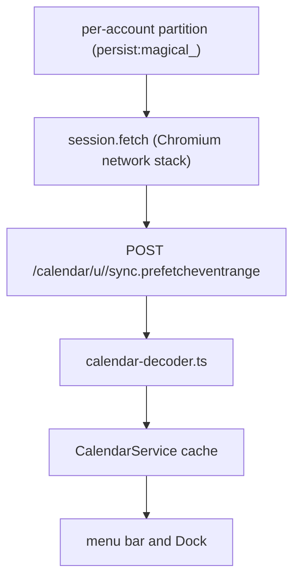

# Magical calendar sync

Magical reads every signed-in account's schedule without OAuth. `CalendarPoller` posts to Google
Calendar's internal range endpoint with the partition's own session cookies, one loop per account
partition. The payload and its decoder are in [`calendar-wire-format.md`](calendar-wire-format.md),
and [`notifications.md`](notifications.md) consumes what this produces.

## Why a session cookie poller

Magical already renders Google Calendar in a `WebContentsView`, so the user is signed in and this
transport costs no incremental authentication. Every other transport asks for a second sign-in or
fails its own way: a background `WebContentsView` costs 250MB–350MB of RAM and 800ms–1.5s per
navigation, the Calendar API v3 requires OAuth and separate token management
([`../shared/sessions-and-security.md`'s Why neither app holds an OAuth client](../shared/sessions-and-security.md#why-neither-app-holds-an-oauth-client)),
and a private `.ics` feed is cached for 6 to 24 hours at Google's edge, too stale for an alert five
minutes before a meeting.

EventKit is kept as an opt-in secondary source, because it reaches a calendar's default
notifications and the iCloud, Exchange and local calendars, none of which the range payloads carry.
On the data an alert needs the two are close, since participation status and conference links are
both decodable from the wire format.

One request covers the whole 365-day window in roughly 50KB under 150ms. Its failure mode is narrow
and loud: Google serialises Protocol Buffers with numeric tags that are stable within a message, so
pinned field indices hold, and the realistic breakages are a restructured response envelope or a
newly required request parameter, each surfacing as a 4xx, a thrown decode, or a range that suddenly
has no events. Plausible but wrong data, the one failure an alert engine cannot tolerate, comes only
from the decoder guessing, which
[`calendar-wire-format.md`'s Pinned indices](calendar-wire-format.md#pinned-indices)
forbids.

## Poller

`CalendarPoller` mirrors Magimail's mailbox poller: it polls Google Calendar's internal web
endpoint from the Electron main process, one loop per account partition.



`CalendarPoller` keeps no events: it returns what it read and forgets it. They live in
`CalendarService.cachedEvents`, keyed by account. The poller only reads; it never writes to Google.

### Zero-OAuth session mechanism

The protocol below was read from a live signed-in session (fixtures in
`apps/magical/tests/fixtures/calendar-web-prefetcheventrange.json`).

- **Endpoint**: `POST https://calendar.google.com/calendar/u/<accountIndex>/sync.prefetcheventrange`
- **Authentication**: the partition's standard Google cookies (`SSID`, `HSID`, `SID`, `SAPISID`),
  with no `Authorization: SAPISIDHASH` header, no Google Cloud project and no consent screen.
  `session.net.fetch` lets Chromium attach the cookies from its own store, so nothing in the poller
  reads, copies or logs them.
- **Headers**:
  ```http
  Content-Type: application/x-www-form-urlencoded;charset=UTF-8
  X-Is-Xhr-Request: 1
  X-If-No-Redirect: 1
  ```
- **Request body** (measured), sent as `application/x-www-form-urlencoded`, with `f.req` holding the
  JSON and three further parameters in the query string:

  ```
  f.req=[[
    ["<calendarId>", "<calendarId>", …],          // explicit; not implied by the account
    [null, null, 20352, 20386],                   // range, as two scalar epoch days
    [null, 3, "calendar.web_20260909.10_p0", …],  // client build label, dated
    [null, 1, 1, 1, 1, null, 0, 0]
  ]]
  &cwuik=10&hl=en_GB&secid=<session token>
  ```

  - **Calendars are named explicitly.** The account's own calendar, secondary calendars, subscribed
    holiday calendars and imported calendars are each passed by id. A request naming no calendar
    returns nothing, so the poller first enumerates the account's calendar list.
  - **The range is two scalars at positions 2 and 3**, not a nested `[start, end]` pair. Epoch days,
    as `Math.floor(Date.UTC(y, m, d) / 86400000)`.
  - **`secid` is a per-session token** carried in the query string, stable across calls within a
    session and shared by both range endpoints.
  - **The client build label is dated** (`calendar.web_20260909.10_p0`) and rotates with Google's
    releases.

  > [!NOTE]
  > **Only `f.req` is enforced.** Replaying a captured request with each part removed (dropping
  > `secid`, sending a bogus one, nulling the build label, sending a two-year-stale label, dropping
  > `cwuik` and `hl`, and all of these together) each returned the same full payload with `200`.
  > Session cookies plus `f.req` are sufficient, so the poller needs no DOM extraction step and can
  > fetch for an account whose view is suspended. Send the label anyway, from a constant, since a
  > newly required request parameter is one realistic breakage; the CI canary notices when the
  > snapshot stops holding.

- **Session expiry**: unlike page navigation, which redirects to `accounts.google.com`, this XHR
  endpoint returns **HTTP 401** with body:

  ```json
  )]}'

  [["er",null,null,null,null,401,null,null,null,16]]
  ```

  `CalendarPoller` reads that as `CalendarSessionExpiredError`, which separates "signed out or
  session expired" from "signed in but no events scheduled".

  A Workspace tenant behind SSO does not always produce that 401. It can redirect the background
  request to `accounts.google.com`, which the session's Chromium fetch follows to a `200` sign-in
  page. The poller recognises both the redirect target and the page's identifier field and reports
  `signed-out` there too, so an expiring SSO session still draws the sign-in banner rather than
  looking like a decode failure.

- **Administrator policy**: a tenant can refuse Calendar's web endpoints outright. `CalendarPoller`
  treats `403`, and a `200` HTML page that names an administrator block, as
  `CalendarRestrictedError` and reports `restricted`. That state is deliberately separate from
  `signed-out` (signing in again cannot lift it) and from `unreadable` (the decoder is fine; the
  tenant is refusing to serve the account). No live tenant has yet produced a policy block, so the
  exact status and body are provisional.

### Source contract

Nothing downstream imports the poller. The alert scheduler, the banner dispatcher and the deep-link
resolver depend only on the interface below, and `CalendarPoller` is one implementation of it:

```ts
export type SourceHealth = 'ok' | 'stale' | 'signed-out' | 'restricted' | 'offline' | 'unreadable';

export interface CalendarEventSource {
  /** Stable across restarts; scopes the cache and the already-notified set. */
  readonly id: string; // 'google:account_personal'
  readonly kind: 'google-session';

  /** The account this source speaks for, for banner attribution. */
  readonly accountId: string;

  events(range: { start: Date; end: Date }): Promise<NormalizedCalendarEvent[]>;

  /** Push where the source supports it; poll-driven here. */
  onChanged(listener: () => void): () => void;

  readonly lastSuccessfulReadAt: Date | null;
  readonly health: SourceHealth;
}
```

The interface keeps the transport a swap rather than a rewrite.

`health` is never inferred from an empty result. "Signed in with nothing scheduled" and "cannot read
your calendar" look identical in the event list and must not look identical here; a poller with no
known calendar ids reports `unreadable` rather than `ok`.

`offline` and `unreadable` are separate states because they call for opposite messages. A thrown
`fetch` means the request never reached Google, so the calendar is untouched and the last good read
still describes it; the poller raises `CalendarNetworkError` and reports `offline`. Google answering
with something the decoder cannot use means the app is broken rather than the network, and reports
`unreadable`. Collapsing the two would tell a user on a train that Magical could not read their
calendar, and tell a user whose wire format has moved to check their wifi.

`restricted` is the tenant refusing to serve the account, generally through an administrator
policy. It is not `signed-out`, because the user's credentials are valid and signing in again will
not help, and it is not `unreadable`, because the app and its decoder are working. The popover draws
its own band for it, with no sign-in button, and `CalendarService` keeps the account in the stalled
set so its cached agenda is not presented as current.

`classifyFailure` maps a thrown read to one of these failure states. Anything it does not recognise
is `unreadable`, the safer error of the two: an outage wrongly called a broken decoder still tells
the user something is wrong, where a broken decoder wrongly called an outage sends them after a
fault no reconnection will fix.

## Polling window and triggers

### Window and paging

- **Window**: `CalendarService` polls `[today - 90 days, today + 365 days]`, computed by `window()`
  from the calendar day on every poll, which keeps it current for a menu bar app left running for
  weeks. There is no per-month cache and no prefetching; each poll fetches the whole window for every
  account, and the window never widens.
- **Paging**: paging the agenda or the mini-month past either edge calls `ensureRange` with 60 days
  either side of the date paged to, and only the part outside the window that the account has not
  already loaded is fetched; the poll keeps reading the baseline. Paging to March is a request to
  see March, not a standing order to re-read it every five minutes, so a second page to a month
  read within the last five minutes reads nothing and is answered from the cache, while one whose
  ledger entry has aged is read again. The loaded-day ledger below is what
  decides that, and it is consulted per account: one account having fetched a month does not stop
  another from being asked for it, because a read is authoritative only over the range it covered.
  Rapid paging buffers the latest requested range in a trailing slot rather than queueing every
  intermediate month or dropping requests: once the in-flight read completes, it fetches the
  destination month directly. A range wider than the window is read as one piece beyond each edge,
  rather than as one span that re-reads the whole baseline in between. Clamping makes paging cheap:
  a back-tap two months out reads only the 30 days before `d-90`, about 1.3 MiB rather than the
  5.3 MiB a full 121 days would cost.
- **Read authority**: a read is authoritative over the range it covered and over nothing else.
  Events overlapping that range are replaced wholesale by what came back, so a cancelled meeting
  disappears; events outside it are kept, which is what lets a paged-to month survive the poll that
  follows. The cache holds what has been fetched rather than what the window covers.
- **Loaded-day retention**: every fetch records, per account, the calendar days it covered and the
  part of each day it actually read, and that record does two jobs. It bounds the cache: a day
  inside the poll window is re-recorded on every poll, so it never ages; a day paged to, or one the
  window has rolled past, ages from the last fetch that read it and is dropped once nothing has
  covered it for `LOADED_RETENTION_DAYS` (90). An event is then dropped when none of its days is
  still loaded, so the cache stops growing with every month visited and every day the window rolls
  past. It also answers paging: `ensureRange` subtracts the covered span from what it is asked for
  and fetches only the gap, so a loaded month costs nothing and a partially read day is asked for
  again rather than assumed. An entry also has a life: a day read more than five minutes ago — the
  mains poll interval — no longer counts as loaded, so paging back to a month after a longer gap
  reads it again rather than serving a copy that may name a meeting cancelled since. The ledger is per launch, rebuilt from the fetches a run makes, so a
  page after a restart re-reads what the last run had loaded; that is the same cost as the first
  page of a fresh install and needs no encrypted file of its own. The sweep runs after each
  successful poll. Measured across `d-90..d+365` on two live accounts, a poll is about 5 MiB and
  takes about 1.25 s; the 90 days of history cost 3.92 MiB, about 44 KiB a day, and the 275 days of
  future beyond it cost 2.59 MiB.

### Triggers

- **Background keep-alive**: every 5 minutes on mains, 15 on battery. A calendar changes far less
  often than a mailbox, so both are longer than Magimail's equivalents.
- **Window focus**: re-polls when the user returns to the window, rate-limited to once a minute so
  switching between apps is not one request per switch.
- **System wake**: re-fetches immediately on `powerMonitor.on('resume')`, and polling stops while
  suspended.
- **Backoff**: a round in which every account failed doubles the interval, capped at an hour. One
  account succeeding resets it, so a signed-out second account cannot slow down the one that works.
- **Timezone shift**: the UTC offset is compared on each poll, and every armed alert is re-armed when
  it moves, because timers are delays from now and would otherwise point at the wrong wall-clock
  moment across a zone or DST boundary. Electron has no timezone-change event, and per-poll is
  frequent enough given the alert horizon.

## Suspending an inactive account

Magical and Magimail release an inactive account the same way, through `RendererPool` in
`packages/core` (see [`../shared/window-lifecycle.md`](../shared/window-lifecycle.md)). What Magical
supplies is the URL an account remembers and the calendar-specific surfaces it releases with a view.

- **Renderer release**: an account is released once it has been off screen for
  `inactiveAccountSuspendMinutes` (default 5 minutes, or `SUSPEND_NEVER`); the mechanism is in
  [`../shared/window-lifecycle.md`'s Account renderer lifetime](../shared/window-lifecycle.md#account-renderer-lifetime),
  and the measurement behind it in
  [`../shared/performance-optimisation.md`'s What actually reclaims renderer memory](../shared/performance-optimisation.md#what-actually-reclaims-renderer-memory-measured).
  Measured on a three-account install, keeping every view live costs about 1.4GB of RAM; suspending
  the two inactive renderers brings that to about 790MB.
- **Polling continues**: the session cookies and partition stay intact, and `CalendarPoller` keeps
  reading through `session.fromPartition(partition).fetch`, so the menu bar and Dock stay current
  while the view is unloaded.
- **State on resume**: before closing, the URL the view was on is recorded without its query. Google
  Calendar updates the URL through the History API as the user changes dates or view modes, so on
  wake `loadURL()` returns to that exact URL and restores the user's timeframe.
