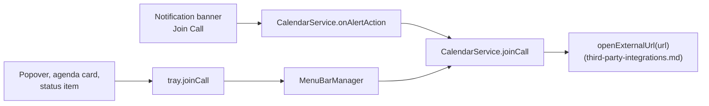

# Conference links

Joining the next call is one of the few things anyone opens a calendar client to do, and Google
Calendar's web interface makes it slow: open the event, find the link in the description, click it,
then answer the browser's prompt about the desktop app. Magical resolves the link once, when the
event is decoded, and every surface that shows a meeting can then offer a single control. The wire
fields the link comes out of are in [`calendar-wire-format.md`](calendar-wire-format.md); the banner
is owned by [`notifications.md`](notifications.md), the join action by [`actions.md`](actions.md), and
the tray controls by [`menu-bar.md`](menu-bar.md).

## What counts as a joinable link

`resolveConferenceUrl(tuple)` runs inside `parseEventTuple`, so an event carries its `conferenceUrl`
by the time it leaves the poller. Nothing parses a description at render time, and no surface has to
know where a link can hide.

It takes the first of three sources that yields a URL:

1. **The structured conference block.** Entry points are `[typeCode, uri, …]`; only `typeCode` `3`
   is the video entry, and `4` and `5` are dial-in numbers.
2. **The bare Meet URL field**, which is Google Meet only.
3. **The free text**, description first and then location, scanned by `findJoinUrlInText`.

### Matched by path, never by host

`JOIN_URL` matches four join paths rather than four domains:

```plain text
teams.microsoft.com/l/meetup-join/ | zoom.us/(j|w)/ | webex.com/(meet/|…j.php) | meet.google.com/
```

The host alone is not enough to tell a join link from its neighbours. A Teams invitation body also
carries `teams.microsoft.com/meetingOptions/` and a `dialin.teams.microsoft.com` number, and
launching either instead of the meeting is worse than offering no button at all.

The match also stops at the first `&`, because the character class excludes it along with whitespace
and quotes. A Zoom link keeps a leading `?pwd=…` and loses anything after it, which is what
[From web URL to desktop client](#from-web-url-to-desktop-client) reads the password from.

### Unwrapping what the invitation did to the link

`findJoinUrlInText` decodes HTML entities before it scans, then passes each candidate through
`unwrapRedirectors`. A raw scan misses links that only exist in encoded or wrapped form, which is
most of them by the time an invitation has crossed two mail systems.

`unwrapRedirectors` follows up to three hops and understands two wrappers: `www.google.com/url?q=`
around an outbound link, and `*.safelinks.protection.outlook.com/?url=` around anything that reached
the invitation through Exchange. A string that does not parse as a URL is returned unchanged rather
than thrown away.

## From web URL to desktop client

Zoom and Microsoft Teams links can open in their native desktop applications. Google Meet and Webex
remain in the browser: Meet has no desktop app, and Webex is opened as a web session.

URL rewriting, LaunchServices verification and fallback handling are unified in `openExternalUrl` and
documented in [`third-party-integrations.md`](third-party-integrations.md).
[`third-party-integrations.md`'s Supported providers](third-party-integrations.md#supported-providers)
details the scheme transformations for Zoom (`zoommtg://`) and Teams (`msteams://`), and
[`third-party-integrations.md`'s LaunchServices verification and fallback](third-party-integrations.md#launchservices-verification-and-fallback)
describes the native `NSWorkspace` check and browser fallback.

## Opening in the browser instead

`alwaysJoinInBrowser` is off by default. Its control is **Always open calls in the browser** under
_Joining calls_ in the settings window; the helper writes the setting back over JSON-RPC and
`CalendarService.joinCall` re-reads it with `loadSettings()` on every call, so a change applies to
the next join without a restart.

Every surface reaches the same launcher, so the preference cannot end up honoured in one place and
ignored in another:



The tray's handler rewrites nothing itself; it calls `this.getCalendarService()?.joinCall(url)`, so a
call joined from the popover, from an agenda card or from the status item honours the preference
exactly as a banner does.

`joinCall` never rejects, whichever way it ends; callers discard the promise, so any launch or
network failure is logged rather than surfaced as an unhandled rejection that leaves the user with a
Join button that does nothing.

## Where the join controls are

Every control below appears only when the event has a `conferenceUrl`. None has a disabled state; a
meeting with no call shows nothing, because a dead Join button is worse than none.

| Surface                  | Control                                                   | Path                        |
| :----------------------- | :-------------------------------------------------------- | :-------------------------- |
| Notification banner      | **Join Call**, on the `magical.meeting.call` category     | `alert.action` → `joinCall` |
| Popover hero band        | **Join**, carrying `video.fill`, beside the meeting title | `tray.joinCall`             |
| Agenda card              | **Join**, on hover, at the end of the metadata line       | `tray.joinCall`             |
| Agenda card, right-click | **Join Meeting**, under **Open in Magical**               | `tray.joinCall`             |
| Status item, right-click | Bold **Join "…"**, the first item, naming the meeting     | `tray.joinCall`             |

The banner's actions are in
[`../shared/notifications.md`'s The category and action contract](../shared/notifications.md#category-and-action-contract),
the hero band in [`menu-bar.md`'s Hero band](menu-bar.md#hero-band), the agenda card and its menu in
[`menu-bar.md`'s Agenda](menu-bar.md#agenda), and the status item's menu in
[`actions.md`'s Video calls](actions.md#video-calls).

## Naming the service

Three providers are named: `Google Meet`, `Zoom` and `Microsoft Teams`. Everything else is a
`Video call`. Those three are the ones anyone recognises on sight, and the same three
`toNativeMeetingUrl` can open in their own client. The link is still found and still opens when
unnamed: `JOIN_URL` matches Webex, it is not named.

Two functions do this, one per process (`conferenceLabel` in `notification-manager.ts` for the
banner, `TrayEvent.conferenceServiceName` in `TrayModel.swift` for the band and the agenda row), and
they have to word it identically. One meeting can reach the user twice, once in a banner and once in
the popover, and reading two ways looks like two meetings.

## What never reaches the log

A meeting link is a credential to anyone holding it, and the log is written to disk. The tray handler
logs the scheme alone, `target.split(':')[0]`, and the banner path logs only whether the event could
offer a Join button at all. A password lifted out of a `pwd=` parameter lives in the URL string
passed to `shell.openExternal` and nowhere else. The line recording a fallback to the browser names
the native scheme for the same reason, never the meeting.
