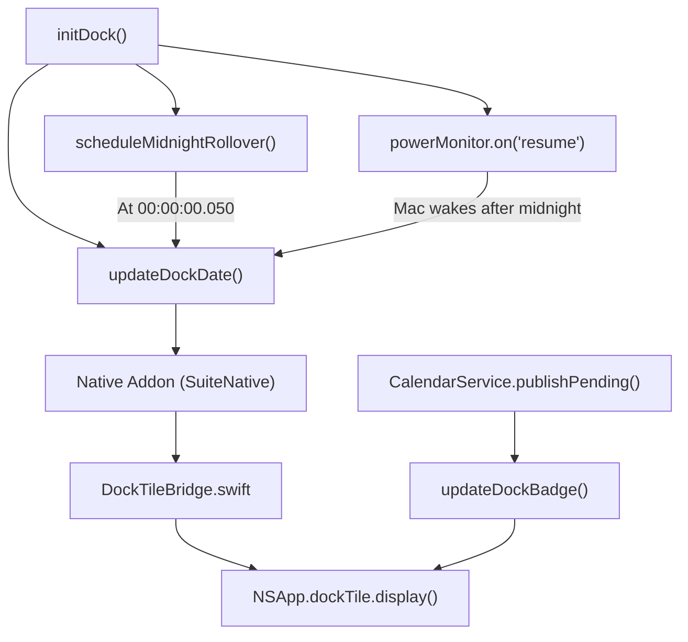

# Dynamic dock tile

The drawing lives in [`dock.ts`](../../apps/magical/src/dock.ts),
[`DockTileBridge.swift`](../../apps/magical/native/Sources/DockTileBridge.swift) and
[`magical_addon.mm`](../../apps/magical/native/src/magical_addon.mm).

## What the Dock icon shows

Like macOS Calendar, Magical draws a live `NSDockTile` icon showing today's date:

- A blue top header carrying the abbreviated month (e.g. `OCT`).
- A calendar page below it, with the day of the month centred on it (`16`).
- A midnight rollover that reschedules itself and listens for system wake.
- A badge carrying the number of invitations awaiting a reply; [`rsvp.md`](rsvp.md) owns what
  counts and what clears it.



## Drawing engine

Magical delegates rendering to an in-process native Swift bridge (`DockTileBridge.swift`) through
the N-API C++ addon. Electron's `app.dock.setIcon()` would rasterise to PNG in Node.js instead,
which costs CPU, churns memory and comes out blurry on Retina displays.

1. **`MagicalDockTileView` becomes the tile.** The bridge sets one instance of this `NSView`
   subclass as `NSApp.dockTile.contentView` and keeps reusing it, so a date change is a
   `needsDisplay` and a `display()` call rather than a new image.
2. **The application's own icon is the artwork.** `NSWorkspace.shared.icon(forFile:)` on the main
   bundle hands back the icon the Dock draws, already carrying the treatment described in
   [The Dock treats the application icon and nothing else](#dock-treats-only-the-application-icon).
   The view asks for it on every draw rather than caching it, because the treatment follows the
   Icon & Widget Style the user picks in System Settings.
3. **The card is cleared, then today's date written on it.** The `.icns` carries a fixed `AUG 31`,
   so the view clips to a 400-square rect around the calendar card, redraws the artwork over it to
   take the old date off, then draws the month and the day numeral as AppKit text in SF Pro Heavy.
4. **`NSApp.dockTile.display()` publishes it.** WindowServer redraws the Dock icon immediately,
   with nothing written to disk.

### The artwork at runtime

The raw artwork — the squircle, wand, stars, card and rings — is
`apps/magical/build/icon.svg`, shipped verbatim as `Contents/Resources/icon.svg` beside
`libMagicalNative.dylib` (the `extraResources` entry in `electron-builder.json`) and read once,
lazily, on the tile's first draw. `DockTileBaseArtwork` in `DockTileBridge.swift` owns the lookup.

It used to be embedded in a generated `DockTileBaseSvg.swift`, which is why every build dirtied a
tracked file: the generator wrote the raw string flush left and SwiftFormat's `indent` rule
re-indented it at commit time, so a rebuild and a commit disagreed by ~480 whitespace-only lines.
Shipping the SVG and reading it at runtime leaves `build/icon.svg` as the one source of truth, with
nothing to regenerate and nothing to drift. The `.icns` and the tile's base artwork still come from
that one file.

The lookup cannot go through `Bundle.main`, which under `pnpm run dev` is Electron's own bundle and holds
neither the SVG nor the `.icns`. `DockTileBaseArtwork` asks `dladdr` where the dylib was loaded from
and reads `icon.svg` beside it, so the packaged app finds `Contents/Resources/icon.svg`, and a
development build, whose dylib sits in `native/.build/<config>/`, walks up to the app's
`build/icon.svg`. The three `<text>` elements carrying the fixed `AUG 31` are stripped in Swift at
load rather than at build time, so the tile draws today's date over a card that has none.

The fixed `AUG 31` stays in the `.icns` because generating it without a date would leave Finder,
Spotlight and a quit-but-pinned Dock slot showing a calendar with a blank page, which is worse than
a date out of step; macOS Calendar ships a fixed date for the same reason. Clearing it costs
nothing because the treatment is an edge effect: differencing the raw `.icns` against the treated
icon gives a mean of 0.43 per channel within 20 of the body edge, falling to 0.019 beyond 60,
which is the resampling floor, and the clip stops more than 80 short of every edge.

### Dock treats only the application icon

macOS 26 gives every application icon a glass treatment: it masks the artwork to the squircle,
lights the top-left edge, shades the one opposite and lays down the drop shadow. It reaches the icon
the bundle declares, and nothing an app hands the Dock at runtime. A probe app whose `.icns` is a
flat red square comes back squircled, inset and shaded, while the same app showing a flat green
square through `NSApp.applicationIconImage` or a blue one through `dockTile.contentView` shows both
raw: no mask, no inset, no shading. So an app cannot ask for the treatment; it can only start from
something that already has it, which is why the engine goes to `NSWorkspace`. Drawing a copy by hand
is not an option either, because the treatment follows the Icon & Widget Style, so it would have to
own Default, Dark, Clear and Tinted and be wrong on at least one of them and again whenever Apple
changes the material.

`NSWorkspace.shared.icon(forFile:)` returns the treated icon rather than the raw `.icns`. On
Magical's own bundle the corner alpha is 0 against the raw file's 1, and the body still measures
824 of a 1024 canvas in the same place, so the system shapes and lights an icon that already carries
Apple's margin without moving it. On Sonoma and Sequoia the same call returns an icon with no
treatment to apply, which is what those Docks draw, so the tile needs no version check.

### SVG template fallback

Where the native drawing is unavailable, such as a headless test run, `dock.ts` fills in an SVG
template instead (`renderDockIconSvg`, using `ICON_SVG_TEMPLATE` from `icon-template.ts`): it
replaces `<text id="cal-month-text">` with the current uppercase 3-letter month and
`<text id="cal-date-number">` with the current day of the month, then passes the result to
`addon.updateDockSvg(svg)`.

## Apple's icon grid and its shadow

The tile fills its whole Dock slot, but a macOS app icon does not. The grid, the artwork inset and
the template shadow are the shared icon system in
[`../shared/brand-and-icons.md`](../shared/brand-and-icons.md); the rest is what they mean
for the tile.

`DockTileBridge.swift` and `build/generate-icons.swift` scale the artwork the same way, so the tile
and the `.icns` land on one grid. The tile stands in for the `.icns` the moment Magical launches,
and drawing it straight into its bounds would put the body about 9 % wider than the app icon's.

The constants still govern where the card and the date land, because the tile positions its text on
the same canvas. The tile draws the inset and the shadow itself only on the fallback path; the icon
`NSWorkspace` returns already carries both, so it goes into the whole slot.

## Updating the date

The date must change the moment the calendar day does, without a timer running continuously:

```ts
export function msUntilNextMidnight(now: Date = new Date()): number {
  const next = new Date(now.getFullYear(), now.getMonth(), now.getDate() + 1, 0, 0, 0, 50);
  return Math.max(1000, next.getTime() - now.getTime());
}
```

It targets 50 milliseconds past midnight (`00:00:00.050`), so `new Date()` resolves to the new
calendar day even under minor timer latency, and it calls `timer.unref()` on the Node.js timeout so
the pending timer does not block process exit during tests or graceful shutdown.

Node.js timers pause and do not fire while the Mac is closed or asleep, so a Mac that sleeps over
midnight would show a stale date when the user re-opens the laptop. `initDock()` therefore
subscribes to Electron's `powerMonitor`: `resume` and `speed-limit-change` both call
`updateDockDate()` immediately.

Nothing polls for the date; updates come from `scheduleMidnightRollover()` and the `powerMonitor`
listeners alone. On any other platform `updateDockDate()` and `updateDockBadge()` return without
doing anything, so a Linux CI runner does not fail.
