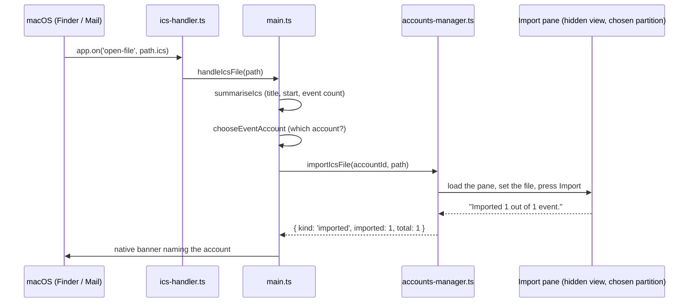

# `.ics` import

Every meeting that arrives as an email attachment is a `.ics` file. Magical reads the file, asks
which account it belongs in, and hands it to that account's Google Calendar through Google's own
Import pane. A double-clicked invite and **File → Import Calendar File…** reach the same flow.



## File association

`apps/magical/electron-builder.json` declares the type, which writes the `CFBundleDocumentTypes`
entry for UTI `com.apple.ical.ics`:

```json
{
  "fileAssociations": [
    {
      "ext": "ics",
      "name": "iCalendar File",
      "description": "Calendar event",
      "role": "Editor",
      "icon": "build/icon.icns",
      "mimeType": "text/calendar"
    }
  ]
}
```

Declaring the type puts Magical in **Open With** and makes it a candidate handler. Becoming the
default handler is a separate claim; see [Claiming the default](#claiming-the-default).

## Opening a file

macOS hands Magical the path through `open-file`. `watchForIcsFiles()` runs as `main.ts` is
evaluated, alongside `setAsDefaultProtocolClient`, rather than from `whenReady`.

Double-clicking an invite while Magical is closed launches it and fires `open-file` before
`whenReady`: before the window, the accounts and their partitions exist. A listener registered at
the usual time is registered too late, and the one file that gets dropped is the file that started
the app. What `watchForIcsFiles()` catches before there is anything to do with it goes into a queue;
`onIcsFile` installs the real handler after the window exists and replays the queue into it. A path
that is not a `.ics` is dropped with a log line. `argv` is never read: macOS delivers documents to
the running instance through `open-file` whether or not the app was already open, so there is no
second path to keep in step.

**File → Import Calendar File…** (`⇧⌘I`) is the same import behind a file picker, for when Magical
is already open and the file is not in front of the user. It joins the flow at `handleIcsFile`, so
both routes meet there. The picker takes one file at a time: each file is a separate question about
which account it belongs in, and allowing several would ask that question repeatedly.

## Describing the file

`readIcsFile` reads the file to a string, or returns null when it has been moved or deleted;
`handleIcsFile` then shows an alert and stops before the user is asked which account.

`summariseIcs` in `ics-file.ts` reads just enough of the file to name the import in the picker. It
unfolds continuation lines first: RFC 5545 folds any line over 75 octets by breaking it and
prefixing the remainder with a space or tab, so a long `SUMMARY` arrives in pieces and reading line
by line would truncate every title that needs this most. It counts `VEVENT` blocks and takes the
first event's `SUMMARY` and `DTSTART`, each from inside the first `VEVENT` only, so a
calendar-level `SUMMARY` never labels a two-hundred-event file with the feed's own name.

It is not a parser, and nothing it returns decides whether the import goes ahead: an unreadable file
still reaches Google, which holds the only opinion on validity that matters. `DTSTART` is read in
its local or UTC form only; a `TZID` names an Olson zone this does not resolve, so the time is taken
at face value.

`describeIcs` writes the picker's second line: the count and file name for a file holding several
events, otherwise the first event's title with its start.

## Account picker

`chooseEventAccount` in `account-picker.ts` presents the picker, the same one **File → New Event**
uses, with the title and message naming the import. `handleIcsFile` passes the described file as the
detail line.

The account is always asked for when more than one exists, whatever `addEventAccountPicker` says
(`forceAsk`): a file from Finder or Mail has no account on screen to have been the one meant.

## Import pane

`ics-import.ts` works Google's own controls at
`https://calendar.google.com/calendar/u/0/r/settings/export`. Google parses the file, so every
`VEVENT`, `RRULE` and `VTIMEZONE` is read by the code that already understands them, and Magical
never holds an opinion about the iCalendar spec. Google Calendar exposes no session-authenticated
endpoint for creating an event, so the file goes through the pane Google already provides. `u/0` is
right for every account because each partition is signed into exactly one Google account.

### Three controls

| Control           | Addressed as                                                          | Why that handle                                                               |
| :---------------- | :-------------------------------------------------------------------- | :---------------------------------------------------------------------------- |
| The file field    | `input[type="file"][name="filename"]`                                 | `name` is the form's contract with Google's server, so it outlives the markup |
| The Import button | the `button` whose trimmed text is `Import`                           | It carries no stable id, label or role beyond its own text                    |
| The result        | the `[role="dialog"]` or `[role="alertdialog"]` containing `Imported` | Google reports the outcome in a modal, not in a live region                   |

No minified class or `jsname` attribute is matched, in line with the project's DOM rules.

### Putting the file in the input

A file input's `value` cannot be assigned from script, by design, so the file goes in over the
Chrome DevTools Protocol. `attachFileToPane` attaches `webContents.debugger`, resolves the input to
a remote object, and calls `DOM.setFileInputFiles`. Chromium dispatches the page's own `change`
handler as it would for a real selection.

Success is not assumed from the call returning. Google's Import button starts disabled and is
enabled by that `change` handler, so `attachFileToPane` waits until the button is enabled: an
enabled button is proof the file reached the form.

The three waits (the pane rendering its file field, the button becoming enabled, the verdict
appearing) run inside the page through `waitUntil` from `@magimail/core`'s `DOM_DRIVE_PREAMBLE`, so
the pane is watched as it changes rather than re-read from the main process every 250 ms.
`waitInPage` carries the predicate across as a string, and the predicate has to yield a boolean or a
string: a DOM node does not survive the trip back.

### Reading the verdict

Google answers in a modal whose text is `Imported 1 out of 1 event.`, or `Imported 0 out of 0
events.` followed by its own reason. `parseImportResult` reads the two counts and returns one of
three outcomes:

| Outcome       | Means                                      | What the user sees                     |
| :------------ | :----------------------------------------- | :------------------------------------- |
| `imported`    | At least one event landed                  | A banner naming the account            |
| `rejected`    | Google read the file and refused it        | An alert carrying Google's own wording |
| `unconfirmed` | The pane gave no answer that could be read | The pane on screen, file already in it |

A partial import counts as `imported`: events landed. A rejection is a verdict on the file, and an
unconfirmed import means the page changed shape, which is not the user's problem to diagnose, so
Magical falls back rather than reporting a failure.

The dialog is dismissed on the way out. The view is the account's own in the fallback case, and
leaving a modal over it would block everything the user does there next.

## Hidden view

`AccountsManager.importIcsFile` builds a second `WebContentsView` on the chosen account's partition
(the same signed-in session Google sees) and never adds it to the window. Driving the import in the
account's own view would take the user's week away for the duration; the hidden view costs one
renderer for about two seconds, and the user's calendar stays on the day they were looking at. The
view is destroyed either way.

It is given the same bounds the account views get. Google lays the pane out against the viewport,
and a zero-sized view leaves the controls unrendered for the selectors to miss.

When the outcome is `unconfirmed`, `revealImportPane` switches to the account and navigates its
visible view to the same pane with the file already in its input; `preparePane` loads the pane and
sets the file without pressing Import. A changed page then costs the user one click.

## Import outcome

`reportImport` in `main.ts` turns the outcome into one message.

A finished import is a banner, posted through the helper's `magical.notice` category, which carries
no action buttons: the work is done, and Snooze on a finished import would offer to postpone
nothing. The banner is titled **Imported to Calendar**, subtitled with the account, and bodied with
the event count.

`rejected` and `unconfirmed` are both alerts, because each leaves the user with something to decide.
A rejection carries Google's own reason. An unconfirmed import says Google's pane is open in the
chosen account with the file already selected, and to press Import to finish.

## Claiming the default

`DefaultHandler.swift` in the Swift helper claims the type with
`NSWorkspace.setDefaultApplication(at:toOpen:)`, naming `Magical.app` as the handler for
`com.apple.ical.ics`. It lives in the helper because Electron cannot reach it:
`app.setAsDefaultProtocolClient` claims a URL **scheme**, and a `.ics` file is a **content type**
for which LaunchServices has no scheme to claim. The helper is the process carrying the app's bundle
identity, so it is the one that can name the bundle.

### Per-type claims

macOS exposes no "default calendar app" role. Mail and the browser are the only two roles System
Settings offers; everything else is tracked per content type and per URL scheme, which is why
`.ics`, `webcal:` and `ical:` can be owned by three different apps at once on the same Mac.
`DefaultHandler.Target` mirrors that, and carries one case because `.ics` is the only thing Magical
can service.

### The claim button

LaunchServices offers no way for an app to stop being a handler, so the settings row is a button.
Once Magical holds the type the button disappears; the only way back is to name a different app in
Finder's Get Info panel. A switch would carry an off position that could not work.

The row reads LaunchServices on every appearance rather than remembering what Magical last set,
because the user can change the handler outside the app at any moment. Both states are the same
sentence with a different app in it, so the row reads as one fact that changes.

### Surfaces and when they ask

Three surfaces reach the same claim:

| Surface                                                   | Behaviour                                                   |
| :-------------------------------------------------------- | :---------------------------------------------------------- |
| Magical → **Set Magical as Default for Calendar Files…**  | Always answers, including "already the default"             |
| **Settings → General**, the **Calendar files (.ics)** row | Shows who holds the type; the button goes once Magical does |
| The launch prompt, once                                   | Claim it, not now, or stop asking                           |

`promptSetAsDefault` is the menu item. It always puts a dialog up, ignoring
`askAboutDefaultCalendarApp` and answering even when Magical already holds the type: the user chose
the item deliberately, so a silent no-op would read as a broken menu.

`offerToBecomeDefault` is the launch prompt. It runs after the `open-file` handler is installed, so
a launch that came from a double-clicked file imports it rather than meeting a dialog first. It
offers three answers, and only "don't ask again" is stored, as `askAboutDefaultCalendarApp` in
`settings.json`.

Outside an app bundle there is nothing to register, so the launch prompt stays quiet, the menu item
says the installed app is needed, and the settings row says the same rather than offering a button
that would fail.
