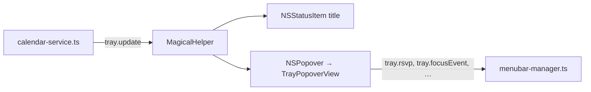

# Menu bar

The status item and the popover both run in the Swift helper, over the mechanism in
[`../shared/menu-bar.md`](../shared/menu-bar.md): the main process serialises the state into one
`tray.update` push and the helper renders from it. This page covers Magical's title modes, the data
the popover draws, its filter and health reporting, and the constraints on rendering it.

Opening the popover never waits on a request, because everything it shows arrived in the last push.
`tray.popoverOpened` asks `CalendarService.refreshIfStale()` for a fresh poll with a one-minute
cooldown, avoiding redundant polls when opening right after startup or a recent poll.

## Where it runs, and how big it is

`MenuBarController` owns the `NSStatusItem` and reuses its `NSPopover` and `NSHostingController`
across presentations instead of rebuilding them on each click. `showMenuBarIcon` decides whether the
status item exists at all: turning it off sends `tray.destroy`, and back on sends `tray.create`.

`TrayPopoverMetrics` holds the popover's size so the `NSPopover` and the SwiftUI view inside it cannot
disagree about it. The width is `defaultWidth`, 340pt. The height is
`height(isCalendarCollapsed:)`, 672pt with the grid expanded and 492pt collapsed, so the chevron
shortens the popover. Both the popover's `contentSize` and the view's own frame take those values.

## Status item title

`MenuBarController.updateTitle()` builds an attributed string from `TrayModel` and redraws it on every
`tray.update` and on a 30-second timer. `menuBarDisplayMode` picks the content.

| Mode          | Draws                | Notes                                           |
| :------------ | :------------------- | :---------------------------------------------- |
| `iconOnly`    | nothing              | The default. Any unrecognised value lands here. |
| `dayOfMonth`  | `16`                 |                                                 |
| `dayAndMonth` | `Wed 16 Sep`         |                                                 |
| `nextEvent`   | `▌ 14m: Design Sync` | Nothing once the day's meetings are done.       |

The glyph is `MenuBarGlyph.statusItemImage()`, a template image so macOS tints it for the menu bar's
own appearance.

### Next event and the account-colour bar

`TrayModel.nextEvent(within:)` returns the meeting under way, or the next one left today, skipping
all-day and completed entries. It never returns tomorrow's, because late in the evening a countdown to
tomorrow's stand-up reads as though it were about to start.

`within` is the only thing the title and the hero band differ on: the band passes `240` and stops at
four hours, while the title passes `nil` and takes whatever is left today. Bounding the title would
blank it mid-afternoon and bring it back later. With nothing left today the title is empty, leaving the
glyph alone.

The leading bar takes the colour of the event's account, not the event's own `colorHex`;
`showMenuBarAccountColor` drops it. `AccountBar.image(hex:)` draws it as a 3×11pt capsule and
`MenuBarTitle.attachment` inlines it, so it sits on the capitals of the title beside it. The summary is
truncated to sixteen characters.

The title reads `filteredEvents`, so hiding a calendar hides it from the title too.
`onCalendarFilterChanged` redraws the title as the toggle is made, rather than leaving it counting down
to a hidden meeting until the next push. When meetings run back-to-back or overlap, the meeting that
started most recently takes priority so the Join button and title advance immediately to the new call.

### Countdown

`TrayCountdown` turns one minute count into the two registers the tray needs: `compact` (`Now`, `12m`,
`1h`, `1h 20m`) for the status item, and `label` (`NOW`, `IN 1 MIN`, `IN 12 MINS`, `IN 1 HR 20 MINS`)
for the hero band. Both split the number the same way.

A 30-second `Timer` re-renders the title, added in `.common` run loop modes so it keeps firing while a
menu is tracking and invalidated on `destroy()`. In addition, `MenuBarController` schedules a precise
transition timer at the next boundary where an event starts or ends (`nextScheduleTransitionDate`), so
back-to-back meetings and newly starting calls advance immediately on schedule rather than waiting for
the next periodic tick.

`MenuBarTitle.countdownWidth` measures the countdown's longest reading, `00h 00m`, and `updateTitle()`
appends whatever the current reading leaves over as a transparent attachment. The rule that keeps the
status item's width from moving while it ticks is shared and in
[`../shared/menu-bar.md`](../shared/menu-bar.md).

## Popover

### Data

`TrayModel.update(from:)` unpacks the last `tray.update` into the state every surface reads:

| Payload key                                                           | Sets                                                          |
| :-------------------------------------------------------------------- | :------------------------------------------------------------ |
| `accounts`                                                            | `accounts`: id, name, colour, unread count, `needsAuth`.      |
| `calendars`                                                           | `explicitCalendars`, the list the filter menu is built from.  |
| `events`                                                              | `events`, kept within the 1900–2100 span and sorted by start. |
| `activeAccountId`                                                     | `selectedAccountId`, falling back to the first account.       |
| `hiddenCalendars`                                                     | `disabledCalendars`, the persisted filter.                    |
| `isCalendarCollapsed`, `isOffline`, `isRestricted`, `lastSyncedAt`    | The matching flags and the banner's age.                      |
| `menuBarDisplayMode`, `showMenuBarAccountColor`, `showCompletedTasks` | The title's and the agenda's settings.                        |

`MenuBarManager.pushUpdate()` filters events to a bounded window (by default 30 days past to
60 days ahead) rather than transmitting the full multi-year cache, and drops redundant pushes when the
payload matches the previous one. `TrayModel.update(from:)` checks equality before mutating
`@Published` fields so unchanged properties do not invalidate SwiftUI views.

`filteredEvents` is the one list the title, the hero band, the agenda and the mini-month dots all read,
so hiding a calendar hides an event from every one of them at once. An event held by several calendars
goes only when every one of them is hidden.

`TrayModel.scheduleFeedItems` groups `filteredEvents` by day and inserts month headers and
empty-period dividers between the groups. Scrolling near either boundary or navigating months calls
`tray.ensureRange`, widening the visible window before the next push.

### Header

`TrayPopoverView.header` holds the `BrandMark`, the calendar filter menu, a New Event button
(`calendar.badge.plus`) that sends `tray.openQuickAdd`, and a gear menu with **Show Completed Tasks**,
**Refresh Calendars** on ⌘R, **Preferences…** and **Quit Magical**.

There is no refresh button in the bar. Polling runs on its own and the popover re-polls a stale cache as
it opens, so the gear item is only there to force a poll, and it disables itself while one is running.

**Preferences…** sends `tray.openSettings` and lets the main process open the window, even though the
helper hosts it. The settings, the account list and the version all live in Electron, and the helper
holds only what a `settings.show` last carried, so a fresh helper showing the window itself would show
the built-in defaults. `openSettingsWindow` in `apps/magical/src/settings.ts` pushes all three with the
request.

### Search field

`TraySearchField` is a native `NSSearchField` at the top of the content. It carries no local filtering:
submitting hands the query to the main window, which navigates Google Calendar to
`/calendar/r/search?q=…`.

The placeholder names the account the search runs in (`Search Work — opens in app`), because a Google
Calendar search runs within one account's web session. It defaults to the active account, or the first
if none is active. With more than one account, `searchMenuTemplate` puts a native dropdown on the
search icon listing each account with its `AccountDot` and a checkmark on the selected one. Return
closes the popover and sends `tray.search` with the query and the chosen account.

### Hero band

The band is drawn when `TrayModel.heroNextEvent` returns a meeting already running or one starting
within four hours. It renders the countdown from `TrayCountdown.label`, the times and the conference
service, then the title with a `.borderedProminent` **Join** carrying `video.fill`. Join hands the link
to `tray.joinCall`; what that does is in
[`conference-links.md`'s From web URL to desktop client](conference-links.md#from-web-url-to-desktop-client).

A popover shown from a status item does not become key on its own, and AppKit greys an accent-coloured
control whose window is not key. `MenuBarController.showPopover()` calls `makeKey()` on the popover's
window rather than activating Magical, which keeps the accent fill and puts ⌘R within reach, and
`TrayProminentButton` pins `.controlActiveState` to `.active` for a window that loses key while on
screen.

### Mini-month grid

Seven columns, Monday first regardless of locale, with neighbouring months' days filling the grid out.
Each day shows up to four dots, one per distinct calendar colour with an event that day, from
`TrayModel.densityDotsByDay`. Today carries a solid disc and the selection a ring, so the two states
compose. Clicking a day calls `requestScrollTo(date:)`, and scrolling the agenda calls `selectDate(_:)`,
both across month boundaries.

### Month header

`model.displayedMonthTitle` sits on the left with a chevron that toggles `isCalendarCollapsed` through
`tray.setCalendarCollapsed`, persisted in settings. Clicking the title calls `jumpToToday()`, which
scrolls the agenda to the now rule rather than to the top of the day, where the morning's finished
meetings are. The chevrons call `previousMonth()` and `nextMonth()`, each asking for `tray.ensureRange`
when the new month falls outside the cached range.

### Agenda

`ScheduleAgendaView` renders `TrayModel.scheduleFeedItems` in a `LazyVStack`: the day groups, the month
headers and the empty-period dividers. On today, a red rule marks the current time, placed as the view
renders rather than on a timer, with the meeting under way above it.

Topmost visible item detection uses `TopmostItemPreferenceKey` to drive the mini-calendar date
selection as the user scrolls. During feed updates or programmatic jumps, scroll-tracking callbacks
(`onDayScrolledIntoView`) are suppressed so background refreshes do not drag `displayedMonthDate` away
from the month currently in view.

Each card carries the event's times, title, calendar and location. Completed tasks follow
`showCompletedTasks`: switching it off removes them from `filteredEvents` and `nextEvent` with them.
Clicking a card reveals the event, and the secondary-click actions, RSVPs and task controls are in
[`actions.md`](actions.md); revealing an event is
[`actions.md`'s Revealing an event](actions.md#revealing-an-event).

### Footer

A centred **Open Calendar** button sends `tray.openApp`, bringing the main window forward.

## Calendar filter and Focus

The filter lives in the header menu, shown when more than one calendar or a task is available. Toggling
a calendar hides its events from `filteredEvents`, so the dots, the agenda, the hero band and the title
change together. The set persists through `tray.setHiddenCalendars` into `hiddenCalendars`, each entry
naming its account as well as its calendar, because a calendar id alone is not unique across accounts.
A push seeds the set until the user touches the filter in the session; after that their live choice
wins.

A macOS Focus can silence a calendar too, and that set is kept apart from this one. A Focus-silenced
calendar is listed in the menu unticked and not tickable, so the menu still says which calendars exist
and the tick cannot offer a choice the Focus overrules. `showAllCalendars()` gives back the user's own
filter only. The surfaces a silenced calendar loses are in
[`focus-filters.md`'s What a filter silences](focus-filters.md#what-a-filter-silences).

## Event colours

`menubar-manager.ts` settles `colorHex` first match winning:

1. The event's own colour, when Google gave it one.
2. The colour of the calendar it is drawn as: the first calendar holding it that the user has not
   hidden.
3. The primary calendar's colour, when it draws as that.
4. The account's own colour, which is what is left when nothing names the calendar.

Step 4 looks coloured rather than broken when it fires, so it is the one to watch. The payload carries
a colour label rather than a hex; [`google-colours.json`](../../apps/magical/src/google-colours.json)
maps that label to the hex Google paints, and it is the only place a colour number becomes a hex.
Calendar colours resolve through the same palette or, for custom colours, unpack the RGB integer
the calendar list carries.

## Offline, sign in required, restricted, and not up to date

`CalendarService` reports each account's last read as `ok`, `stale`, `signed-out`, `restricted`,
`offline` or `unreadable`, together with when that source last read successfully.
`MenuBarManager.setAccountHealth` keeps the latest reading per account and derives the flags into
`tray.update`, pushing only when a reading changes.

At most one banner shows, in the order below.

- **Offline.** `isOffline` is one flag for the whole popover while health is per account, so it is
  claimed only when the app has accounts and every one of them is failing with `offline`.
- **Sign in required.** The account whose read raised `CalendarSessionExpiredError` arrives with
  `needsAuth`. The banner names the account and offers **Sign In**, which sends `tray.showAccount`.
- **Calendar access blocked.** `isRestricted` says Google refused the endpoint by tenant policy. It
  offers no button, because no credential the user can enter lifts an administrator's block; the
  copy points them at their administrator instead.
- **Not up to date.** `lastSyncedAt` is the oldest successful read among the accounts that have stopped
  reading, so the banner names the worst case. It is absent rather than stale once everything reads
  again.

While any banner is up, the agenda withholds its "No events scheduled" placeholder, because a clear day
and a dead network look identical from the agenda.

## Rendering constraints

1. **Opening the popover must not wait on the network.** The helper renders from the state
   `tray.update` last pushed, and `tray.popoverOpened` may trigger a poll whose result arrives after
   the popover is already on screen.
2. **The agenda is lazy.** `ScheduleAgendaView` uses `LazyVStack`, so a feed spanning months across
   several accounts still scrolls smoothly.
3. **No web views.** The popover is AppKit and SwiftUI throughout. The helper is a separate process
   with no Electron in it, and a `WebContentsView` must never be embedded in the popover.
