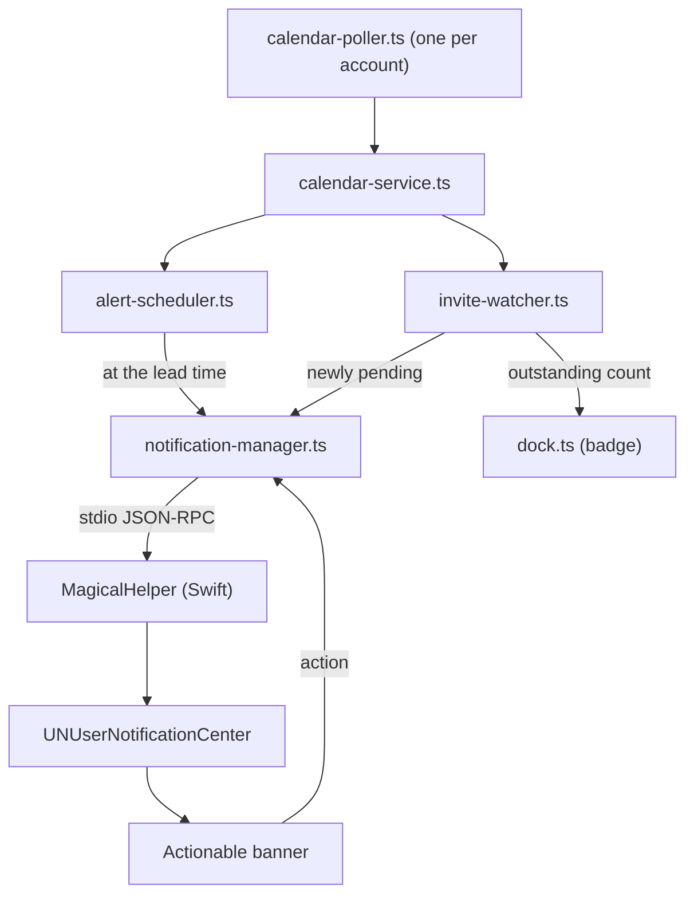

# Meeting alerts and invitation banners

Magical posts two kinds of banner. A meeting alert is time-based and fires once at a moment computed
from the event's start. An invitation is state-based and stays pending until the user answers it.
`alert-scheduler.ts` decides the first and `invite-watcher.ts` the second, and `calendar-service.ts`
owns the poll loop that feeds both.



The scheduler knows nothing about banners, and the notification manager knows nothing about where an
event came from. A press on a banner comes back as an `alert.action` event; [`actions.md`](actions.md)
owns where each action lands.

## Alert scheduler

The scheduler takes normalised events and arms a timer for the moment each alert is due. It knows
nothing about how a banner is drawn.

### Firing on the second

A poll tick is too coarse for the wait: "five minutes before" must not mean "some time in the five
minutes before". `schedule()` computes `startTime - leadMinutes` and arms a `setTimeout` for that
exact moment. It is idempotent, so calling it after every poll with the full window re-arms what
changed and drops timers for meetings that were cancelled or moved out of range.

### Alert window

The scheduler arms a timer only for a moment inside the alert window, which reaches ten minutes ahead
and two minutes behind.

| Constant            | Value  | Bound                                                                                                                                      |
| :------------------ | :----- | :----------------------------------------------------------------------------------------------------------------------------------------- |
| `MAX_TIMER_MS`      | 10 min | A longer timer is at the mercy of sleep and clock changes, so the scheduler leaves it unarmed and the next poll arms it accurately.        |
| `LATE_TOLERANCE_MS` | 2 min  | A machine asleep through an alert wakes with the moment already past; ninety seconds late is still worth a banner, forty minutes is noise. |

`setTimeout` measures elapsed time rather than wall-clock time, so a machine that sleeps for an hour
wakes with its timers an hour behind. `reconcile()` re-evaluates every armed timer against the clock
and runs on `powerMonitor` resume and on a UTC offset change; anything whose moment has passed fires
immediately, within the late tolerance. The timer callback makes the same judgement for itself,
because an overdue timer can run before the resume handler does: beyond the tolerance it drops the
alert rather than announcing a meeting that started an hour ago.

`fireAt` is an absolute instant, and the scheduler compares epoch milliseconds, so its timing is
timezone-aware. Changing the Mac's UTC offset changes the local clock time shown for an alert, not
the moment it fires: a 15:00 London meeting seen from Paris alerts at the same absolute moment, now
16:00 Paris. `checkTimezoneShift()` calls `reconcile()` after an offset change. The rebuild derives
every timer from its unchanged `fireAt` and recalculates no alert time.

The lead time is `meetingAlertLeadMinutes`, which defaults to 5 and offers 1, 5, 10, 15 and 30
minutes. `meetingAlertsEnabled` turns alerting off.

An event's own notification time overrides the setting. `leadFor` takes the longest of the event's
reminders with `Math.max`, which is the earliest banner, so a meeting that asks for fifteen minutes'
warning gets it. An event that takes its calendar's default carries nothing on the wire and falls
back to the setting; the range payload does not carry a calendar's default notifications, so that
fallback is `meetingAlertLeadMinutes`. [`calendar-wire-format.md`](calendar-wire-format.md) owns what
the payload carries.

The Swift helper sends a settings change as `settings.changed`, and `applySettingChange()` in
`main.ts` routes the keys to `CalendarService.applySettings()`, which re-reads the settings,
re-filters and reschedules cached events through `rearmCachedAlerts()` without a network round trip,
calls `setLeadMinutes()` if the lead time moved, and polls. `setLeadMinutes()` drops every armed timer, since
each was computed against the old lead, and the poll that follows re-arms them.

### Firing once

`alertKey(event, leadMinutes, sourceId)` identifies one alert for one occurrence:

```ts
`${sourceId}|${event.instanceId ?? `${event.id}@${event.startTime.getTime()}`}|${leadMinutes}`;
```

It keys on the recurrence instance rather than the event id because every occurrence of a weekly
stand-up shares an event id; keying on that would alert for the first occurrence and stay silent for
the rest of the year. The start time is included so a rescheduled meeting is a new alert rather than a
suppressed one, and the lead time so changing the setting does not resurrect old alerts. An occurrence
the wire returned carries its own id, `<seriesId>_<occurrenceStartUTC>Z`, and needs no expansion.
What never goes in the key is the series anchor `IDX.seriesAnchor`: every occurrence carries the same
one, so keying on it would alert for whichever occurrence arrived first and stay silent for the rest.

A key is marked notified before dispatch rather than after, so a throw in the handler cannot leave the
alert eligible to fire again on the next poll. The key list is persisted, bounded at
`MAX_REMEMBERED_ALERTS` (500), so a restart does not replay the day.

### Snooze

Snooze arrives after the alert has fired, which is the point of the button, so a fired alert has to
outlive its own dispatch or there is nothing left to re-arm. `recentlyFired` keeps the last 64, and
`snooze(key, minutes)` re-arms from either map.

### Never alerted

All-day entries are excluded. A birthday or an out-of-office block has no moment to be five minutes
early for.

Declined meetings are excluded, on the measured code `1`. Tentative, `2`, still alerts: a Maybe is a
meeting the user may well attend, and dropping an alert for one is a missed meeting where an extra
banner is not. An unrecognised code alerts rather than being assumed to mean declined.

Events belonging to calendars muted in Settings are excluded. When a calendar's
`accountId|calendarId` key appears in `disabledAlertCalendarIds`, its events are filtered out before
reaching the scheduler and the invite watcher, suppressing both meeting alerts and invitation banners
for that calendar. The account is part of the key because Google gives Birthdays, Tasks and each
locale's holidays the same id in every account; a bare calendar id is the shape written before that
and still mutes the calendar in every account. An event sits on several calendars at once, and it is
excluded only when every calendar holding it is muted. The same rule decides the banner a Focus would
silence.

The Notifications tab shows a per-calendar toggle for each calendar discovered across configured
accounts, grouped in an inset scrollable box and coloured with the calendar or account swatch.
Toggling a calendar writes its `accountId|calendarId` into `disabledAlertCalendarIds`. The account's
own name heads each group and is a checkbox too, muting or unmuting every calendar under it in one
change; the calendars underneath stay individually adjustable afterwards.

A calendar an active macOS Focus silences is not excluded here. It is scheduled as usual and its
banner is dropped at the moment `MagicalHelper` would post it, because a Focus lasts an afternoon and
an alert armed now may be due after it ends; see
[`../shared/focus-filters.md`'s Focus only ever silences](../shared/focus-filters.md#focus-only-ever-silences).

### Removed account

`schedule()` only prunes within the source it is handed, so an account that stops being polled would
keep every alert it had armed, and its meetings would still ring. `forget(sourceId)` cancels those
timers, and `syncPollers()` calls it as it drops the poller. It clears the recently-fired record too,
so Snooze on a banner still on screen cannot re-arm an alert for an account that has gone.

`notified` keeps its keys. Dropping them would let a meeting that has already rung ring a second time
if the same account were added back inside the lead window.

## Alert log

One alert is traceable end to end in `~/Library/Logs/Magical/main.log`, which is the only way to watch
the subsystem work without waiting for a banner:

```plain text
(Main)                 Setting meetingAlertLeadMinutes = 10
(CalendarService)      Alerts on, lead 10 min; re-arming
(AlertScheduler)       Lead time 5 -> 10 min; dropping 2 armed alert(s)
(CalendarPoller)       google:account_1: 34 event(s) across 3 calendar(s)
(AlertScheduler)       google:account_1: 34 event(s), 30 alertable, armed 2, dropped 0, 2 pending (lead 10 min); soonest abc123 fires 2025-09-01T14:25:00.000Z in 300s
(AlertScheduler)       Firing abc123 from google:account_1, 10 min before start
(NotificationManager)  Posting banner for abc123, join button yes
```

Event titles are never logged. A meeting title is calendar content and the log exists to be attached to
a bug report; the event id follows the occurrence from the poller to the banner without carrying any of
it. `schedule()` logs one line per source per poll, which distinguishes a source that saw nothing from
one whose nearest alert is still beyond the timer horizon.

## Invite watcher

`observe()` takes the full window after every poll and returns the invitations that have newly
arrived, which is the set the banner posts for. What makes an invitation pending, how a recurring
series counts as one and which occurrence dates it are
[`rsvp.md`'s Outstanding invitations](rsvp.md#outstanding-invitations); the watcher applies that rule
and the banner announces what the rule newly admits.

### Seeding

Notifying every unanswered invitation on each poll would post a banner per invitation every five
minutes, and a fresh pile of them at every launch, for invitations the user already knows about. So the
first observation of a source seeds: its pending set is recorded silently, and only what appears
afterwards is announced. `observe()` returns invitations that have arrived, not invitations that are
outstanding.

### Badge and banner

The Dock badge shows `pendingCount()`, which is every invitation still outstanding. The banner
announces only what is new: a notification is news and fires once, while a badge is a triage counter
that shows the whole pile until it is dealt with. `dockBadgeMode` chooses between the two readings;
what the number counts, and the dropdown that lists the same pile, are in [`rsvp.md`](rsvp.md).

## Posting the banner

Banners are delivered by the shared
[`NotificationControllerBase`](../../packages/swift-notifications/Sources/HelperNotifications/NotificationControllerBase.swift);
the helper ownership, the category and action contract, the content order and the sound rule are in
[`../shared/notifications.md`](../shared/notifications.md).

Magical's own categories:

| Category               | Actions              |
| :--------------------- | :------------------- |
| `magical.invite`       | Yes, Maybe, No       |
| `magical.meeting.call` | Join Call, Snooze 5m |
| `magical.meeting`      | Snooze 5m            |
| `magical.notice`       | none                 |

Join is not `.foreground`, so opening the meeting does not bring Magical forward. Both an alert's and
an invitation's content are built in `notification-manager.ts`: an alert is the meeting name, then `In
5 minutes · 14:30`, then the conference provider or the location; an invitation is the event name, then
`Invitation from <organiser>`, then when it is. `conferenceLabel` names Google Meet, Zoom and Microsoft
Teams, and calls everything else a video call.

A press travels back as an `alert.action` event carrying the alert's `key`, `accountId`, `eventId`,
`deepLink` and `conferenceUrl`. `onAlertAction` routes each one to the same method the tray RPC
reaches; see [`actions.md`](actions.md).

## Answering an invitation

A banner's Yes, Maybe and No carry `rsvp:yes`, `rsvp:maybe` and `rsvp:no`. `onAlertAction` answers
through `sendRsvp`, keyed by the invitation key the banner holds. [`rsvp.md`](rsvp.md) owns the pile an
answer moves and [`actions.md`'s Answering an invitation](actions.md#answering-an-invitation) owns the
mechanism.

## Deep links

Every banner carries a `magical://` deep link built by `buildEventLink`. An event with a resolvable
`eid` gets `magical://event?account=<id>&eid=<eid>&at=<iso>`; one without gets
`magical://date?account=<id>&at=<iso>`, so a dead `eid` still opens Magical on the right day rather
than nowhere. Tapping the banner, or its Open action, hands the link to `openDeepLink`, which reveals
the event in place: it routes the account's view to the event's day and clicks its chip, so the detail
panel opens over the view the user already works in. [`actions.md`](actions.md) owns the resolution of
a link and what each action does.

## Source health

A failed read must never look like an empty calendar, so `CalendarService` reports an unhealthy source
two ways:

- A poll that throws is classified by `classifyFailure`: `signed-out`, `offline` when the request never
  reached Google, and `unreadable` otherwise. Reported once per transition rather than once per tick.
- A poller that stopped succeeding without throwing on this particular tick is caught by
  `checkStaleness()` against `STALE_AFTER_MS` (20 minutes). That is several poll intervals, so one
  transient failure is not an alarm, but it is well under the time it takes to miss a day of meetings.

Both reach a log line and the `onHealthChanged` callback, which carries the state and when that source
last read successfully. The menu bar popover renders the reading; see
[`menu-bar.md`'s Offline, sign in required, and not up to date](menu-bar.md#offline-sign-in-required-and-not-up-to-date).

### Stale cache

A source that has gone longer than `STALE_AFTER_MS` without reading keeps firing alerts from what it
last cached, because a stopped alert is worse than a stale one. Those banners say so: the body reads `⚠︎ Calendar last synced 25 minutes ago`, in place of the location or the call
provider rather than alongside it. macOS gives a banner one body line, and whether the meeting is still
happening matters more than where it is.

Nothing is added while a source is reading normally. A source that has never read counts its age from
launch rather than from the epoch, so the first alert after a cold start offline does not claim the
calendar was last synced in 1970.

### Refused permission

Denial is the one failure the app cannot infer for itself: once permission is refused every dispatch
still succeeds and no banner is drawn, so a silent morning looks exactly like a quiet one. The helper
reports the outcome of the permission prompt back as `notify.authorization`, and `CalendarService` says
so once per launch with a dialog offering to open System Settings.

### Restart during an outage

`CalendarService` writes the normalised event cache to `event-cache.json` in `userData` after any poll
round in which at least one account read something, and seeds it back in the constructor. `start()`
arms the scheduler from it before the first poll has answered.

Without it, launching into an outage would draw an empty agenda and fire no alert until the network
returns. The already-notified set is what stops the seeded cache replaying a morning of meetings.

It is a separate file from `alert-state.json` on purpose. That one is rewritten every time a banner
fires and holds a few hundred keys; this one is written once a poll and is three orders of magnitude
bigger, and sharing a file would put a megabyte of events on the path an alert takes.

Only `CACHED_DAYS_PAST` (7) to `CACHED_DAYS_AHEAD` (60) is written, against a poll window of 90 days
back and a year ahead. What has to survive is the day in front of the user: the alerts that fire from
it, and an agenda that opens on today. Paging beyond it while offline shows nothing, which the
popover's banner already accounts for.

A time that comes back unusable drops the event rather than reviving it as `NaN`. A timer armed on
`NaN` never fires and nothing says why, which is worse than the event being absent.
