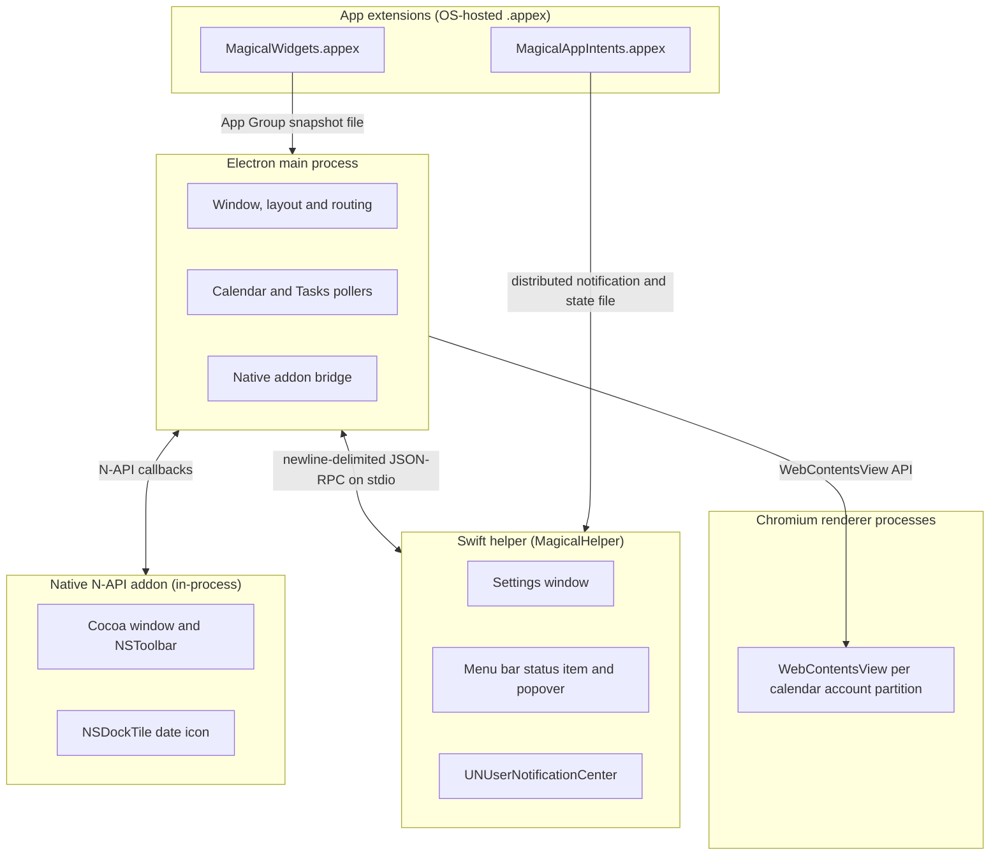

# Architecture overview

Magical is a native macOS menu bar and desktop client for Google Calendar. This file maps the tree
and says how the pieces fit; [`README.md`](README.md) indexes the pages that go deeper into each
subsystem.

## Stack and workspace

The runtime, build tooling and workspace layout are true of both apps and live in
[`../developer-guidelines/coding-standards.md`'s Stack and workspace](../developer-guidelines/coding-standards.md#stack-and-workspace).

## System overview

Magical runs the shared process shape: an Electron main process orchestrates, the Swift helper draws
the native UI in a child process, a C++ N-API addon reaches the window from inside Electron, and the
OS-hosted extensions are reached through files and notifications. Google Calendar itself runs in a
Chromium renderer, one per account partition. The shared mechanism is in
[`../shared/process-model-and-ipc.md`](../shared/process-model-and-ipc.md).

Magical imports the shared infrastructure from [`@magimail/core`](../../packages/core): the Chrome
identity, the session partition configuration, the `BaseWindow` options and the encrypted local cache
files (`secret-file.ts`; see
[`sessions-and-security.md`'s Local cache files at rest](../shared/sessions-and-security.md#local-cache-files)).

Each account view is a `WebContentsView` on its own `persist:magical_<id>` partition, hosted by the
window in [Window and views](#window-and-views).

## Window and views

Magical uses a single `BaseWindow` with `titleBarStyle: 'hiddenInset'`, `sidebar` vibrancy, and
dimensions of 1280x820 (`minWidth: 1280`), hosting one `WebContentsView` per account. Google
Calendar's top bar carries non-collapsible navigation controls that demand at least 1211px on
Workspace accounts, so enforcing `minWidth: 1280` prevents the top bar from clipping or triggering
horizontal scrolling. `BrowserWindow` would allocate a default renderer process (~100 MB RAM) that is
never displayed, so `BaseWindow` is used instead.

### Titlebar insets and traffic lights

Views are offset vertically by `TOOLBAR_HEIGHT` (52px) so Google Calendar's web banner does not
collide with the system buttons. With `hiddenInset`, macOS traffic lights draw over the top-left of
the window frame. The inset area also holds the native AppKit `NSToolbar` (see
[Native toolbar](#native-toolbar)).

### Lazy loading and account suspension

`AccountsManager` creates account views late and closes them early, through the shared pool in
[`../shared/window-lifecycle.md`](../shared/window-lifecycle.md). Magical supplies the URL an account
remembers and the calendar-specific surfaces it releases with a view. The remembered URL is a Calendar
URL with the query dropped, so a resumed view lands on the date and mode the user left. The memory the
release saves, and why the query is dropped, are in
[`calendar-sync.md`'s Suspending an inactive account](calendar-sync.md#suspending-an-inactive-account)
and [When a view cannot load](#when-a-view-cannot-load).

### Single-instance lock

Only one Magical instance may run concurrently (`requestSingleInstanceLock`). Chromium requires an
exclusive filesystem lock on partition cookie jars and LevelDB databases. A second instance that
reads an active partition fails with silent `LOCK` errors.

### When a view cannot load

A view whose load fails for want of a network shows Chromium's error page, which names a `net::` code,
offers a reload that fails the same way, and never mentions Magical. `accounts-manager.ts` replaces
it on `did-fail-load` with the page in `@magimail/core`'s `offline-page.ts`. That page names the app
and the service it cannot reach, retries the URL that actually failed rather than reloading itself,
and retries again on its own once the connection returns.

`isNetworkLoadFailure` decides which failures qualify. Alongside the codes that name a missing network
it counts `net::ERR_FAILED`, which is what a navigation a service worker handled reports when the
worker cannot answer it. `net::ERR_ABORTED` is excluded: a navigation superseded by another reports
it, and that happens throughout Google's sign-in redirects.

**Google Calendar's own offline mode keeps working.** An account with it turned on registers a service
worker that answers navigations under `/calendar/u/<n>/` from its cache, so with no network the window
shows the real calendar rather than the offline page. That cache matches on the exact URL: measured,
`/calendar/u/0/r` is served with no network and `/calendar/u/0/r?pli=1`, which is the URL a cold start
leaves behind, fails. This is why a released account's remembered URL drops its query. The date and
the view mode live in the path, so a resumed view still lands where the user left it.

## Sessions and browser identity

Each account uses an isolated Chromium profile partition named `persist:magical_<id>`, configured via
`configureGoogleSession` from `@magimail/core`. The shared session configuration and browser identity
are in [`../shared/sessions-and-security.md`](../shared/sessions-and-security.md).

- **The two apps use different partition prefixes**, `persist:magical_` and `persist:magimail_`, so
  they never collide on the same SQLite profile database lock.
- **`configureGoogleSession` sets the request headers** (`User-Agent`, `Sec-CH-UA`) at startup.
- **Headers alone are not enough**, because the page also reads `navigator.userAgentData`. Bare
  Chromium omits the brand entries, which triggers Google's "This browser or app may not be secure"
  block. `calendar-preload.ts` runs `applyMainWorldIdentity` via `contextBridge.executeInMainWorld`,
  so the headers and the in-page JavaScript properties agree across all endpoints.

## Calendar and Tasks view modes

Google Calendar is a single-page app with two full-page modes. The grid lives under
`/calendar/u/<n>/r`; full-screen Google Tasks is `/calendar/u/<n>/r/tasks`, reached client-side so
the document never reloads. `AccountsManager` reads the mode off the route — bounded at `/r/tasks`
so `/r/tasksomething` cannot be mistaken for it — from `did-navigate` and `did-navigate-in-page`,
and records it per account, so switching away and back returns to the mode each account was in. A
suspended account re-derives its mode from the URL it resumes on rather than needing its own
persistence.

The transition is announced through `onModeChanged`, and only for the account on screen: a
background account changing mode changes nothing the user can see. The native toolbar consumes the
signal: `< Today >` and Search dim in Tasks mode, where neither has an answer to give, and
re-enable on the grid. An account switch re-applies the mode of the account arriving, because each
account keeps its own.

Actions that drive a control only the grid draws — reveal, RSVP, delete, complete, and the toolbar's
New Event — check the mode first and route the view back to the calendar root before looking for
anything. The Tasks canvas has no event chip, no RSVP control and no Create button, so an action that
skipped this would wait for a grid that never renders and report a silent failure. Add Event leaves
the user in the calendar grid; a reveal routes on to the event's day from there.

**New Task is the one creation action that does not leave.** In Calendar mode the Create menu carries
a Task item, so the task is written where the user is looking; in Tasks mode the page draws no Create
menu, so the app clicks and focuses its own "Add a task" entry instead. No route either way, which is
what makes the toolbar the cross-mode capture rather than a mode switch.

A task being written when the route happens is not lost, so the guard needs no flush or hold before
it leaves: measured on a live account, Tasks persists an uncommitted draft as it is typed, and the
draft survives leaving the mode and coming back.

## Native toolbar

The toolbar's mechanism, and the rules every native toolbar item follows, are in
[`../shared/native-ui.md`](../shared/native-ui.md). Magical's configured items are:

- **`accounts`**: multi-account segmented switcher.
- **`navGroup`**: segmented control carrying `<` (Previous), `Today` and `>` (Next), dispatched into
  the web page as semantic DOM clicks (`triggerCalendarAction`). Dimmed in Tasks mode, where there is
  no period to move.
- **`invites`**: `NSMenuToolbarItem` carrying the count of invitations awaiting a reply on the active
  account, opening onto a list of them with Accept, Maybe, Decline and Open per entry. See
  [`rsvp.md`](rsvp.md).
- **`addTask`**: New Task button (`checklist`), which creates a task where the user is: the Create
  menu's Task item on the grid, or the page's own "Add a task" entry in Tasks mode.
- **`addEvent`**: New Event button (`calendar.badge.plus`), which opens Google Calendar's event
  composer, leaving Tasks first when the composer is asked for from there.
- **`search`**: optional native `NSSearchField` available via toolbar customisation, expanding Google
  search on submit. Dimmed in Tasks mode, because Google's search is an event search, not a task
  search.

The switcher segments show account colour dots, focus dimming and authentication warning icons. A
filled dot means invitations have arrived on that account and not been dealt with, which is the only
thing that says which account they are waiting on.

## Menu bar

The status item and its popover both run in the Swift helper, not in Electron; the mechanism is in
[`../shared/menu-bar.md`](../shared/menu-bar.md). Magical's four title modes, the countdown formatter
both surfaces share, the popover's metrics, the mini-month grid, the hero band and the day-grouped
agenda are in [`menu-bar.md`](menu-bar.md), and how the surfaces act on an event, with every tray RPC,
is in [`actions.md`](actions.md). Hiding a calendar in the popover's filter
hides it everywhere the tray draws, including the menu bar title, and the choice is persisted as
`hiddenCalendars`, each entry naming its account as well as its calendar.

## Styling and theming

The anti-FOUC injection mechanism, the semantic-selector rule and the theming model are shared and in
[`../shared/design.md`](../shared/design.md). Magical's own decisions:

- `calendar-css.ts` is injected via `webContents.insertCSS()` on `did-navigate`, before initial
  layout and first paint, so there is no flash of unstyled content.
- **"Hide app sidebar" matches the Google rail by its `data-keeps-details-open` hook**, which sits on
  the rail, the panel itself and the wrapper around the reopen button and nowhere else — not by the
  broader `role="complementary"`, which would take the left drawer's calendar lists with it.
- **"Hide Tasks tab" (off by default) hides the whole top-right Calendar/Tasks switcher.** Measured
  on a signed-in calendar, the switcher is a plain `div` of two `span`-wrapped buttons — "Switch to
  Calendar" and "Switch to Tasks" — with no role or authored hook, so the container is reached with
  `:has(> span > button)` anchored on the Tasks button's locale-mapped label. The companion rail's
  own `[role="tablist"]` is deliberately left untouched, so the full-screen Tasks page still loads
  when reached from the rail or a link; switching the setting on while that page is on screen routes
  back to the calendar, because the switcher that would return the user is gone.
- The main week and day calendar grid (`[role="grid"]`) keeps a solid background for text contrast.
- **The full-screen Tasks view (`/calendar/r/tasks`) shows window vibrancy like every other route.** Its
  task list is a cross-origin `tasks.google.com` embed the top frame cannot style, so
  `getCalendarSubframeCss` is injected into it separately; it clears the embed's own background layers
  and leaves the task card solid.
- Turning vibrancy off removes the transparency from both the CSS and the window: `setVibrancy(null)`,
  with an opaque background of `#1b1b1b` or `#f8fafd`.

Google Calendar has its own dark and light modes, and on the "Device" appearance setting the web
application tracks CSS `prefers-color-scheme`, so Magical only has to drive that media query through
`nativeTheme.themeSource`. No page reload, and no third-party CSS inversion filter.

## Navigation rules

`links.ts` enforces strict origin allowlisting:

- Internal navigation is permitted for `calendar.google.com`, `accounts.google.com` and
  `myaccount.google.com`.
- `setWindowOpenHandler` and `will-navigate` intercept external links: outbound tracking
  redirectors (`google.com/url?q=` and Outlook Safelinks) are unwrapped, restoring macOS Universal Links
  for apps supporting deep links including Todoist, Notion, Linear and Figma
  ([`third-party-integrations.md`](third-party-integrations.md)).
  Meeting links ([`conference-links.md`](conference-links.md)) are rewritten to native custom schemes
  and verified with LaunchServices when installed, falling back to `shell.openExternal`.

A trackpad swipe or the mouse's own horizontal wheel moves a day, a week or a month, depending on the
view: it makes the same semantic DOM clicks the `navGroup` arrows make, through `navPrev` and `navNext`.
Sideways movement belongs to the wheel here because a calendar has nowhere sideways to scroll. The
mouse's side buttons navigate history: Calendar manages popups, search, and settings through `popstate`,
so Back dismisses them and returns to the grid. The calendar grid itself does not navigate periods on
the side buttons — horizontal scroll moves through time instead.

A period rather than history when scrolling sideways, because Google Calendar adds no history entry when a day
or a week changes, and a history move therefore has nothing to traverse outside the month view. The View
menu's Back and Forward are history, and are the way back to a period visited earlier or out of settings.
The mechanism, and which inputs each app answers, are in [`../shared/native-ui.md`](../shared/native-ui.md),
_Back and forward input_.

## Dynamic Dock tile

Magical renders today's live calendar date directly onto the macOS Dock tile using Apple's native
`NSDockTile` API, rather than from static image files or an SVG rasterisation package. The drawing,
the midnight rollover, the `powerMonitor` resume handling and the RSVP badge are in
[`dock-icon.md`](dock-icon.md).

## Calendar wire protocol decoder

Magical decodes Google Calendar's internal web client data stream, the
`POST https://calendar.google.com/calendar/u/<index>/sync.prefetcheventrange` endpoint, whose wire
format, XSSI guard, unauthenticated-response check and pinned-index decoding rules are all in
[`calendar-wire-format.md`](calendar-wire-format.md). A pinned index holding something that is not an
event date throws, because the alert engine is built on this decoder and a banner at the wrong hour is
worse than none.

## Swift helper

The settings window, the menu bar status item and its popover are all built in SwiftUI and AppKit and
run in a separate native binary (`apps/magical/swift/`).

- **The helper talks to the Electron main process over newline-delimited JSON-RPC** on
  `stdin`/`stdout` (`SuiteRPC`).
- **It runs under the `.accessory` activation policy**, so it adds no extra icon to the macOS Dock.
- **It ships inside `Magical.app/Contents/MacOS/MagicalHelper`** and inherits the main app's bundle
  identifier for notifications and preferences.
- **The main process pushes the state on every open** (`settings.show`), so a restarted helper never
  shows stale controls.

## Removing app data

Three actions take data back, and each sits where the scope it clears is visible.

- **Reset Session…** in **Settings → Accounts** signs the selected account out of Google and clears
  its cookies and storage. The account and the app's settings stay.
- **Remove Account…** beside it drops the selected account's record, clears the stored data and cache
  of its Chromium session, and purges what the calendar service held for it: its events leave the
  in-memory cache and `event-cache.json`, and its suppression keys leave `alert-state.json`, so no
  meeting or fired alert survives a filter row that no longer exists. Other accounts and the global
  settings stay. The partition directory itself stays until the next launch's `pruneOrphanPartitions`
  sweep, rather than the removal, because Chromium may still hold the files open.
- **Remove All App Data and Quit…**, on its own above Quit in the app menu, removes everything the
  install wrote and then quits. It is the only one of the three that leaves nothing behind, and the
  only cleanup that can run at all: macOS runs no code when a bundle is deleted and never clears its
  `~/Library` files. The target list, the deferred post-quit deletion and what survives are in
  [`../shared/sessions-and-security.md`'s Removing an app](../shared/sessions-and-security.md#removing-an-app).
