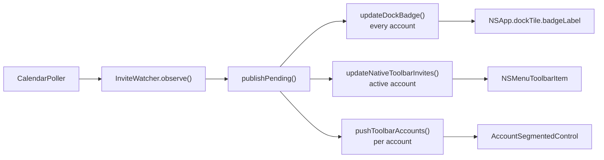

# Invitations awaiting a reply

`InviteWatcher` holds every invitation still awaiting a reply, and it is the only thing that counts
them. `CalendarService.publishPending()` reads that set out for the Dock badge, the toolbar dropdown
and the account switcher's dots, from the same array on the same call. No surface counts the event
cache again: `InviteWatcher` drops an invitation the moment one is answered from a banner, where the
cache still reports `needsAction` until the next read.



## Outstanding invitations

An event is awaiting a reply while its `myResponseStatus` is `RESPONSE_NEEDS_ACTION` (`0`). Accepted,
tentative and declined meetings do not count. Three further cases stay out:

- `'notInvited'` is not a guest's invitation. An event visible on a shared calendar the user is not a
  guest of does not owe them a reply.
- A meeting that has finished does not count. `observe` drops an occurrence whose `endTime` has
  passed.
- A recurring series counts once. `inviteKey` keys on `seriesId ?? id`, so a weekly meeting is one
  invitation rather than fifty-two.
- A series with any answered occurrence is not pending. A reply answers only its occurrence, and
  Google can leave `needsAction` on future ones; because the series is one invitation by key, a
  response anywhere in it settles the badge and the read state.

`inviteKey` produces `<sourceId>|invite|<seriesId>`, and `outstanding` is one map across every
source, holding every calendar an account subscribes to rather than the account's own alone.
Reaching `RESPONSE_NEEDS_ACTION` means the user is a guest of the event, so the invitation owes a
reply wherever its calendar lives.

The next occurrence stands for the series. `observe` keeps the earliest occurrence that has not yet
finished, which dates every row by when the meeting next is. The poller expands a year ahead, so a
weekly meeting yields about fifty-two occurrences per poll under one key, and taking whichever
arrived last would date a standup next June.

`observe` takes the full window after every poll and returns only what arrived, which is the set the
banner posts for. The first observation of a source seeds instead: its pending set is recorded
silently, and only what appears afterwards counts as an arrival. That separation is
[`notifications.md`'s Invite watcher](notifications.md#invite-watcher).

## Dock badge

`publishPending()` passes the count to `updateDockBadge`, which keeps none of its own.

```ts
export function formatRsvpBadge(count: number): string | null {
  if (count <= 0) return null;
  if (count > 99) return '99+';
  return String(count);
}
```

`null` clears the badge, so answering the last invitation leaves the tile bare. The label goes to
`addon.setDockBadge`, which reaches `dock_tile_set_badge` in `DockTileBridge.swift` and assigns
`NSApp.dockTile.badgeLabel`; `updateDockBadge` falls back to `app.dock.setBadge` when the native
addon will not load.

The badge belongs to the app, so it counts every account. It is the number the user sees with the
window closed, and it states how much is waiting for them rather than how much is waiting on
whichever account happens to be open.

## Toolbar dropdown

The dropdown sits in the window showing one account, so it lists that account alone; offering to
answer an invitation that is not in the calendar behind the window invites a reply from the wrong
identity. It is an `NSMenuToolbarItem` with the identifier `invites`, built in `ToolbarBridge.swift`.

- The count rides on the item as its `title`, following `dockBadgeMode`: unread arrivals in
  `newInvitations` mode, the whole pending pile in `allPending` mode.
- The symbol switches between `tray` and `tray.full`. The item is never disabled, so an empty pile
  opens onto a menu that says `No Invitations`.
- Each invitation is one `NSMenuItem` whose submenu carries Accept, Maybe, Decline, Mark as Read and
  Open in Calendar.
- An invitation already read is drawn in `secondaryLabelColor` through `attributedTitle`. The rows
  left in full colour are exactly the ones `dockBadgeMode` `newInvitations` counts, because both read
  `isNewArrival`.
- `Mark as Read` sits in the submenu, beside the answers, because an `NSMenuItem` cannot carry a
  context menu of its own. `Mark All as Read` closes the dropdown's own menu and appears only while
  something is unread.
- `NSMenuItem.subtitle` carries the start time. It arrived in macOS 14.4 and the deployment target is
  14.0, so below that the same text is folded into the title.
- Titles pass through `truncateTitle`, which cuts at 40 characters and backs off to a word boundary
  where there is one near the cut, because an `NSMenu` is as wide as its widest item.

The account name is not shown, because every row belongs to the account already named in the
switcher.

`publishPending()` sends the whole list on every change, never a diff. It is a couple of dozen
entries at most, and a menu rebuilt from the same array that produced the badge cannot drift apart
from it.

```plain text
publishPending() -> updateNativeToolbarInvites(json)
                 -> addon.updateInvites(json)
                 -> toolbar_update_invites  (dlsym)
                 -> ToolbarManager.updateInvites(json:)
```

`updateInvites` is looked up with `dlsym` but left out of the required-symbol check, so an older
dylib still loads and has no dropdown.

A choice returns through the toolbar action callback as `invite:yes`, `invite:maybe`, `invite:no`,
`invite:read` or `invite:open`, carrying the invitation key as the action's value. `main.ts` routes
those to `CalendarService.handleInviteAction`. `Mark All as Read` carries no key and arrives as
`invitesReadAll`. The three answers go to the same `sendRsvp` the notification banners use, which
already holds a press made while an editor is open and falls back to opening the event when driving
Google's controls fails; see [`actions.md`'s Answering an invitation](actions.md#answering-an-invitation).

## Account switcher dots

Each segment of the account switcher carries the account's colour as a dot, filled when invitations
have arrived on that account and not been dealt with, and a ring otherwise. `newArrivalsByAccount()`
feeds it through `pushToolbarAccounts()` in `main.ts`, and `ToolbarAccount.unreadCount` carries the
number into AppKit. Magical sets `showUnreadCountsInSwitcher` to false, so the dot carries the state
alone without a count beside the account name.

The dot follows arrivals rather than the whole pile, whichever way `dockBadgeMode` is set. A dot fed
by the backlog would be filled permanently on any account carrying invitations the user has decided
to ignore. It clears the same two ways the arrivals do: answering, or marking read.

## What the badge counts

`dockBadgeMode` in Settings → Appearance chooses between two readings of the same set. Both modes
are Magimail's two under the same setting name; [`../magimail/notifications.md`'s What the dock badge
counts](../magimail/notifications.md#what-the-dock-badge-counts) owns the shared reading. Magical also
clears the second mode when the user marks invitations read, because it has a list to mark and
Magimail has nothing equivalent.

| Mode                   | Counts                                       | Clears when              |
| :--------------------- | :------------------------------------------- | :----------------------- |
| `allPending` (default) | every invitation still awaiting a reply      | the last one is answered |
| `newInvitations`       | invitations that arrived while you were away | answered, or marked read |

`newInvitations` (shown in Settings as **Unread invitations**) counts `arrivals`, which an invitation
joins only when a banner fires for it, so the backlog Magical absorbs silently on a first look never
enters. It applies to the Dock badge alone:
the dropdown lists the whole pile either way, because it is a place the user goes to deal with
invitations rather than one that calls them there.

Answering the invitation, here or from a banner or in Google, and marking it read from the dropdown
are the two things that take the number down. Marking read reaches only the active account, because
that is all the dropdown shows. Opening the dropdown does not mark anything read. `arrivals` is
persisted beside the fired-alert record in `alert-state.json`, because the badge outlives the
process: quit with two unanswered arrivals and the badge reads 2 on the next launch.

## Answering an invitation

Three paths answer an invitation through Magical, and every one of them ends in `deliverRsvp`: the
dropdown's `invite:yes`, `invite:maybe` and `invite:no` through `handleInviteAction`, a banner's
`rsvp:*` through `onAlertAction`, and the menu bar popover's `answerRsvp`, which derives the key from
the cached event because it knows the event and not the invitation.
[`actions.md`'s Answering an invitation](actions.md#answering-an-invitation) owns what `deliverRsvp`
does with the page, the three outcomes and the held retry.

What belongs here is the pile. An `ok` outcome calls `invites.resolve(key)` and `publishPending()`, so
the badge and the dropdown drop the invitation before the next poll. A reply covers one occurrence
and Google leaves the rest of the series needing one, which the pending rule above absorbs: the series
stays out of the pending set once any occurrence has been answered.

Answering in Google or on a phone never reaches Magical. `observe` no longer sees the invitation as
pending at the next poll, so it leaves `outstanding`, and the key is forgotten so a genuine
re-invitation is announced again.

The watcher has three removal paths, and they differ in what they leave behind:

- `resolve(key)` drops the key from `outstanding`, `announced` and `arrivals`. The dropdown's answer, a
  banner, the popover and a queued RSVP that lands all end here.
- `markRead(key)` removes the key from `arrivals` alone, leaving the invitation in the pile for an
  answer. `handleInvitesReadAll` calls `acknowledge`, which does the same for every arrival on the
  active account.
- `forget(sourceId)` drops everything belonging to an account that has been removed, and takes the
  source out of the seeded set as well. Without it the badge shows a number the user cannot clear,
  because no later poll will report those invitations answered, and re-adding the account absorbs its
  backlog silently instead of posting a banner per outstanding invitation.

## Every path that moves the number

`publishPending()` is the only caller of `updateDockBadge`, `updateNativeToolbarInvites` and the
switcher refresh. Every path that can change the pile ends there:

| Trigger                              | What it does to the outstanding set                                 |
| :----------------------------------- | :------------------------------------------------------------------ |
| A poll completes                     | `observe()` recomputes it for that source                           |
| An invitation is answered in Magical | `resolve(key)` drops it, from a banner, the dropdown or the popover |
| A queued RSVP lands                  | `resolve(key)` drops it once Google accepts the answer              |
| An account is removed                | `forget(sourceId)` drops everything belonging to it                 |
| An invitation is marked read         | `markRead(key)`, or `acknowledge(sourceId)` for the whole list      |
| A meeting finishes                   | The next poll drops it, once its last occurrence has passed         |
| The active account changes           | Nothing; the dropdown re-filters, the badge holds                   |

Two rows wait for a poll, which can be fifteen minutes away on battery: a meeting finishing, and an
answer given outside Magical. Every other press reaches `publishPending()` as it lands, because the
watcher drops the invitation the moment its surface reports it.
