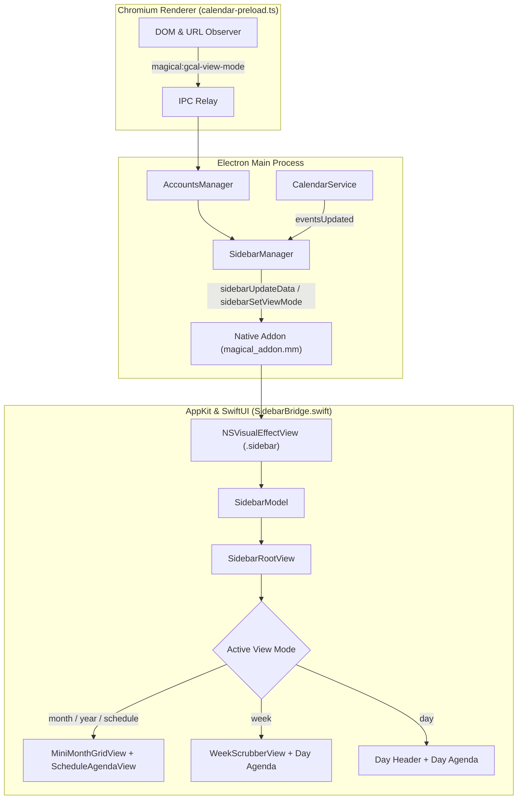

# Companion sidebar

The companion sidebar is a native macOS SwiftUI surface anchored to the side of the Google
Calendar web view. It adapts its contents to match Google Calendar's active timeframe, displays
event density and schedules, and folds smoothly in and out without reloading web contents.

## Window layout and animated folding

The sidebar occupies a fixed width of 280pt (`SIDEBAR_WIDTH`) along the right edge of the main
window. The main window dimensions remain 1280x820pt (`minWidth: 1280`).

When the sidebar is visible, `window-layout.ts` splits the window's content area below the 52pt
native toolbar:

- The active `WebContentsView` spans from `x = 0` to `width = windowWidth - 280`.
- The native AppKit container (`NSVisualEffectView` with `.sidebar` vibrancy) spans from
  `x = windowWidth - 280` to `width = 280`.

When collapsed, the `WebContentsView` expands to fill the full width of the window, and the sidebar
frame collapses to `width = 0`.

Folding and unfolding animate smoothly across 250ms via AppKit's `NSAnimationContext` (`easeInEaseOut`),
synchronising the `animator().frame` of both views.

### Toggling visibility

Sidebar visibility is toggled through three access points:

- Keyboard shortcut `Cmd+\` (View → Toggle Sidebar).
- Native toolbar button `sidebar.right` (labelled "Toggle Sidebar").
- Menu item `View → Toggle Sidebar`.

Visibility is persisted in the global settings store under `sidebarVisible` (defaults to `true`).

## View mode detection

Google Calendar is a single-page application that changes timeframes without document reloads.
`calendar-preload.ts` observes view changes through two complementary mechanisms:

1. **Navigation events**: Listening to `did-navigate-in-page` and URL changes under `/calendar/u/<n>/r`.
2. **DOM attributes**: Observing attribute changes on `div[data-viewkey]` and grid containers using a
   debounced `MutationObserver`.

`calendar-routes.ts` decodes the URL and viewkey into a canonical `CalendarRouteInfo`:

- `month`, `year`, `schedule` (or `agenda`): large timeframe overviews.
- `week`, `customweek`: multi-day grids.
- `day`, `customday`: single-day views.

When the timeframe changes, `calendar-preload.ts` emits `magical:gcal-view-mode` over IPC to the main
process. `SidebarManager` receives the payload and pushes the mode and anchor date to the native
layer via `sidebarSetViewMode`.

## View modes and presentations

`SidebarRootView` switches its layout based on the active mode in `SidebarModel`:

### Fantastical style (Month, Year, Schedule)

For high-level views where fitting a calendar grid into 280pt is impractical, the sidebar presents a
compact Fantastical-style layout:

- **`MiniMonthGridView`**: A compact month calendar displaying day numbers, selection highlights,
  and event density dots. Clicking the disclosure chevron collapses the grid to give more vertical space
  to the agenda.
- **`ScheduleAgendaView`**: A vertically scrollable list of upcoming events grouped by date.

### Week mode

When Google Calendar is in Week view, the sidebar shows:

- **`WeekScrubberView`**: A horizontal bar containing `<` and `>` arrow steppers to move between days,
  and seven day pills (Sunday through Saturday). Each pill renders the day initial, date numeral,
  event density dots, a filled accent disc for Today, and a selection outline for the active day.
- **Day agenda**: A vertically scrollable agenda showing the selected day's events.

### Day mode

When Google Calendar is in Day view, the sidebar displays:

- **Day header**: `< Today >` navigation controls displaying the full formatted date.
- **Day agenda**: A vertically scrollable agenda displaying the active day's events.

## Today highlight and Now indicator

Across all modes, the sidebar keeps the user anchored in time:

- **Today highlighting**: The current date is marked with a filled accent disc in the mini-month grid
  and week scrubber, and bold accent text in date gutters.
- **Now indicator**: When viewing today's events, a horizontal red rule (`nowRule`) indicates the
  current time position.

## Navigation and actions

Clicking an interactive element in the sidebar drives the main calendar view:

- **Date selection**: Clicking a date in the mini-month grid or week scrubber calls
  `navigateToDate(view, date)`, updating Google Calendar's SPA URL and grid in place.
- **Event selection**: Clicking an event card brings the main window forward and reveals the event.
- **Video calls**: Clicking a conference button on an event card immediately launches the meeting link
  in the default system handler.
