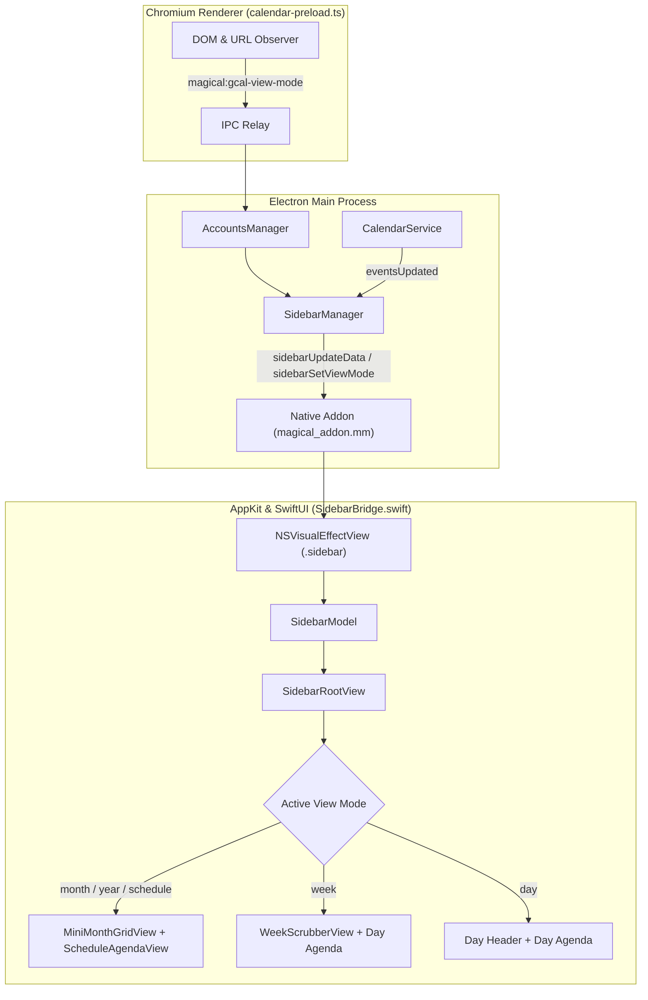

# Companion sidebar

The companion sidebar is a native macOS SwiftUI surface anchored to the side of the Google
Calendar web view. It adapts its contents to match Google Calendar's active timeframe, displays
event density and schedules, and folds smoothly in and out without reloading web contents.

## Window layout and animated folding

The sidebar occupies a fixed width of 340pt (`SIDEBAR_WIDTH`: a 324pt card plus 8pt margins) along
the right edge of the main window. The window opens at 1320x850pt, and its minimum width is 1320pt
with the sidebar visible (980pt of Google Calendar plus the sidebar) and 980pt with it hidden.

When the sidebar is visible, `window-layout.ts` splits the window's content area below the 52pt
native toolbar:

- The active `WebContentsView` spans from `x = 0` to `width = windowWidth - 340`.
- The native AppKit container (`NSVisualEffectView` with `.sidebar` vibrancy) spans from
  `x = windowWidth - 340` to `width = 340`.

When collapsed, the `WebContentsView` expands to fill the full width of the window, and the sidebar
frame collapses to `width = 0`.

Folding and unfolding animate smoothly across 250ms via AppKit's `NSAnimationContext` (`easeInEaseOut`),
synchronising the `animator().frame` of both views.

### Toggling visibility

Sidebar visibility is toggled through three access points:

- Keyboard shortcut `Cmd+\` (View → Toggle Sidebar).
- Native toolbar button `sidebar.right` (labelled "Toggle Sidebar").
- Menu item `View → Toggle Sidebar`.

Visibility is persisted in the global settings store under `sidebarVisible` (defaults to `true`).

## View mode detection

Google Calendar is a single-page application that changes timeframes without document reloads.
`calendar-preload.ts` observes view changes through two complementary mechanisms:

1. **Navigation events**: Listening to `did-navigate-in-page` and URL changes under `/calendar/u/<n>/r`.
2. **DOM attributes**: Observing attribute changes on `div[data-viewkey]` and grid containers using a
   debounced `MutationObserver`.

`calendar-routes.ts` decodes the URL and viewkey into a canonical `CalendarRouteInfo`:

- `month`, `year`, `schedule` (or `agenda`): large timeframe overviews.
- `week`, `customweek`: multi-day grids.
- `day`, `customday`: single-day views.

The route is not the authority on the date. Calendar changes view without changing the date in the
path, so `/r/month` can be showing any month and `/r/week` any week. The preload reads the packed
`data-datekey` cells inside `[role="main"]` and takes the displayed month from the grid
(`calendar-visible-range.ts`): month view fills its first and last weeks with days from the
neighbouring months, so the month with the most cells is the one on screen. A route date is used
when it falls in that month, which keeps the clicked day selected; otherwise the grid's month wins.
Today is only the fallback when nothing is rendered yet. That is what keeps the sidebar on the
range Google Calendar is showing rather than resetting to the current month.

When the timeframe or anchor date changes, `calendar-preload.ts` emits `magical:gcal-view-mode` over
IPC to the main process, carrying the mode, the anchor date and the first weekday read from the grid.
`SidebarManager` receives the payload and pushes all three to the native layer via
`sidebarSetViewMode`. A report with no anchor keeps the previous one, because changing view is not
changing date; a report with no first weekday leaves the last one alone, because a Day or Schedule
grid has nothing to read it from. A change of first weekday alone is enough to push, since Google
re-lays its grid out without moving the date when the setting changes.

## View modes and presentations

`SidebarRootView` switches its layout based on the active mode in `SidebarModel`:

### Fantastical style (Month, Year, Schedule)

For high-level views where fitting a calendar grid into 280pt is impractical, the sidebar presents a
compact Fantastical-style layout:

- **`MiniMonthGridView`**: A compact month calendar displaying day numbers, selection highlights,
  and event density dots. The grid shows the month Google Calendar is showing. Clicking the
  disclosure chevron collapses the grid to give more vertical space to the agenda.
- **`ScheduleAgendaView`**: A vertically scrollable list of upcoming events grouped by date. In
  Month view the list is bounded to the days the grid draws, including the leading and trailing
  weeks; in Schedule view it is the continuous agenda. Its event times and dates follow the Mac's
  clock and locale through `TimeDisplay`, like the menu bar's; see
  [`time-and-locale.md`](time-and-locale.md).

Selecting a day from the leading or trailing week of the grid (1 December while November is on
screen, say) moves the agenda to that day but leaves the grid on November. That day is inside the
grid, so its events are in the bounded agenda. The selection is local; Google Calendar is what
changes the month.

Schedule is the one timeframe with no bounded range of its own. Its month selector carries
`<`/`>` arrows like the Menu Bar Tray, enabled only between the first and last months the agenda
covers; Month and Year have no arrows, because Google Calendar owns their range. Scrolling the
agenda moves the selector with it.

Scrolling the agenda updates the selected day, and hovering a day's events draws that day in the
grid without moving the agenda: the two are `selectedDate` and `hoveredDate`, and only an explicit
click sets `requestedScrollDate`. Without that split, scroll tracking fed the selection back as a
scroll request and the highlight could not follow the feed. The Menu Bar Tray's agenda and mini month
behave the same way.

A filter toggle is pushed as a filter-only `sidebarUpdateData` carrying `hiddenCalendars`,
`hiddenCalendarsRevision` and `showCompletedTasks`, not the event list, so the tick does not wait on
serialising every event to reach the pane being watched.

Schedule's feed loads forward like the Menu Bar Tray's. Reaching the end calls
`requestMoreEvents`, deduplicated over 30 days, which reaches the main process as
`sidebarEnsureRange`: it fetches ±60 days around the date and widens the window `SidebarManager`
serialises, so the new events survive the payload filter. Month view is bounded by its grid and does
not ask for more.

### Week mode

When Google Calendar is in Week view, the sidebar shows:

- **`WeekScrubberView`**: A horizontal bar of seven day pills, running from Google Calendar's
  first weekday for that account to the day before it. Each pill
  renders the day initial, date numeral, event density dots, a filled accent disc for Today, and a
  selection outline for the active day. One horizontal swipe moves one day, and the gesture stops at
  the edge of the week Google Calendar is showing: the sidebar moves inside Calendar's range, it does
  not move Calendar to another week. A horizontal scroll over the card belongs to the sidebar only;
  the window-wide navigation monitor leaves it alone, so the same swipe cannot also change the period
  in Google Calendar.
- **Day agenda**: A vertically scrollable agenda showing the selected day's events.

### Day mode

When Google Calendar is in Day view, the sidebar displays:

- **Day header**: The full date for the day Google Calendar is showing.
- **Day agenda**: A vertically scrollable agenda displaying the active day's events.

## Today highlight and Now indicator

Across all modes, the sidebar keeps the user anchored in time:

- **Today highlighting**: The current date is marked with a filled accent disc in the mini-month grid
  and week scrubber, and bold accent text in date gutters.
- **Now indicator**: When viewing today's events, a horizontal red rule (`nowRule`) indicates the
  current time position.

## Navigation and actions

Google Calendar chooses the range; the sidebar follows it. Nothing in the sidebar navigates the web
view to another date.

That includes which day a week starts on. The strip, the mini month's lead padding and header row,
and `displayedMonthGridRange` all take their first weekday from the earliest `[role="main"]
[data-datekey]` cell Google has drawn, so the sidebar's week cannot drift from the week beside it.
The main process stores that weekday per account in `firstWeekdayByAccount`, and the helper draws
its first frame from the stored value; the Mac's own first day is only the answer on the first
launch for an account. Why the sidebar reads Google rather than the Mac, and what the popover and
widgets use instead, is in [`time-and-locale.md`](time-and-locale.md#first-day-of-the-week).

- **Date selection**: Clicking a date in the mini-month grid or week scrubber selects that day in the
  sidebar only. It never moves Google Calendar, so a day from the neighbouring month can be inspected
  in the agenda without the calendar jumping to it.
- **Bounded headers are labels**: In Day, Week, 4-Day, Month and Year, Google Calendar owns the
  range, so the title is not a control. Schedule has an agenda the selector can step away from, so
  its month title is a button calling `syncToGCalRange()` to return to Google Calendar's date.
- **Event selection**: Clicking an event card brings the main window forward and reveals the event.
- **Video calls**: Clicking a conference button on an event card immediately launches the meeting link
  in the default system handler.
