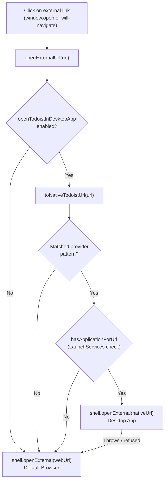

# Third-party integrations

Event descriptions and task bodies frequently contain links to external tools such as task managers,
issue trackers and project boards. When clicked in Google Calendar, these links open a browser tab
even if a native macOS desktop client is already installed. Magical intercepts external links before
they leave the application, rewrites recognised provider URLs into native custom URL schemes, verifies
with LaunchServices that the application is installed, and hands the link directly to the native client.

External link interception is unified in `openExternalUrl` in `links.ts`, covering both `window.open`
requests and top-level in-view navigations initiated from account WebContents.

## Supported providers

### Todoist

The Todoist integration intercepts task and project URLs copied from Todoist's web and desktop
clients, routing them to the native Todoist app (`todoist://`).

| Item        | Web URL format                                                                                                                      | Launched native URL         |
| :---------- | :---------------------------------------------------------------------------------------------------------------------------------- | :-------------------------- |
| **Task**    | `https://app.todoist.com/app/task/<id>` `https://todoist.com/app/task/<id>` `https://todoist.com/showTask?id=<id>`          | `todoist://task?id=<id>`    |
| **Project** | `https://app.todoist.com/app/project/<id>` `https://todoist.com/app/project/<id>` `https://todoist.com/showProject?id=<id>` | `todoist://project?id=<id>` |

Any URL with an unrecognized path (such as `/app/today` or marketing pages) or an unparseable ID is
passed through to the browser unchanged.

## LaunchServices verification and fallback

macOS LaunchServices maintains handler registrations per scheme. Asking LaunchServices whether a
handler exists prevents macOS from showing a system error dialog ("There is no application set to
open the URL") when the client is not installed.

1. **Pre-flight check**: `hasApplicationForUrl` in `native-handlers.ts` queries the native C++
   addon bridge (`NSWorkspace.URLForApplicationToOpenURL:`). Results are memoised per scheme for the
   duration of the application process.
2. **Launch failure fallback**: Even when registered, an application may fail or refuse to launch
   (e.g. if the application bundle was uninstalled without unregistering the URL scheme).
   `openExternalUrl` catches launch exceptions and falls back to opening the original web URL with
   `shell.openExternal(webUrl)`.

## User settings

The integration is enabled by default. Users who prefer opening tasks in a specific browser profile
can disable the behavior in Magical Settings:

- **Setting key**: `openTodoistInDesktopApp` (boolean, default: `true` in `settings.json`).
- **UI control**: **Open Todoist links in desktop app** under the **General** tab in the Swift
  settings window.
- **Helper IPC**: Emits `settings.changed` over newline-delimited JSON-RPC to the Electron main
  process when toggled, persisting changes immediately without requiring an application restart.
