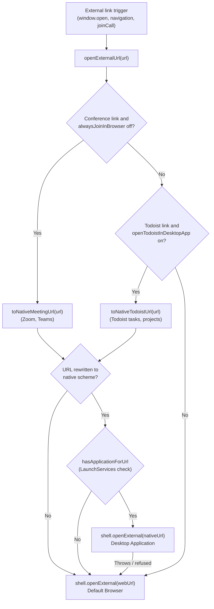

# Third-party integrations

Event descriptions, task bodies and meeting invitations frequently contain links to external
services such as video conference providers and task managers. When clicked in Google Calendar or
joined from a meeting control, these links open a browser tab even if a native macOS desktop client is
already installed. Magical intercepts external links before they leave the application, rewrites
recognised provider URLs into native custom URL schemes, verifies with LaunchServices that the
application is installed, and hands the link directly to the native client.

External link interception is unified in `openExternalUrl` in `links.ts`, covering `window.open`
requests, top-level in-view navigations (`will-navigate`), and conference join actions (`joinCall`).

## Supported providers

| Provider            | Web URL pattern                                                                                             | Native URL scheme                                      | Preference                                |
| :------------------ | :---------------------------------------------------------------------------------------------------------- | :----------------------------------------------------- | :---------------------------------------- |
| **Zoom**            | `zoom.us/j/<id>` `zoom.us/w/<id>`                                                                       | `zoommtg://zoom.us/join?action=join&confno=<id>&pwd=…` | `alwaysJoinInBrowser` (off by default)    |
| **Microsoft Teams** | `teams.microsoft.com/…` `teams.live.com/…`                                                              | `msteams://…`                                          | `alwaysJoinInBrowser` (off by default)    |
| **Todoist**         | `todoist.com/app/task/<id>` `app.todoist.com/app/task/<id>` `todoist.com/showTask?id=<id>`          | `todoist://task?id=<id>`                               | `openTodoistInDesktopApp` (on by default) |
| **Todoist**         | `todoist.com/app/project/<id>` `app.todoist.com/app/project/<id>` `todoist.com/showProject?id=<id>` | `todoist://project?id=<id>`                            | `openTodoistInDesktopApp` (on by default) |

### Zoom

`toNativeMeetingUrl` rewrites Zoom web join links (`zoom.us/j/<id>` and `zoom.us/w/<id>`) into
`zoommtg://zoom.us/join?action=join&confno=<id>`. When the original URL contains a password query
parameter (`?pwd=…`), it is extracted and appended as `&pwd=…` so joining does not prompt for a
passcode.

Conference discovery and join controls across the tray and notifications are documented in
[`conference-links.md`](conference-links.md).

### Microsoft Teams

`toNativeMeetingUrl` rewrites Teams meeting links on `teams.microsoft.com` and `teams.live.com` by
substituting the `https://` prefix with `msteams://`. Non-meeting paths (such as `meetingOptions/` or
dial-in numbers) are excluded by conference resolution before reaching the rewrite stage.

Conference discovery and join controls are documented in
[`conference-links.md`](conference-links.md).

### Todoist

`toNativeTodoistUrl` intercepts task and project links copied from Todoist's web and desktop
clients, converting them to `todoist://task?id=<id>` and `todoist://project?id=<id>`. Both current
single-page app routes (`/app/task/<id>`, `/app/project/<id>`) and web redirector endpoints
(`/showTask?id=<id>`, `/showProject?id=<id>`) are supported.

URLs with unrecognised paths (such as `/app/today` or marketing pages) and malformed IDs pass through
to the browser unchanged.

## LaunchServices verification and fallback

macOS LaunchServices maintains handler registrations per URL scheme. Launching an unregistered custom
URL scheme directly causes macOS to display an error modal ("There is no application set to open the
URL"). Magical verifies client availability before dispatching:

1. **Pre-flight check**: `hasApplicationForUrl` in `native-handlers.ts` queries the native C++ addon
   bridge (`NSWorkspace.URLForApplicationToOpenURL:`). Results are memoised per scheme for the
   duration of the application session, avoiding redundant LaunchServices lookups.
2. **Missing client fallback**: When LaunchServices reports no registered application, `openExternalUrl`
   dispatches the original web URL with `shell.openExternal(webUrl)` to open the system default browser.
3. **Launch failure fallback**: An application registration can outlive the bundle it points to. If
   `shell.openExternal(nativeUrl)` throws or is refused, `openExternalUrl` catches the error and
   falls back to opening the web URL in the browser.

## User settings

Both integrations are configurable in Magical Settings and take effect immediately without restarting
the application:

- **Always open calls in the browser**: Key `alwaysJoinInBrowser` (boolean, default: `false`). Located
  under **Joining calls** in the settings window. When enabled, Zoom and Teams links bypass native
  scheme rewriting and open directly in the browser.
- **Open Todoist links in desktop app**: Key `openTodoistInDesktopApp` (boolean, default: `true`).
  Located under **General** in the settings window. When disabled, Todoist links remain unchanged and
  open in the default browser.
- **Helper IPC**: Toggling either control sends a `settings.changed` notification over JSON-RPC from
  the Swift helper to the Electron main process, persisting the change to `settings.json` immediately.
