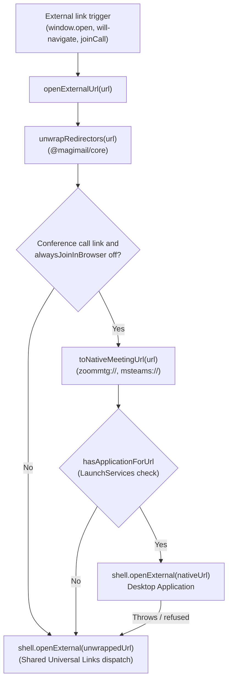

# Third-party integrations

External links clicked in Google Calendar pass through `openExternalUrl` in `links.ts`.
Tracking redirectors are unwrapped using `@magimail/core`, and meeting links (Zoom and Microsoft
Teams) are rewritten to native desktop schemes when enabled.

The shared redirector unwrapping and Apple Universal Links resolution mechanism is documented in
[`../shared/third-party-links.md`](../shared/third-party-links.md).

## Desktop apps via Universal Links

Magical delegates external link unwrapping and desktop app dispatch to the shared implementation in
[`../shared/third-party-links.md`](../shared/third-party-links.md). Outbound links in event
descriptions and tasks have Google tracking prefixes stripped via `@magimail/core`, allowing macOS
Universal Links to open native desktop clients (such as Todoist, Notion, Linear, Figma, and Slack)
without opening a browser tab. Non-meeting URLs require no bespoke custom schemes or user toggles.

## Video conference schemes

Unlike modern web tools using Universal Links, video conferencing platforms rely on custom URL schemes:

| Provider            | Web URL pattern                                | Native URL scheme                                      | Preference                             |
| :------------------ | :--------------------------------------------- | :----------------------------------------------------- | :------------------------------------- |
| **Zoom**            | `zoom.us/j/<id>` `zoom.us/w/<id>`          | `zoommtg://zoom.us/join?action=join&confno=<id>&pwd=…` | `alwaysJoinInBrowser` (off by default) |
| **Microsoft Teams** | `teams.microsoft.com/…` `teams.live.com/…` | `msteams://…`                                          | `alwaysJoinInBrowser` (off by default) |

### Zoom

`toNativeMeetingUrl` rewrites Zoom web join links (`zoom.us/j/<id>` and `zoom.us/w/<id>`) into
`zoommtg://zoom.us/join?action=join&confno=<id>`. When the original URL contains a password query
parameter (`?pwd=…`), it is extracted and appended as `&pwd=…` so joining does not prompt for a
passcode.

Conference discovery and join controls across the tray and notifications are documented in
[`conference-links.md`](conference-links.md).

### Microsoft Teams

`toNativeMeetingUrl` rewrites Teams meeting links on `teams.microsoft.com` and `teams.live.com` by
substituting the `https://` prefix with `msteams://`. Non-meeting paths (such as `meetingOptions/` or
dial-in numbers) are excluded by conference resolution before reaching the rewrite stage.

Conference discovery and join controls are documented in
[`conference-links.md`](conference-links.md).

## LaunchServices verification and fallback

macOS LaunchServices maintains handler registrations per custom URL scheme. Launching an unregistered
custom URL scheme directly causes macOS to display an error modal ("There is no application set to open
the URL"). Magical verifies custom meeting schemes before dispatching:

1. **Pre-flight check**: `hasApplicationForUrl` in `native-handlers.ts` queries the native C++ addon
   bridge (`NSWorkspace.URLForApplicationToOpenURL:`). Results are memoised per scheme for the
   duration of the application session, avoiding redundant LaunchServices lookups.
2. **Missing client fallback**: When LaunchServices reports no registered application, `openExternalUrl`
   dispatches the unwrapped web URL to open the system default browser.
3. **Launch failure fallback**: An application registration can outlive the bundle it points to. If
   `shell.openExternal(nativeUrl)` throws or is refused, `openExternalUrl` catches the error and
   falls back to opening the unwrapped web URL in the browser.

## User settings

Meeting schemes are configurable in Magical Settings:

- **Always open calls in the browser**: Key `alwaysJoinInBrowser` (boolean, default: `false`). Located
  under **Joining calls** in the settings window. When enabled, Zoom and Teams links bypass native
  scheme rewriting and open directly in the browser.
- **Helper IPC**: Toggling the control sends a `settings.changed` notification over JSON-RPC from the
  Swift helper to the Electron main process, persisting the change to `settings.json` immediately.
