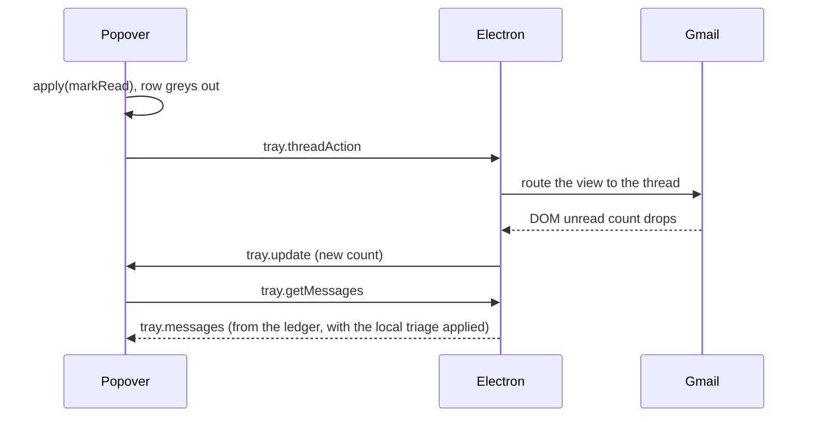

# Acting on a message or thread

Magimail acts on Gmail by clicking Gmail's own controls in the account's live view; it renders no
action UI of its own. The main window toolbar, a notification's buttons, a menu bar popover row and
a `magimail://thread/<id>` link all end at the same click inside the page — or, for triage, at the
same `/sync/` write from the main process.

## Action set

Gmail's toolbar identifies its controls with an `act` attribute, verified against the live DOM:

| `act` | Control        |
| :---- | :------------- |
| 1     | Mark as read   |
| 2     | Mark as unread |
| 7     | Archive        |
| 8     | Move to Inbox  |
| 9     | Report spam    |
| 10    | Delete         |

Compose carries no `act` number; it is the `gh="cm"` control.

`apps/magimail/dom-labels.json` maps Magimail's actions onto Gmail's controls: Archive (`act="7"`),
Delete (`act="10"`), Mark as read (`act="1"`), Mark as unread (`act="2"`), Compose (`gh="cm"`) and
the rest. Move to Inbox and Report spam are Gmail controls Magimail does not click.

Every action resolves through one of two bands, and the map records which. A strong hook is used
wherever Gmail left one — an `act` number, `gh`, a `name` — and a localised label only where it left
none. An action sets exactly one of `selectors` or `labels`, never both, so a hook miss is a miss
rather than a guess at a label; there is no comma-joined fallback left to resolve in _document
order_. The page-side resolver is `findAction`, carried by `DOM_DRIVE_PREAMBLE`, which returns the
element and the band that matched it; `validateDomActionMap` runs the map at load and throws on a
defect. The shape and rules are [`dom-labels.md`](../shared/dom-labels.md).

The thread toolbar carries no labels: no `aria-label` and no `data-tooltip` on the `act` element,
its ancestors or its descendants. The `act` number is the only thing that identifies a control
there, so every action the toolbar offers is a hook.

## Two dispatch functions

`triggerMailAction(action, accountId?)` clicks the control in the account's live view. It drives
Gmail's own toolbar, so it hits whatever is selected there. The main window toolbar uses it for
Archive, Delete, Compose and reply, because the selection on screen is exactly what those buttons
should act on. Reply, reply to all and forward are the map's label actions: Gmail renders each as a
`span[role="link"]` with no `aria-label`, no `data-tooltip` and no `act`, so a localised label is
its only handle. Each sets `order: 'last'`, because one set of controls renders per message and
replying means replying to the newest: a floating `aria-label="Reply"` button is laid out too, but
it precedes the per-message controls in document order, so the last laid-out match is the message's
own control.

`performThreadAction(accountId, threadId, action)` takes a thread id. If `action === 'open'`, it
raises the window, switches to the account, routes the view to the thread, and brings it into focus.
For triage actions (`archive`, `trash`, `markRead`, `markUnread`), it delegates to the account's
`MailboxSource`, whose `ThreadActionDriver` is the fallback stack (`createDefaultThreadActionDriver`):
the direct driver and the DOM driver, tried in order.

1. **Primary (`SyncThreadActionDriver`)**: Posts the mutation to Gmail's internal `/sync/u/<n>/i/s`
   from the main process, mapping Gmail's legacy hex thread id onto the decimal reference that
   protocol names. It needs no renderer: the partition's cookies authenticate the request and the
   headers Gmail's own `/sync/` traffic carried are replayed from `gmail-sync-state.ts`. The thread
   changes without routing the viewport or flashing the UI.
2. **Fallback (`DomThreadActionDriver`)**: If the direct write returns false or throws, it wakes the
   account's own view, routes it to the thread, clicks the control in the thread toolbar, and routes
   back to where it interrupted.

The direct write changes the server, but Gmail's own client never hears about it, so nothing in the
page has fetched the new state. When the account already has a view open, the driver therefore presses
Gmail's toolbar refresh control (`div[act="20"]`) so the open list re-renders without a page reload.
With no view there is nothing to refresh, and the next open reads the new state anyway.

`gmail-sync-state.ts` records the headers Gmail's own `/sync/` request carried. It watches
`session.webRequest.onBeforeSendHeaders`, not the request body, because `X-Framework-Xsrf-Token` rides
in the headers and `onBeforeRequest` never sees them. `Origin`, `Referer` and the `sec-fetch-*` family
are replayed verbatim, which is what makes a main-process fetch match the page's own. The capture is
keyed by partition, so it outlives the page. Measured on a live account: the XSRF token did not change
across a page reload, so it is scoped to the session rather than the page load.

A notification's buttons, a `magimail://thread/<id>` triage link and `tray.threadAction` all reach
the account's `MailboxSource`, which runs this driver stack. `THREAD_ACTIONS` names the set once for
all of them (open, archive, trash, mark read, mark unread),
and `TRIAGE_ACTIONS` is that set without open. Only open asks to look at something: it raises the
window and changes the account on screen, while triage must not — and does not need a renderer to not
do it.

## Where an action is triggered

### Main window toolbar

The `NSToolbar` buttons call `triggerMailAction`, so they act on the current selection. Archive,
Delete and Mark Read stay enabled on a list view because they act on a list selection too, while
Print and Share are disabled without an open message and the reply group is enabled from what the
open thread actually renders.

### A notification's action buttons

A banner carries three actions from `UNUserNotificationCenter`: Archive, Mark Read, and Delete, which
is marked destructive. Tapping the banner itself opens the thread. The helper sends `notify.action`
(or `notify.click` for the tap) with the account and message id, and the main process routes it
through the account's `MailboxSource` — for the tap that means building the window, because opening
asks to look at the message.

### A menu bar popover row

Right-clicking a row archives, trashes, marks read or marks unread without opening the thread, so the
three newsletters at the top of the list can be cleared from the popover. Left-click still opens, and
the menu leads with that. The row sends `tray.threadAction`.

### A `magimail://thread/<id>` link

`?action=` names what to do with the thread, defaulting to opening it. The same set a notification's
buttons offer is reachable without one, so a Focus Filter, a script or a Shortcut can triage a named
thread directly. The action is read before anything is built, because whether the link is triage
decides whether a window is needed at all.

### With no window open

Every one of the four arrives from outside the window, and the window may not exist: a banner outlives
the window that scheduled it, and with the menu bar tray off, closing the window really closes it
(`accountsManager = null`) rather than hiding it. Each entry point therefore serves itself instead of
returning early on the null — a press that silently did nothing is the same class of failure as an
alert that never fires.

Triage is routed to the account's `HybridFeedSource` for a notification button, a
`magimail://thread/` triage link and `tray.threadAction`. Its driver tries the direct `/sync/` write
first, which needs no view, so a triage that lands costs one POST and nothing appears. A write the
direct driver cannot do, because the partition has no captured `/sync/` headers or Gmail refused the
mutation, wakes the account's view through the renderer pool (`wakeAccountForAction`) and drives the
DOM, so the page can be driven without being looked at. A view that never becomes ready fails the
action rather than being raised.

Triage never raises one. `performThreadAction` raises the window itself for `open`, and everything
that asks to look at something — an open, an account row, a compose, a search, a triage link that
names no account to write against — goes through the window that resolves it and raises it directly.

A window Magimail builds hidden is told so through `handleWindowHidden`, so its account ages out like
any other; see
[`window-lifecycle.md`'s Account renderer lifetime](../shared/window-lifecycle.md#account-renderer-lifetime).

## Read state

Mark read clicks nothing in a thread. A thread offers no mark-as-read control, because opening the
thread is what marks it read; Gmail shows mark-as-**unread** (`act="2"`) instead. A `markRead` on a
thread therefore routes there and stops: the route itself is the action. Marking unread rides on the
same fact from the other side, since the route marks the thread read whether it was or not, and
clicking `act="2"` is what puts it back.

Read and unread are a single toggle in the message list. Gmail renders both controls and lays out
only the one the selection's state calls for, so `toggleReadState` clicks whichever is on screen. The
popover row's menu works the same way: Archive, then whichever of Mark as Read and Mark as Unread the
row is not already in, then Delete under a divider.

## Routing an account's view to a thread

`performThreadAction` routes the view to the thread before it clicks — for `open`, and for triage when
the sync request is unavailable and the DOM fallback takes over. The route carries most of the care.

### Navigating by hash

Gmail's live URL carries a query (`?pli=1`) that the thread URL does not, so `loadURL` differs from
the current document by more than its fragment and reloads the page, which tears down any open
compose. Assigning `location.hash` in the page is always a same-document route, and Gmail merges the
two states itself: the hash becomes `#inbox/<thread>?compose=<draft>`, leaving a docked compose or an
inline reply untouched. Measured: text typed into either survives the route, including inside Gmail's
autosave debounce.

### Detecting arrival

Gmail's legacy hex thread id cannot confirm arrival. Gmail resolves the id and rewrites the
hash to its own canonical form (`#inbox/FMfcgz…`) about 100ms later, so the id asked for stops
appearing in the URL at precisely the moment the thread appears on screen; a gate waiting for that id
never fires, times out, skips the action, and leaves the thread it opened marked read.

The URL alone is no better: it reads as a thread route the instant the hash is assigned, while the
list is still on screen and the toolbar is still laid out, so a visible Archive button is no evidence
the right thread is up, and acting on button visibility alone archives or deletes whatever the view
was showing before.

Arrival is therefore a thread route plus a title that has moved, checked against the `webContents` in
the main process rather than inside the page, which lets it reuse `isThreadUrl` instead of restating
that pattern in injected script. `routeToThread` sets the hash and then waits inside the page for
`document.title` to leave what it was, through `waitUntil`. The thread id is deliberately not part of
the test. The title is re-baselined on each pass, so a render landing somewhere that is not a thread
waits for the next move rather than returning, and cannot spin, because every pass needs a fresh
title. A route that never lands performs no action and restores the previous hash. Settling is kept
separate and best-effort: a route that arrives and then keeps redrawing is still a route that
arrived, and failing it would report a thread the caller had reached as one it never got to.

### Acting on an account that is not on screen

Hiding the window releases the account on screen too (see
[`window-lifecycle.md`'s Account renderer lifetime](../shared/window-lifecycle.md#account-renderer-lifetime)).
Without that, a toolbar button or a menu command after `inactiveAccountSuspendMinutes` of a tray-only
window would drive a view that was never attached and never loaded a page.

Every entry point that drives a view therefore goes through `wakeAccountForAction`, which is the
contract `performThreadAction` and its siblings use. It hands the pool Magimail's own sign-in page and
its wait for Gmail's chrome (`[role="main"]` or `[gh="cm"]`), and its `release` re-arms the
inactivity timer. A `triggerMailAction`, a read toggle, a search focus, a compose pop-out and a
`magimail://thread/` link all wake the same way; `reloadActiveViewOnResume` does too, so a system
resume reloads a renderer rather than silently doing nothing.

Triage does not wake the account for the direct write. It needs no view, and the DOM fallback wakes one
inside the driver, so a triage the direct write lands never builds a renderer at all; one it cannot do
builds a background window, whose account ages out through `handleWindowHidden` like any other hidden
one.

Waking the renderer is not enough on its own. `updateLayout` sizes only the account on screen, so a
background account's view has no parent and a 0x0 viewport, and Gmail renders no thread toolbar into
nothing. For the length of the action `sizeForBackgroundAction` attaches the view at the bottom of the
stack, gives it the same rect as the account on screen and hides it with `setVisible(false)`, so it
lays out at the window's size without being drawn, then takes it out again. Placing it beside the
window instead does not work; bounds outside the parent are clipped back to nothing.

### A thread already on screen

If the active view is already displaying the notification's thread, `performThreadAction` runs the
toolbar click directly: it does not assign `location.hash` and does not restore the previous hash.
Opening or marking read an already-visible thread returns immediately.

Which thread is on screen cannot be read from the URL alone, for the id rewrite
[Detecting arrival](#detecting-arrival) covers. `isShowingThread` therefore asks the document as well,
where the rendered thread still carries `data-legacy-thread-id` and `data-legacy-message-id`. The DOM
alone is not enough either, because a message listed in the inbox carries those same attributes on
its row; the DOM only counts when the view is on a thread route to begin with.

### Refusing to route over unsaved work

`routeToThread` verifies that the view is not holding unsaved work before mutating the hash. It
refuses to route if the URL is in settings (`location.hash.startsWith('#settings')`), if a modal
dialog is open (`[role="dialog"]`), or if any input, textarea, or contenteditable element has focus
or holds text.

Routing is refused whenever the view holds something a route would interrupt, and an open compose is
the common case rather than the exception, so a dropped press would make triage silently do nothing
whenever the user happens to be writing. `performThreadAction` queues the refused action instead,
retries every 5 seconds once the view is free, and gives up after 15 minutes. Opening is deliberately not held: it asks to look at something now, and raising the
window five minutes later over whatever the user moved on to is worse than not moving at all.

The guard only applies to routing. An action on the thread already displayed clicks its toolbar
control directly, which navigates nowhere and so cannot disturb a compose; that is why archiving the
thread you are reading works while you are writing a reply to it.

### Confirming Gmail accepted the click

Restoring the previous hash immediately after clicking an action button aborts in-flight network
requests. `clickThreadControl` drives the toolbar via `@magimail/core`'s `DOM_DRIVE_PREAMBLE`:
`resolveOrdered` finds the candidate button, and `clickAndConfirm` dispatches input events and waits
for evidence that Gmail accepted the mutation (the button is removed or hidden, or the combined text
of live regions changes from its pre-click snapshot). Once confirmed, `waitUntil` requires DOM
mutations to quieten for 250 ms before restoring the route. Gmail never confirming is logged rather
than passed over, because a wait that stops waiting looks exactly like one that succeeded.

The text is compared against a snapshot rather than tested for presence. Gmail keeps its live regions
in the document permanently and the first of them is empty, so asking whether one exists, is laid out
or holds text answers yes on an idle page, before anything has been clicked.

`restorePreviousRoute` then checks whether the document is still on the thread routed for the action.
If the user clicked to another message or switched folders while the action was running, their active
route is preserved. It identifies the thread the same way `isShowingThread` does, by the hash or the
ids in the DOM; comparing hashes alone reads Gmail's own rewrite as the user having moved, and
abandons every restore.

### Serialising rapid actions

Quick successive clicks from Notification Center could race route changes against one another. An
action queue (`mailActionQueue`) drains actions in order with an inter-action tick, rather than
letting overlapping operations collide.

## Popover triage feedback

Unlike every other row action, triage does not dismiss the popover. Triage comes in runs, and closing
after each action would mean reopening it to reach the next row.

`TrayModel.apply` marks the row read in the helper's own row state as the action is sent, rather than
waiting for the poll that will confirm it. A poll is far enough away that a row left unread reads as
the click having missed. An archived or trashed row stays in the list as read rather than
disappearing, matching how the ledger treats a reduced thread; the list does not reshuffle under the
pointer mid-triage. See [`unread-counts.md`](unread-counts.md#local-actions-and-grace).

The count follows on its own. Acting on the thread routes the account's live view to it, and the
status item counts on the same terms as the account switcher: both read the account's ledger, so a
background account and a thread marked read in the main window count the same way. See
[`unread-counts.md`](unread-counts.md). `tray.threadAction` still nudges that account's poller once
the action has run, for the categories Gmail is not showing: the sidebar can only report the rows it
renders.

`apply` records the state as well as showing it, and `setMessages` re-applies the record over every
list that arrives:

Acting on a thread moves an unread count, a changed count pushes fresh tray data, and
`MenuBarController.updateData` answers that by asking for messages again while the popover is open.
Electron serves that from the account's `UnreadLedger` when the popover asks. The ledger keeps the
optimistic triage state over its rows until a source fresh enough to include the action confirms or
contradicts it. The row therefore reads the way the user acted on it, not the way a lagging source
still reports it.

A record settles as soon as the incoming list says the same thing: a thread marked read is settled once it
drops out, one marked unread once it is listed again. Anything still waiting after
`TrayModel.localStateGrace`, 30 seconds, is dropped anyway, so an action Gmail never applied stops
claiming to have worked.
