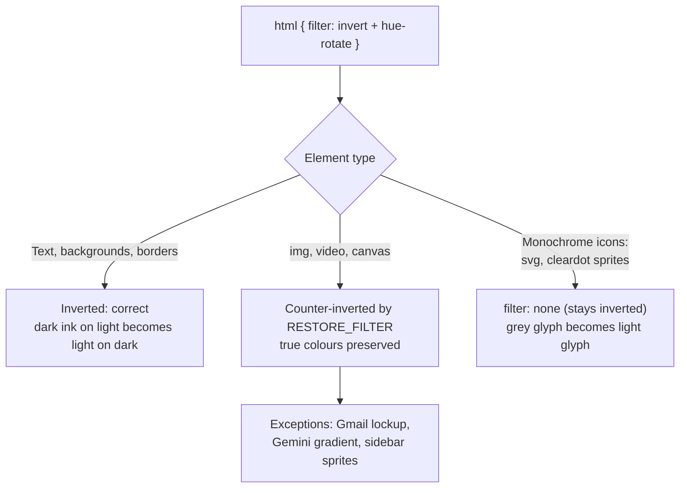

# Dark mode

Magical's dark mode is free: Google Calendar honours `prefers-color-scheme`, so one line of
`nativeTheme` does it (see [`design.md`'s native dark mode sync](../shared/design.md#native-dark-mode-sync-magical)).
Gmail offers nothing equivalent, so everything below follows from that.

## Gmail ignores the system theme

Gmail cannot be switched into dark mode from the client, so Magimail inverts the page instead.

Emulating light and then dark over the page with Magimail's own CSS disabled left every computed
style identical: body, banner, navigation, main and row backgrounds and colours alike. Of the 47
rules mentioning `prefers-color-scheme` among the 31,342 Gmail loads, 45 are gated behind
`forced-colors: active`, which is Windows high-contrast mode and has nothing to do with appearance;
the remaining two set a single SVG fill.

Gmail's own dark theme is a server-side account preference, set under Settings → Themes. There is no
cookie, no URL parameter and no local switch: on a light-theme account Google serves no dark palette
at all, so there is nothing client-side to flip. It is also the wrong setting, because it applies
once per Google account and follows the user to their phone and every browser they sign into; it
cannot follow macOS appearance, and Magimail's per-account partitions cannot scope it.

## Filter chain

Dark mode is two filters in opposition: the page is inverted wholesale, then the things that must
keep their true colours are inverted back.

```css
html {
  filter: invert(1) hue-rotate(180deg) brightness(1.2) contrast(0.85) saturate(1.1);
}
img,
video,
canvas,
svg {
  filter: saturate(0.909091) contrast(1.176471) brightness(0.833333) hue-rotate(180deg) invert(1);
}
```

The second is exported as `RESTORE_FILTER`. It undoes the brightness, contrast and saturation
adjustments as well as the inversion, so a counter-inverted image lands back on its original colours
rather than on a washed-out approximation; a plain `invert(1)` in its place would not. Adapted from
[gmail-auto-dark-mode](https://github.com/renefs/gmail-auto-dark-mode) (MIT).

An element is either inverted with the page or restored to its authored colours, and neither is right
for everything. A photograph must be restored. A dark-grey icon glyph must not, because restoring it
paints dark grey onto a dark background.



## What the counter-invert leaves alone

Gmail draws every icon in its chrome one of exactly two ways: an inline `<svg>`, or a 1×1
`cleardot.gif` spacer carrying a CSS sprite as its background image. Both are monochrome, both must
take the page inversion, and neither may be counter-inverted. That is the whole of the exemption:

```css
[role='toolbar'] svg,
[role='button'] svg,
…,
img[src*='cleardot'] {
  filter: none !important;
}
```

Nothing else may join that list. Measured on a live inbox, 29 of 229 interactive controls carry an
`<svg>` and 59 carry a cleardot sprite. The only controls holding a real `` are the account
avatar and emoji reactions, which are precisely the images that must keep their colours.

Scope the exemption too narrowly and Gmail's action icons render dark grey on the dark background,
invisible. Scope it by container (`[aria-label] img`, `a img`, `div[role="main"] [aria-label] *`) and
it matches almost the whole page, so 103 of the page's 112 images lose their counter-invert and the
account avatar, the Gmail lockup, attachment file-type icons and inline mail images all render
colour-inverted. What decides is whether the image is _monochrome_, not whether it is _interactive_.
CSS cannot ask whether an image is monochrome, so the exemption names the two mechanisms Gmail
actually uses and nothing else. Selector lists here are ARIA-only by repo convention; see
[`AGENTS.md`](../../AGENTS.md). A `span` selector in this list would do nothing: only
`img, video, canvas, svg` are counter-inverted, so a span has nothing to undo.

## Named exceptions

Four things need handling beyond the general rule.

### Gmail lockup

`logo_gmail_lockup_default_1x_r7.png` is a single image containing both the multicolour M and the
word "Gmail" in dark grey. Counter-inverting it preserves the M and leaves the text dark, which is
unreadable; leaving it inverted with the page makes the text light and the M wrong. It is therefore
split with `clip-path`. The `` is clipped to the icon portion and counter-inverted as usual; a
`::after` pseudo-element on the anchor overlays a second copy of the same URL clipped to the text
portion, with `filter: none`, so the page inversion lightens it. The split assumes the `` is
counter-inverted; a rule that stops that breaks the logo.

### Ask gemini

The Gemini button is a multicolour gradient SVG, and the blanket `svg` exemption would invert it. It
is named by its localised label from the app's action map, scoped with `:lang()` to the language that
label is written for, and given `RESTORE_FILTER` back.

### Companion sidebar tab icons

Built-in and marketplace add-on icons are painted as `background-image` on spans rather than as
``, so the base counter-invert never reaches them. They are matched on
`[style*="background-image"]` within `[role="tab"]` and restored. Generic utility icons (the add-on
`+`) are excluded, since those are monochrome.

### Subframes

The Google Apps drawer and third-party add-on panels are separate frames and get their own
stylesheets, `getSubframeDarkModeCss` / `getSubframeLightModeCss`. They follow the same rule, plus a
counter-invert for sprite-bearing spans, which appear far more often in add-on markup than in Gmail's
own.

## The rules are a data manifest

The selectors, their declarations and the light resets are `apps/magimail/dark-mode.json`, not code.
Each entry is one rule: the `selectors` it targets, the `dark` declarations, and the `light` block
that undoes them. The top frame is the `main` section and the add-on frames are `subframe`.

Two placeholders are substituted when the stylesheet is built. `{{restoreFilter}}` is the
counter-invert above. `{{label:<action>}}` is the `:lang()`-scoped attribute fragments of an action
in `dom-labels.json`, so the Gemini button and the add-on tab keep their one definition rather than
a second English copy in the stylesheet.

`validateDarkModeManifest` runs over the file at load and throws on a problem, so a bad edit fails at
startup rather than as a page that is quietly half-styled. A rule that needs no light reset states
`darkOnly` and a `note` saying why; every other rule must carry its `light` block. A selector change
is an edit to the data, not to `src/css.ts`, which only builds the stylesheet from it.

The file is bundled, so a selector change still ships in a release. The point is that it is one
reviewable place, editable without rebuilding the stylesheet module.

## Light mode is an explicit reset, not an absence

Theme switching re-injects in place rather than reloading, so light mode cannot omit the dark
rules; the previous stylesheet's effects would persist. Each rule in `dark-mode.json` therefore
carries the `light` block that returns its properties to their default — `filter: none`,
`color: inherit`, `color-scheme: light`, `clip-path: none`, and `content: none` on the logo overlay —
and `validateDarkModeManifest` rejects a rule that omits one. A rule with no reset would survive a
switch to light and produce a page that is correct only until the user changes theme.

## Injection

Covered in [`../shared/design.md`](../shared/design.md); two points matter for dark mode.

**Timing.** CSS is injected with `insertCSS` on `did-navigate`, never `dom-ready`. Waiting for
`dom-ready` shows a fully painted white Gmail before the filter lands, which is the worst flash to
show someone who chose dark mode.

**Origin.** Injection uses `cssOrigin: 'user'`, because user-origin `!important` outranks the
author-origin `!important` Gmail uses throughout. That makes the filter stick, and it also puts the
rules beyond devtools: Chromium does not expose user-origin stylesheets over CDP, so the winning
rules are invisible there and cannot be edited from an attached debugger. Use `--css-override`; see
[`debugging.md`](../developer-guidelines/debugging.md).

## Known limitations

The filter approach cannot be made correct in general; these are the places where it is knowingly
wrong.

**Multicolour SVGs invert.** The exemption treats `svg` as monochrome, which holds for 39 of the 48
SVGs on a loaded inbox. The other nine (the Gemini icons, the four-colour Google logo and the Tools
glyph) invert unless named explicitly, as in [Ask gemini](#ask-gemini). CSS cannot count an SVG's
fills, so the only fix is to enumerate them.

**Colour fidelity is approximate.** `hue-rotate(180deg)` is a linear-ish rotation in a non-linear
space; it is not a true colour inversion. Counter-inverted images are close to their originals, not
identical.

**Everything here rests on Gmail's own markup.** The cleardot sprite convention and the lockup PNG
are implementation details of a page Google changes without notice. When dark mode breaks after a
Gmail update, re-take this document's measurements rather than trusting them.

## Changing any of this

Verify against a live page, not only against the test suite. A test asserting that the stylesheet
_contains_ a selector proves only that it was written; it cannot tell you how the cascade resolved.

`pnpm run magimail:debug` attaches a debugger and a live-editable stylesheet in one command
([`debugging.md`](../developer-guidelines/debugging.md)). Ask questions that count rather than
questions that sample. "How many images lost the counter-invert" localises a bug in one query, where
inspecting three elements does not:

```js
[...document.querySelectorAll('img')]
  .filter((i) => getComputedStyle(i).filter === 'none')
  .map((i) => i.src);
```

In a correct dark mode, every result of that query is a `cleardot.gif`.
