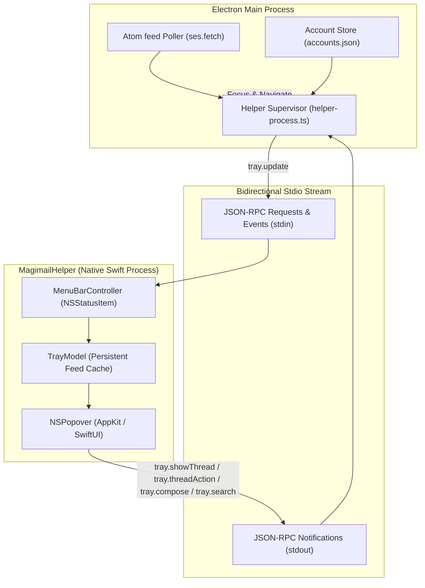
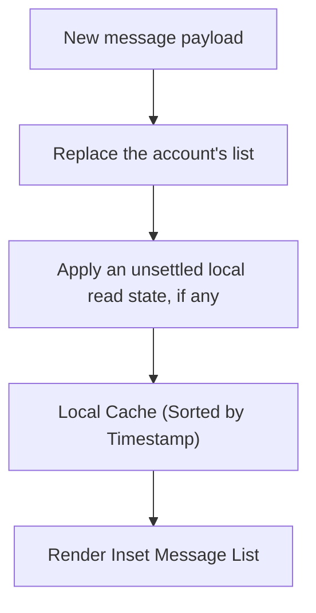

# Menu bar status item and popover

The status item and popover run in the Swift helper. The popover's rows can open a thread or act on
it; the actions themselves, and how they reach Gmail, are in [`actions.md`](actions.md).

## Process boundary and IPC

The menu bar status item and popover live in the Swift helper process (`MagimailHelper`), not in
Electron:

Helper and main process talk in newline-delimited JSON-RPC over `stdin` and `stdout`:

| Event / Method       | Direction         | Payload                                                        | Action Performed                                                                         |
| :------------------- | :---------------- | :------------------------------------------------------------- | :--------------------------------------------------------------------------------------- |
| `tray.update`        | Electron → Helper | `{ accounts: Account[], threads: Thread[], totalUnread: int }` | Updates `TrayModel`, refreshes status item title/unread dot, updates popover view.       |
| `tray.showThread`    | Helper → Electron | `{ threadId: string, accountId: string }`                      | Switches main window to target account partition and navigates directly to thread.       |
| `tray.threadAction`  | Helper → Electron | `{ threadId: string, accountId: string, action: string }`      | Archives, trashes, marks read or marks unread that one thread, leaving the window alone. |
| `tray.compose`       | Helper → Electron | `{ accountId?: string }`                                       | Opens compose window in specified account (or shows account picker if unspecified).      |
| `tray.search`        | Helper → Electron | `{ query: string, accountId?: string }`                        | Switches to and wakes the named account, then loads the search in its Gmail view.        |
| `tray.openPrefs`     | Helper (Internal) | None                                                           | Instantiates native `SettingsWindowController` directly in Swift.                        |
| `tray.popoverOpened` | Helper → Electron | None                                                           | Asks every poller for a hint poll, rate-limited inside the poller.                       |
| `tray.refresh`       | Helper → Electron | None                                                           | Polls every account now, then pushes `tray.messages` for each so the popover redraws.    |

## Status item mechanics

The status item's ownership, the template-image glyph rule and the glyph grid are in
[`../shared/menu-bar.md`](../shared/menu-bar.md). Magimail's own detail is that the unread count goes
in the status item title as tabular numbers (e.g. `(3)`), so there is no custom badge bitmap; the
glyph's state or the account dot says whether there is unread mail.

## Popover layout and sizing

The single fixed width and the content-driven height are the shared popover rules in
[`../shared/menu-bar.md`](../shared/menu-bar.md). Magimail's width is `TrayPopoverMetrics.width`,
340pt, and its feed stops growing at `maxListHeight`, 320pt, then scrolls.

### Account filter menu

A menu in the header narrows the feed to one account, sitting beside compose and the gear. It appears
once there are two accounts to choose between.

The menu lists "All Accounts" with the total unread count, then one item per account carrying its
colour dot and its own count. The dot is filled when mail is waiting and a ring when it is not, the
same mark the main window's toolbar switcher uses. An account whose session has expired shows an
orange warning triangle instead, and sheds its count: the feed behind it has stopped, so the number
is one nobody should read.

Each item is a `Toggle`, which AppKit draws as a tick beside the account showing. Selecting an
account sets the filter to it, so the ticks behave as a radio group and "All Accounts" is the way
back. The selection also decides which account the header's compose button targets; see
[`quick-compose.md`](quick-compose.md).

### Which account a search runs in

A Gmail search runs inside one account's session, so the popover has to name one. The placeholder
says which, and where the results appear: "Search Personal — opens in app". `tray.search` carries
that account, and the main process switches to it before loading the search URL, so the window lands
on the results rather than on another account's inbox.

The filter names the account whenever it is set. With the filter on "All Accounts" and more than one
account configured, the accounts hang off the field's own magnifier icon as an `NSSearchField`
`searchMenuTemplate`: each one by name, with its colour dot and a tick on the account a query would
go to. AppKit draws the chevron and owns the hit target, so the field keeps the popover's full width.
The dot is the same colour as the accent pill on that account's rows, so the menu says where a query
goes without spending a word on it. The tick follows the account the placeholder names rather than
whatever was last clicked, so it sits on the first account before anything has been picked;
`TraySearchField` rebuilds the menu on every update, which is what keeps the two in step.

The menu carries none of AppKit's recents tags, `NSSearchFieldRecentsMenuItemTag` and its siblings. A
search field reads those tags to manage a recent-search list and rewrites the items carrying them;
untagged items it passes through as written, which is why plain `NSMenuItem`s behave as an ordinary
menu here.

## Getting a newer list

The Atom poller runs on its configured interval (see [`unread-counts.md`](unread-counts.md)), so what
the popover shows on opening is as old as the last tick. Two things shorten that.

Opening the popover sends `tray.popoverOpened`, and every poller takes it as a hint. Hints are
rate-limited inside `AtomFeedPoller.requestImmediatePoll()` rather than obeyed, so opening the
popover repeatedly is not a way to hammer Gmail.

The gear menu's **Refresh Inbox**, on ⌘R, is the way to force one. It calls `pollNow()` on every
account, waits for them all, and then pushes `tray.messages` per account. That push is what makes the
refresh visible: messages are otherwise pulled, with the helper asking through `tray.getMessages` as
the popover opens, so a poll answered after that would sit in the main process until the popover was
closed and reopened. `TrayModel.isRefreshing` disables the item while a poll is out, and any state
arriving from Electron clears it, whether that is a changed unread count or a fresh message list.
The popover stays open throughout, because the point is watching the list it is already showing get
newer.

## Thread list source and `TrayModel` state

### The ledger's rows, fed by Gmail's cache

The Atom feed ([`unread-counts.md`](unread-counts.md)) only returns unread messages, so a thread
dropping out of it is indistinguishable from one that was read, archived or deleted.
`HybridFeedSource` therefore reads Gmail's own local cache into the `UnreadLedger`, and the
popover draws its threads from the ledger. Gmail's data worker keeps that cache synchronised, so every
row carries the thread's real read state, labels and category, and a deleted thread disappears rather
than lingering as a muted row. Local triage changes the ledger row immediately, so the popover and the
badge cannot disagree about a thread the user just acted on.

`TrayModel` keeps its own copy of the threads it was last handed, replacing the account's whole list
on each payload:

The payload is not persisted on the Electron side. Each `tray.getMessages` pull, and each forced
refresh, asks `MailboxSource.getRecentMessages()`, which refreshes the ledger from the current cache,
so the popover opens on what Gmail last wrote plus any local triage not yet confirmed. A read that
could not run — a suspended or still-loading view — leaves the last list in place rather than blanking
it; only a cache that was read and held nothing clears the popover. An archive or trash from the
popover pulls its row at once and suppresses a stale copy until the cache drops it, rather than
leaving a deleted thread visible while Gmail's worker catches up.

An unread thread is drawn the way Mail and Messages mark unread: a filled dot in the account's accent
colour at the end of the subject line, the sender and subject at full strength, and a faint accent tint
on the row. A read thread has no dot, a faded accent pill, secondary text, and no tint. The dot is the
primary signal — it holds up under vibrancy and in dark mode where a low-opacity fill can vanish — and
sits away from the accent pill so the two do not read as one glyph.

1. **A thread missing from a newer payload is gone**, not carried as a muted row: the ledger keeps
   read rows too, so absence means archived or deleted.
2. **Inbox zero still shows recent context**, because the ledger keeps read rows rather than ageing
   them in place.
3. **Items are pruned by count alone** in the popover, not by age. `TrayModel.retentionLimit` keeps
   twenty threads per account, matching `RECENT_TRAY_MESSAGES` (twenty), the number Electron asks the
   ledger for.

### Category symbols mapping

When Gmail categories are present, threads display an unweighted SF Symbol beside the timestamp:

| Category   | Gmail Tab      | SF Symbol                      |
| :--------- | :------------- | :----------------------------- |
| Primary    | Inbox Tray     | `tray`                         |
| Social     | Two People     | `person.2`                     |
| Promotions | Price Tag      | `tag`                          |
| Updates    | Info Circle    | `info.circle`                  |
| Forums     | Speech Bubbles | `bubble.left.and.bubble.right` |

The mapping is duplicated on purpose, in `MailCategory.swift` (helper) and `WidgetCache.swift`
(widget extension): helper and extension run in separate sandboxed bundles, with no shared framework
to hold one copy. Primary draws its own symbol (`tray`) rather than being left blank, so "Primary"
cannot be read as "Not Yet Classified".
