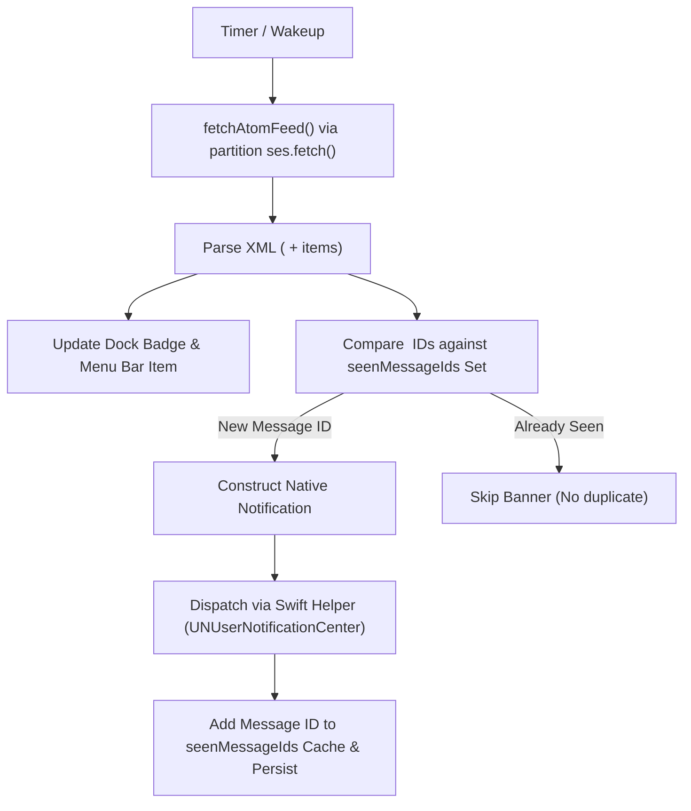

# Notifications

How an unread becomes a native banner, which category its thread is in, and what the dock badge
counts. Banners are delivered by the shared
[`NotificationControllerBase`](../../packages/swift-notifications/Sources/HelperNotifications/NotificationControllerBase.swift),
whose contract is in [`../shared/notifications.md`](../shared/notifications.md). The feed and the
poller are in [`atom-feed.md`](atom-feed.md); a banner's buttons, and every other way Magimail acts
on a thread, in [`actions.md`](actions.md).

## What makes a notification

### Two gates

A message is announced only if it passes both:

| Gate      | State                    | Question                             |
| --------- | ------------------------ | ------------------------------------ |
| Id        | `seenIds`, capped at 500 | Has this id ever appeared in a poll? |
| Watermark | `lastIssuedAt`, epoch ms | Did it arrive at or after the mark?  |

Both are persisted per account in `atom-state/<accountId>.json`. Every unseen id is recorded whether
or not it is announced, so a message the watermark holds back cannot resurface later if the mark
falls behind it. The watermark only ever subtracts from what the id gate admits, so a mistake in it
can cost a notification but never produce a duplicate.

The id gate blocks anything the poller has ever observed unread, permanently and without timestamps:
read a message, mark it unread again five minutes later, and no second banner fires. The watermark
covers what the id gate cannot know about: mail that predates the install, mail read between two
polls so no poll ever saw it, and ids evicted by the 500 cap.

### Arrival

A banner is an event, _this arrived_, while the badge, the menu bar count and the widgets are state,
_this is unread right now_. The feed exposes only the second, so the two are separated. The tray and
the widgets take `fullcount` for the count and Gmail's own `_xdb` cache for the list, so a message
marked unread reappears in both.
The dock badge reads one or the other by mode; see [what the dock badge counts](#what-the-dock-badge-counts).

### Dedup window

`ARRIVAL_TOLERANCE_MS` is one hour, and the comparison is
`issued >= lastIssuedAt - ARRIVAL_TOLERANCE_MS`. `issued` is when a message was sent, not when it
landed, so mail delayed in transit arrives stamped earlier than mail that overtook it: greylisting
retries after five to fifteen minutes, relays back off further, and a sender's clock can be wrong.
Against a bare mark those deliveries would sit behind it and never be announced. An hour covers
realistic delay and skew while staying far short of the timescale on which people triage mail back
to unread; the id gate is unaffected, so the triage case is still suppressed, and a message the
tolerance re-admits is announced once, because announcing it records its id.

The mark advances to the newest arrival across every entry in the feed, not only the announced ones,
so it tracks the mailbox rather than the notifications. However long the app was shut, mail that
arrived after the mark still announces. Four edge cases:

- The mark is capped at now, so a message dated in the future (spam routinely is) cannot drag it past
  every genuine arrival.
- The comparison is `>=`, because feed timestamps have one-second resolution.
- A message whose date cannot be parsed is announced, and does not move the mark.
- State written before the watermark existed reads `lastIssuedAt` as 0, so the first poll announces
  on id alone.

Reopening after a long absence announces everything that arrived meanwhile, in one burst.

## How a notification is formatted

The title, subtitle and body order, and why a subject is the subtitle rather than the body, are the
shared formatting contract in [`../shared/notifications.md`](../shared/notifications.md).

The Gmail category is rendered to a PNG and carried as a `UNNotificationAttachment`, which macOS
draws as a thumbnail on the trailing edge of the banner. This is the only channel available: an app
has no say over a banner's icon, which is always its own, and no API overrides it per notification.
`CategoryAttachment` bakes one image per category and writes a fresh copy for each banner, because
the attachment takes ownership of the file it is handed and moves it into the system's own store, so
a single file cannot serve two notifications. It is drawn in a mid grey, because the banner's
background follows the appearance while the attachment is baked once; a glyph in either label colour
would vanish into one of the two. A failure to render or attach drops the image and posts the banner
anyway.

`threadIdentifier` is the category, so Notification Center stacks banners per category and a pile of
promotions can be cleared without disturbing the rest.

## Which category a thread is in

The Atom feed carries no label per entry, so category is resolved by fetching the four lookup
sub-feeds and asking which one contains the id. `primary` has no sub-feed of its own: Gmail's tabs
are mutually exclusive, so it is the residue.

Resolution covers the whole feed, not only the announced messages, because the badge and the
silenced-category filter need a verdict for every thread still waiting, not only the ones announced
this poll. Each verdict is memoised by message id, so a poll that adds no unclassified id fetches
nothing. Marking a message unread returns it to the feed with its verdict pruned, so classifying in
front of the callback would put four sub-feed fetches between the click and the badge; everything not
needed before `onPoll` is classified afterwards, in `classifyRemainder`. The memo is bounded by the
feed itself: a thread that leaves the unread-only feed is neither counted nor announced, so its
verdict is dropped and re-classified if the thread returns. It is not
persisted, because the sub-feeds can always be asked again. The tray and the widget do not read this
memo: they take each thread's category from Gmail's own `_xdb` cache, where the label is already
stored.

A sub-feed that failed classifies nothing: a refused fetch is indistinguishable from an empty one,
and reading "in no sub-feed" as `primary` would file an update under primary for as long as the
thread stayed in the feed. An entry left unclassified is read as `primary` for that poll only.
`dispatchNotifications` applies the same fallback, because the helper needs some row of the settings
matrix and primary is the row least likely to be silenced.

The category and action contract, and the rule that sound belongs to the category level rather than
a global switch, are in [`../shared/notifications.md`](../shared/notifications.md). The helper checks
`isAccountMuted` before posting and the main process does not filter a Focus-muted account itself; the
extension vends no notification predicate, as [`focus-filters.md`](focus-filters.md) records.

## What the dock badge counts

The badge has three modes, set in Settings → Appearance → Dock & Menu Bar and stored as `dockBadgeMode`:

| Mode          | Counts                                    | Source                                         |
| ------------- | ----------------------------------------- | ---------------------------------------------- |
| `allUnread`   | Everything unread right now (the default) | `fullcount`, blended with the sidebar observer |
| `newArrivals` | Mail that arrived and is still waiting    | `activeArrivals`                               |
| `off`         | Nothing                                   | None                                           |

The switcher and the menu bar ignore the setting and always show the unread count per account,
because both answer what state each inbox is in, and only the backlog answers that.

The two modes exist because the same number means opposite things to different people. At inbox zero
the badge should read 1 the moment anything lands. With four thousand unread it reads a permanent
red `4000` that never changes and therefore never tells them anything, and the usual fix is to switch
it off entirely, which also loses the signal. `newArrivals` is the iOS Mail model: count what arrived
while you were away, and leave the backlog out.

Only reading the mail decrements it. Clearing the badge on window focus is not the rule, because
Magimail is brought forward to write one mail, check a calendar invite or search for an attachment,
and clearing would lose the mark on mail you have not looked at. The set of unhandled arrivals is
`activeArrivals`, maintained by `trackArrivals` on every poll:

1. Everything `newMessages` announced this poll joins the set.
2. Everything that has left the feed leaves the set; the feed lists only unread mail, so a dropped
   id was read, archived or deleted.
3. Arrivals in a category set to `off` are excluded on the way in and on the way out alike, the same
   categories `displayedUnread` subtracts, so both modes count the same mail.

Arriving and being read between two polls therefore nets to nothing.

### Paged feed

The feed pages its entry list: `<fullcount>` is the whole unread total, while the `<entry>` blocks
are only the newest slice. How large that slice is has not been measured: it is not documented, the
feed is unversioned, and no mailbox to hand carries enough unread to observe the cut. Nothing here
depends on the number.

Only the arrival count is exposed to this. The unread total is read straight off `<fullcount>`, a
figure in its own right and not derived from the listing, so `allUnread` is exact however few entries
come back; silenced categories are subtracted from their sub-feeds' `<fullcount>` for the same
reason. It is `newArrivals` alone that is built from the entries, because identifying which messages
are new is only possible from the messages themselves.

Absence is treated as conclusive: an arrival the feed stops listing is pruned. Below the page size
that is right, since every unread message is listed and absence can only mean the mail was handled;
above it the count can fall short, never overshoot. `arrivalsIncomplete` is set when `<fullcount>`
exceeds the number of entries returned, and the badge then renders `12+` instead of `12`, the same
"at least this many" claim it already makes at the top end with `999+`. The comparison reads the
answer off the response, so it needs no page size and survives Google changing the limit. Across
accounts the flag is a disjunction: one account short of the truth makes the sum short of the truth,
so any `+` is a `+` on the total.

A message that falls off the listing before it has ever been seen is not lost, because it was never
recorded in `seenIds`; it is picked up as new when reading the mail above it brings it into view,
subject to the usual tolerance. Only an arrival that was counted and then pushed out of sight is
gone for good.

### Persisted set

`activeArrivals` is written to `atom-state/<accountId>.json` alongside `seenIds` and `lastIssuedAt`,
because quitting with two unhandled arrivals must still read 2 on the next launch: by the time a
fresh set is built, every message in the feed is merely unread, and nothing distinguishes the two
that arrived. Only ids are stored; nothing downstream needs a time.

The count is also read back before the first poll, because waiting for the first fetch left the badge
blank for a few seconds at every launch and read as though it had cleared itself. The unread total is
not seeded this way: `accounts.json` is only written on account events, so its `unreadCount` is
whatever it was at the last rename or sign-in.

### Poll cadence

`newArrivals` cannot use the sidebar DOM observer, which knows what is unread, not what arrived, so
the count comes from the feed alone and moves at poll cadence rather than the observer's 0 ms. A
mailbox change hint re-polls within about a second of the click, so reading a new message clears it
promptly, just not synchronously. `allUnread` keeps the instant path.

## Process identity

The `Contents/MacOS` placement, the code-signing identity the helper has to claim, the shared
LaunchServices quit, and why development builds have no bundle, are the shared requirements in
[`../shared/notifications.md`](../shared/notifications.md).
