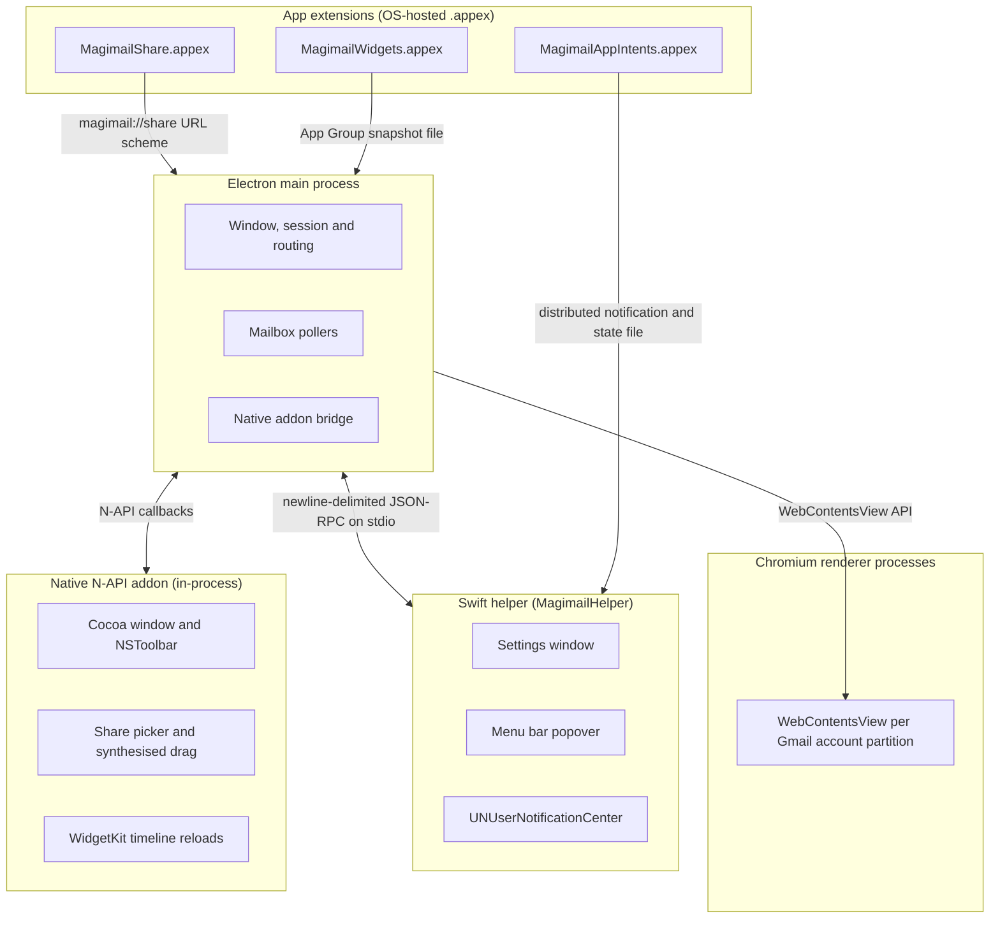
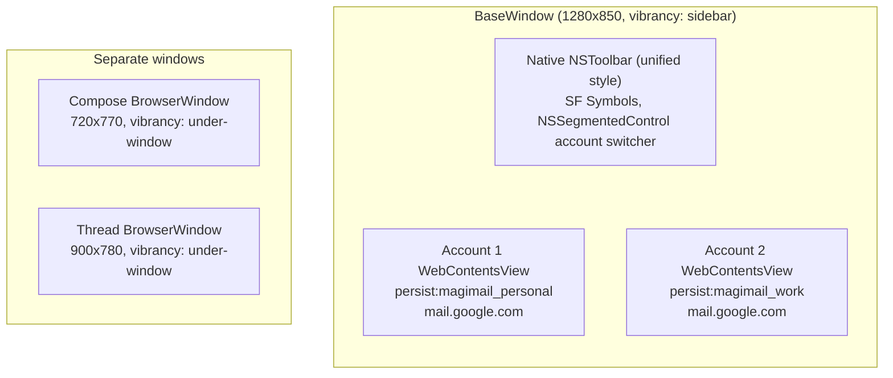

# Architecture overview

Magimail is a native macOS desktop client for Gmail. This page maps the tree on `main` and says how
the pieces fit; [`README.md`](README.md) indexes the pages that go deeper into each subsystem.

## Stack and workspace

The runtime, build tooling and workspace layout are true of both apps and live in
[`../developer-guidelines/coding-standards.md`'s Stack and workspace](../developer-guidelines/coding-standards.md#stack-and-workspace).

## System overview

Magimail runs the shared process shape: an Electron main process orchestrates, the Swift helper
draws the native UI in a child process, a C++ N-API addon reaches the window from inside Electron,
and the OS-hosted extensions are reached through files, URL schemes and notifications. Gmail itself
runs in a Chromium renderer, one per account partition. The shared mechanism is in
[`../shared/process-model-and-ipc.md`](../shared/process-model-and-ipc.md).

Each account view is a `WebContentsView` on its own `persist:magimail_<id>` partition, stacked in
one `BaseWindow`; see [Window and views](#window-and-views).

## Window and views

The main window is a `BaseWindow` with a native Swift toolbar and several child `WebContentsView`
instances stacked by z-order. A `BaseWindow` carries no hidden renderer of its own, which saves
about 100MB against a `BrowserWindow`:

Only the active account view is attached; others are detached but keep their session and unread
state. There is no drag `WebContentsView`: the `NSToolbar` sits over the titlebar and consumes those
events itself, so AppKit drags the window from the toolbar's empty space.

The menu bar popover is a native `NSPopover` owned by the Swift helper, not an Electron window; see
[`process-model-and-ipc.md`](process-model-and-ipc.md).

## Sessions and browser identity

Each account gets its own Chromium session partition, named `persist:magimail_<id>` by
`account-store.ts` (`persist:magimail_personal`, `persist:magimail_work`, …), so cookies, storage and
auth state are fully isolated. The shared session configuration and browser identity are in
[`../shared/sessions-and-security.md`](../shared/sessions-and-security.md).

## Native toolbar

The toolbar's mechanism, and the rules every native toolbar item follows, are in
[`../shared/native-ui.md`](../shared/native-ui.md). Magimail's default layout holds a native
`NSSegmentedControl` account switcher, a Pop-out New Message button (`Cmd+Shift+N`), Share, and
Print. It sets `allowsUserCustomization = true`, so you can add the triage (Archive, Trash,
Toggle Read), reply actions and search through `View → Customize Toolbar...` or by right-clicking
empty toolbar space.

## Navigating

A two-finger swipe on the trackpad moves through Gmail's history, as it does in Safari or Chrome, and so
do the mouse's side buttons. Gmail pushes a history entry as you move between the mailbox and a thread,
so Back returns you to where you were; when a thread or settings view has no prior history (such as a
deep-linked message or cold start), Back falls back to returning to the mailbox list. The mouse's horizontal
wheel is left alone: a wheel notch is a scroll rather than a gesture.

The View menu's Back (`Cmd-[`) and Forward (`Cmd-]`) do the same, and grey out when there is nowhere to
go. The mechanism, and which inputs each app answers, are in
[`../shared/native-ui.md`](../shared/native-ui.md), _Back and forward input_.

## Menu bar

The status item and its popover run in the Swift helper; the mechanism is in
[`../shared/menu-bar.md`](../shared/menu-bar.md). Magimail's glyph, list aging and SwiftUI
popover layout are in [`menu-bar.md`](menu-bar.md), and every row action is in
[`actions.md`](actions.md).

## Styling and theming

The vibrancy, transparency and CSS-injection mechanism is shared and in
[`../shared/design.md`](../shared/design.md); Magimail's dark-mode filter, and every selector it
exempts, is in [`dark-mode.md`](dark-mode.md).

Two details are Magimail's own:

- **Decoration panel divs** (`div.wl`, `.wq`, `.wp`, `.wo`, `.wn`) are hardcoded CSS selectors. They
  are Gmail's empty background-panel siblings and carry no semantic attributes to match on instead.
  The CSS fast path leaves no timing gap, so there is no structural JS fallback anchored to
  `div[role="navigation"]`.
- **Transparent background.** Toggling `transparentBackground` in settings calls
  `setVibrancy('sidebar')` / `setVibrancy(null)` on the `BaseWindow`. The CSS is the same either way,
  so transparency shows vibrancy when on and the window's opaque `#1b1b1b` or `#f8fafd` surface
  colour when off.

## Removing app data

Three actions take data back, and each sits where the scope it clears is visible.

- **Reset Session…** in **Settings → Accounts** signs the selected account out of Google and clears
  its cookies and storage. The account, its caches and the app's settings stay.
- **Remove Account…** beside it drops the selected account's record, clears the stored data and
  cache of its Chromium session, and deletes the account's persisted poller state, so no
  seen-message record outlives the mailbox it describes. Other accounts and the global settings stay.
- **Remove All App Data and Quit…**, on its own above Quit in the app menu, removes everything the
  install wrote and then quits. It is the only one of the three that leaves nothing behind, and the
  only cleanup that can run at all: macOS runs no code when a bundle is deleted and never clears its
  `~/Library` files. The target list, the deferred post-quit deletion and what survives are in
  [`../shared/sessions-and-security.md`'s Removing an app](../shared/sessions-and-security.md#removing-an-app).

Removing an account also drops it from the in-memory Focus Filter state, so the account switcher and
the Dock badge stop leaning on an id nothing can reach. `focus-filter.json` is left as it is: the App
Intents extension owns that file, and an account id it names that no longer exists is ignored there.
The partition directory itself stays until the next launch's `pruneOrphanPartitions` sweep, rather
than the removal, because Chromium may still hold the files open. The fixed `magimail_personal` and
`magimail_work` partitions are exempt from both.
