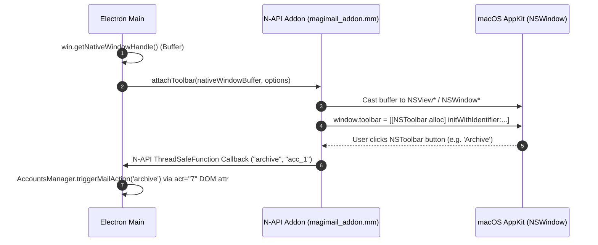
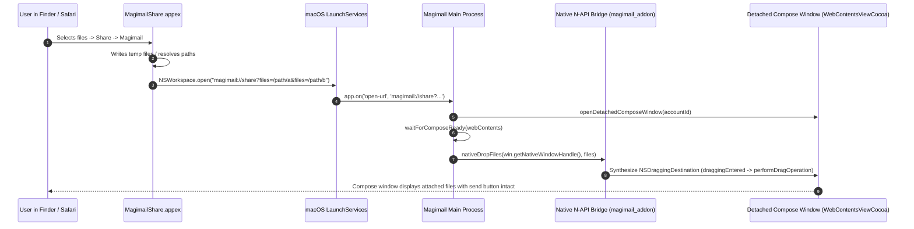
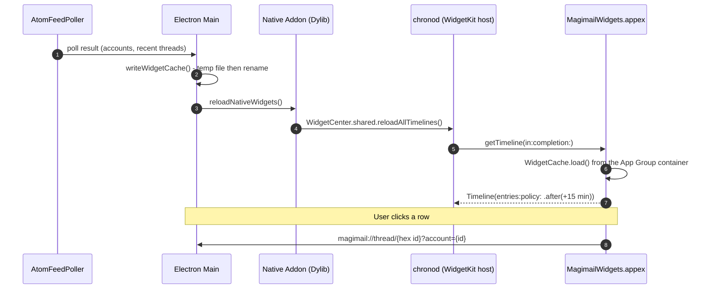
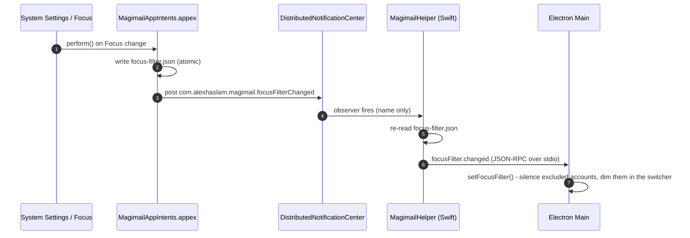

# Magimail's IPC channels

The project-wide shape, the stdio JSON-RPC the helper speaks, and the general fault-tolerance rules
live in [`../shared/process-model-and-ipc.md`](../shared/process-model-and-ipc.md). This page covers
what Magimail adds on top: the Gmail renderer channels, the native addon, the Share extension, the
widget extension and the App Intents extension.

## Gmail renderer

`preload.ts` runs inside every Gmail `WebContentsView` and watches `div[role="navigation"]` with a
`MutationObserver`, so triage in the sidebar reaches the badge without waiting for a network round
trip. This is the only conventional Electron IPC in the app.

| Channel                     | Direction       | Payload                                                                    | Consumer                                               |
| --------------------------- | --------------- | -------------------------------------------------------------------------- | ------------------------------------------------------ |
| `DOM_UNREAD_UPDATE`         | Renderer → Main | `{ timestamp, counts, presentCategories, hasCategoriesSection, isLoaded }` | `AccountsManager.handleDomUnreadUpdate`                |
| `MAILBOX_CHANGE_HINT`       | Renderer → Main | _(none)_                                                                   | `AtomFeedPoller.requestImmediatePoll` for that account |
| `UPDATE_MISSING_CATEGORIES` | Main → Renderer | `NotificationCategory[]`                                                   | The in-page setup banner                               |

**The sender is identified, never asserted.** Neither renderer channel carries an account id.
`event.sender.id` is resolved through `getAccountIdForWebContentsId`, so a view can only report about
itself and a compromised renderer cannot move another account's count.

**Both renderer channels fire from one place**, and only when the serialised report differs from the
last one. A sidebar mutation that changes nothing (Gmail rewrites that subtree constantly) costs one
comparison and no IPC.

**The two say different things and are trusted differently:**

- `DOM_UNREAD_UPDATE` carries counts, which the main process blends with the feed: the DOM is
  authoritative for the rows it can see, and the Atom sub-feeds cover the categories it cannot (see
  [`notifications.md`](notifications.md) and `AccountsManager.getAbsentCategoriesForAccount`). The
  report also says whether a Categories section exists at all and whether the sidebar has finished
  loading; `isLoaded: false` suppresses evaluation entirely, so a half-rendered sidebar never
  registers as an account without categories.
- `MAILBOX_CHANGE_HINT` carries nothing. It is a _trigger_, not a value: it only changes _when_ the
  feed is asked, never what the answer is. Hints are cheap and may be spurious (editing a draft
  mutates the same subtree), so the poller rate-limits them rather than trusting them.

That split is the invariant `tests/badge-source-of-truth.test.ts` defends: a hint may cross the
boundary, but a count may only cross from the scoped navigation rows, never from `document.title`,
which carries drafts as well as unread mail.

## Native addon

The addon compiles from N-API and Objective-C++ (`native/src/magimail_addon.mm`) over a Swift dylib
(`libMagimailNative.dylib`) into a native `.node` binary; no sockets or pipes are involved. It holds
everything that must run as the app itself: the toolbar, the share picker, the synthesised file drag
and WidgetKit timeline reloads.



### Why it runs in-process

The constraint decides what belongs here, not the feature. The toolbar needs the real `NSWindow`
behind a `BrowserWindow`; the share picker and the synthesised drag need that window's main thread;
and a `WidgetCenter` timeline reload needs the Electron main process itself.

Then the reason: macOS `chronod` uses Apple's BaseBoard framework to check that the calling
process's executable matches `CFBundleExecutable` (`Magimail`) in `Info.plist`. `MagimailHelper`
shares the bundle ID but fails that check with `Resolved bundle path does not match executable` and
`ChronoCoreErrorDomain Code=10`. Only the Electron main process qualifies.

### Pointer handshake

Electron exposes the raw Cocoa pointer of its window through `win.getNativeWindowHandle()`, which
returns a Node.js `Buffer` holding the pointer to the underlying `NSView`. The addon unwraps it and
attaches the toolbar:

```objc
uint8_t* bufferData = (uint8_t*)napi_buffer_data;
NSView* mainView = *(NSView**)bufferData;
NSWindow* window = [mainView window];
toolbar_attach((void*)window, /* ... */);
```

`ToolbarManager` holds one toolbar and the window it belongs to, and attaching to a different window
detaches the old one first. A main window closed and reopened from the dock is a new `NSWindow`, and
without the detach the toolbar stays bound to the dead one and the new window is bare.

The toolbar itself is built in `native/Sources/ToolbarBridge.swift`, which inherits from
`ToolbarManagerBase` in `packages/swift-native`. The addon only marshals the pointer across. The
toolbar's mechanism, its AppKit controls and its click dispatch are shared in
[`../shared/native-ui.md`](../shared/native-ui.md); Magimail's own items and default layout are in
[`overview.md`](overview.md#native-toolbar).

## Share extension

`MagimailShare` reaches Magimail through the system URL scheme. macOS runs an app extension
(`.appex`) in a sandbox container isolated from user apps, so no other channel is open to it:



See [`share-and-handlers.md`](share-and-handlers.md) for the staging, the account picker and the
synthesised drag.

## Widget extension

The widget extension is not an RPC peer. `chronod` launches it when it feels like rendering, long
after the poll that produced the data, so there is no live channel to answer on. The app instead
leaves a snapshot where the extension can find it, and pokes WidgetKit to come and re-read it.



Two things here are easy to get wrong, and each one fails silently:

1. **The snapshot lives in the App Group container.** Resolving it goes through the addon, because
   only `containerURL(forSecurityApplicationGroupIdentifier:)` makes `containermanagerd` create a
   directory the sandboxed extension can open. That call reads the code signature's entitlements and
   team prefix, unlike the reload above, so it does not care which executable makes it. The extension
   is sandboxed, and the group is the shared location it and the app are both entitled for.
2. **Ids are converted on the way in.** The Atom feed reports message ids in decimal, and every
   Gmail URL that opens a message wants the same 64-bit value in hex. `toGmailUrlId` converts once
   into `threadId`, which the widgets, the tray and notifications all build their URLs from. `id`
   stays decimal; it is the feed's identity, persisted to decide what is new.

The timeline reload must originate from the Electron main process; see
[Why it runs in-process](#why-it-runs-in-process). The layouts and the timeline provider are in
[`widgets.md`](widgets.md).

## App Intents extension

`MagimailAppIntents.appex`, an ExtensionKit bundle in `Contents/Extensions`, vends the Focus Filter.
Like the widget it is not an RPC peer. The system launches it in a sandbox of its own, with no
channel back to the app, when the user edits a Focus or when a Focus turns on. It writes its
decision to a file and posts a distributed notification to say the file has changed.



Three things here are easy to get wrong, and getting any of them wrong fails silently:

1. **The intent must be declared only inside the appex.** An `extraResources` entry that also placed
   `Metadata.appintents` at `Contents/Resources` tells the system the _app_ vends the intent, and
   `FocusSettingsExtension` asks the app to resolve it and fails with
   `Failed to map MagimailFocusFilter ... to a concrete AppIntent type`, because the main executable
   is Electron and holds no Swift intent types. With the appex as the only declaration the policy
   reads `only implemented in extension ..., using it`. An app written in Swift can declare it in
   both places and ship the intent in each binary; Magimail cannot.
2. **The notification carries no payload.** A sandboxed process cannot deliver a `userInfo`
   dictionary over `DistributedNotificationCenter`; it is dropped without error. The name alone is
   the signal, and the file is the state.
3. **The write must not be swallowed.** `perform()` writes with `try`, not `try?`, so a sandbox
   denial shows up as a presentable error instead of a filter that silently does nothing.

The extension is sandboxed and the app is not, so it reaches the focus state through the App Group
container. The appex keeps its signature through packaging only because it is listed in `signIgnore`;
see [`../shared/building-and-signing.md`](../shared/building-and-signing.md). The Swift helper is
entitled for the same group and reads `focus-filter.json` from there.

Settings changes travel the other way as `focusFilter.set`, and the renderer reads the current state
over `FOCUS_FILTER_GET` / `FOCUS_FILTER_SET`. [`focus-filters.md`](focus-filters.md) covers what the
app does with the filter: which surfaces drop an excluded account, and which only dim it.

## Fault tolerance and lifecycle

1. **The Swift binary is missing, or the helper crashes.** `isHelperAvailable()` returns `false` and
   `isHelperRunning()` gates every call site, so nothing throws. Nothing takes its place either: the
   menu bar item, the settings window and notifications are absent for that run. Mail itself is
   unaffected, because it lives entirely in the Chromium views and the Atom poller.
2. **The widget snapshot is missing or unreadable.** `WidgetCache.load()` returns `.empty`, so a
   widget renders its "Open Magimail to sync" placeholder rather than failing to load. The 15-minute
   timeline policy keeps widgets refreshing even when the app is not running to poke them.
3. **The machine sleeps and wakes.** `powerMonitor.on('suspend')` pauses the background Atom feed
   polling loops and timers; `powerMonitor.on('resume')` refreshes every account view at once, wakes
   the Swift helper and syncs the Atom feed straight away.

A failure is recorded through `@magimail/core/logger` into `~/Library/Logs/<AppName>/main.log`, and
helper-side diagnostics go to stderr rather than the JSON-RPC stdout. What is captured, at what
level, and what is redacted out is in [`../shared/logging.md`](../shared/logging.md).
