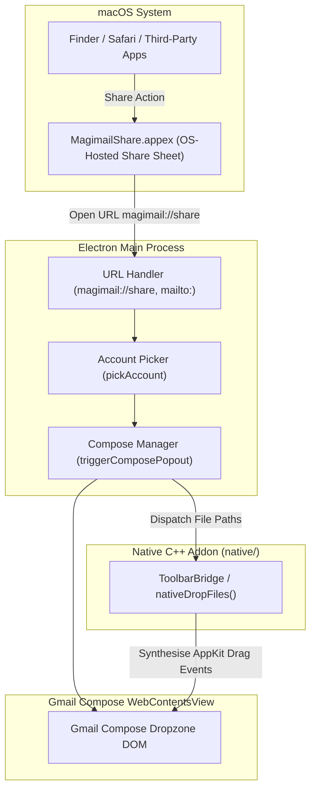
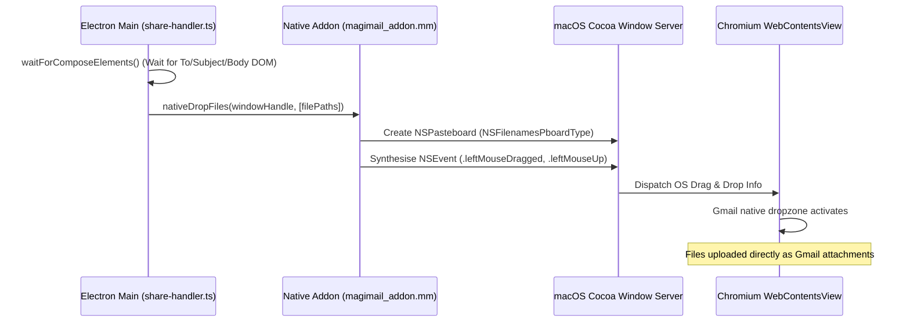

# Share Sheet, handlers and synthesised drag

## Processes a share crosses

Content shared into or out of Magimail crosses three processes:



## Inbound sharing

### Share Sheet extension

`MagimailShare.appex` is a standalone macOS app extension bundled inside
`Magimail.app/Contents/PlugIns/`:

- **Bundle ID**: `com.alexhaslam.magimail.share`
- **Activation rules**: set in `Info.plist` to accept files (images, documents, PDFs), web URLs and
  selected plain text.
- **It hands its payload over by opening an internal URL**, because an app extension runs in a
  restricted OS sandbox and can neither execute Node.js nor call Electron directly:
  ```plain text
  magimail://share?files=/path/to/doc.pdf&files=/path/to/img.png&text=...&url=...
  ```
- **It copies each file into `SharedFiles/<uuid>/` in the App Group container first**, owner-readable
  only. The sender's own file may sit somewhere the main process cannot reach, and the extension is
  gone by the time Magimail reads the URL. Magimail removes that copy; see
  [staging and cleanup](#staging-and-cleanup).

### Account picker coordination

A share can arrive when no account window is frontmost, so Magimail asks which account to use:
`handleShareUrl()` receives the payload in the main process, and if multiple Google accounts exist it
presents an AppKit account selection sheet ("Share content with which account?"). Once the user picks
the destination, Magimail initialises or focuses that account's partition.

## Synthesised AppKit file dragging

### JavaScript cannot attach a local file

Gmail runs in a standard Chromium `WebContentsView`, and a browser only accepts a disk path in
`<input type="file">` if the user chose it in a file picker. Simulating the drop in JavaScript
(`new DragEvent('drop', { dataTransfer: ... })`) fails too: Chromium's Blink engine checks that the
backing OS drag pasteboard exists.

Magimail therefore synthesises Cocoa drag events through its N-API addon, so attaching the files
costs the user no second prompt:



1. **`waitForComposeElements()` polls the compose view** until the Gmail compose DOM is rendered and
   interactive.
2. **`nativeDropFiles` calculates the screen coordinates of the compose dropzone**, then invokes
   Cocoa's `NSDraggingInfo` event pipeline directly on the window's underlying `NSView`.
3. **Gmail treats the drop as a real drag from Finder**, attaching the files with its usual progress
   bars and preview chips.

## Outbound sharing and export

Magimail exposes native macOS sharing and export through `File` → `Share`:

- **Share Link**: opens Apple's `NSSharingServicePicker`, anchored to the toolbar or menu, so the
  active thread URL can go straight to Messages, AirDrop, Notes, Reminders or a third-party
  extension.
- **Copy Link**: copies the authenticated Gmail thread permalink to the system pasteboard
  (`NSPasteboard`).
- **Export as PDF**: calls Chromium's `webContents.printToPDF()` with print stylesheets that strip
  Gmail's navigation chrome, and writes the paginated PDF to the save destination the user chose.
- **Share as PDF**: writes the PDF into a temporary directory, then presents `NSSharingServicePicker`
  with that file attached. The directory goes once the chosen service reports it has finished; see
  [staging and cleanup](#staging-and-cleanup).
- **Native Print**: calls `webContents.print()` with the standard macOS print sheets, so system
  printer presets and paper sizes apply.

## URL schemes and default mail client

### Standard `mailto:` client

Magimail declares `mailto` URL scheme handling in `Info.plist`. `apps/magimail/src/mailto.ts` parses
an incoming `mailto:` query, pulling out `to`, `cc`, `bcc`, `subject` and `body`. The native account
picker appears before navigation, so the message composes from the account the user chose.

### Deep link routing

The app handles custom protocol routes via `app.setAsDefaultProtocolClient('magimail')` and `mailto:`.
The complete route taxonomy (`thread`, `inbox`, `search`, `compose`, `share`), action parameters,
and cold-launch lifecycle are documented in [`deep-links.md`](deep-links.md).

### Becoming the app macOS opens `mailto:` with

Three surfaces reach the same claim:

| Surface                                              | Behaviour                                                      |
| :--------------------------------------------------- | :------------------------------------------------------------- |
| **Magimail → Set Magimail as Default Email Reader…** | Always answers, including "already the default"                |
| **Settings → General**, the `mailto:` row            | Shows who holds the scheme; the button goes once Magimail does |
| The launch prompt, once                              | Claim it, not now, or stop asking                              |

The menu item and the launch prompt are `promptSetAsDefault` and `checkOnStartup` in
[`default-client.ts`](../../apps/magimail/src/default-client.ts), and both claim the scheme through
`app.setAsDefaultProtocolClient('mailto')`. Only "don't ask again" is stored, in
`default-client-preference.json` under the user data directory.

The settings row is `DefaultHandlerRow` in the Swift helper, fed by
`SettingsModel.refreshHandlers()`. It lives there because Electron answers only whether Magimail
holds the scheme, never which app holds it instead; `NSWorkspace.urlForApplication` names that app,
and `DefaultHandler.swift` asks it. Magical reaches LaunchServices from its helper too, for a
different reason: `.ics` is a content type, and Electron can claim only URL schemes. See
[`ics-import.md`'s Claiming the default](../magical/ics-import.md#claiming-the-default).

The row reads LaunchServices on every appearance rather than remembering what Magimail last set,
because the user can name a different reader in System Settings at any moment. The button goes once
Magimail holds the scheme, because LaunchServices offers no way to stop being a handler; the only way
back is to name another app in System Settings. Outside an app bundle, as under `pnpm run dev`, there is
nothing to register, so the row says the installed app is needed rather than offering a button that
would fail.

## Staging and cleanup

Both halves of sharing put readable mail on disk: an outbound share renders the thread to a PDF the
sharing service reads, and an inbound share arrives as files the extension has already copied.
Neither is content the app needs once the operation is over, and `share-staging.ts` is the one module
that makes these files and the one module that removes them.

### Removal

| Staging                                     | Written by                  | Removed when                                                   |
| :------------------------------------------ | :-------------------------- | :------------------------------------------------------------- |
| `$TMPDIR/magimail-share-<ts>/<subject>.pdf` | `shareActiveThreadAsPdf`    | The chosen sharing service reports it has read the file        |
| `<group>/SharedFiles/<uuid>/`               | `ShareViewController.swift` | `handleShareUrl` returns, whichever way the share ended        |
| `$TMPDIR/magimail-share-<ts>/<attachment>`  | `share-handler.ts`          | 30 seconds after the synthesised drop, once Gmail has uploaded |

The PDF waits on a real answer rather than a timer. `showSharingPicker` stands its delegate in as the
chosen service's delegate and calls back on `didShareItems:`, on `didFailToShareItems:`, or straight
away when the sheet closes with nothing chosen. A timer would have to outlast an AirDrop transfer to
be safe, and would still take the file out from under a slower one. The staged original goes in a
`finally`, so a cancelled account picker and a compose window that never opened clear it as surely as
a successful attachment does.

### Guarding removal

The inbound file list arrives from a `magimail://share` URL, and any process on the machine can open
one of those with any path in it. A path is therefore removed only once it has been shown to be a
staging directory owned by the app, resolved through `realpath` so no `..` or symlink reaches past
the check:

- a directory named `magimail-share-*` sitting directly under the temp directory, or
- a directory named after a UUID sitting directly under `SharedFiles/` in the app's own App Group
  container.

A build with no entitlement for the group resolves no container, so it can prove nothing about the
path it was handed and removes nothing. Anything that fails a check is logged and left alone.

### Startup sweep

`sweepAbandonedShareStaging` runs once from `whenReady` and takes both kinds, so a build that stops
the leak also clears what earlier ones left behind, and it collects staging from a crash between
writing a file and sharing it. It takes only directories last written more than an hour ago: a share
arriving while Magimail is closed launches it, so staging written seconds ago can be the very file
the share is waiting to attach, and a sweep with no age bound would race the share that started the
app.

## Outbound links

External links clicked in email bodies, detached thread views, and compose popouts are intercepted by
`setWindowOpenHandler` and `will-navigate` in `accounts-manager.ts` and `compose.ts`.

Magimail unwraps tracking redirectors via `unwrapRedirectors` in `@magimail/core` before calling
`shell.openExternal`, allowing macOS to resolve registered Universal Links directly to desktop apps
such as Todoist, Notion, Linear, Figma, and Slack. See
[`../shared/third-party-links.md`](../shared/third-party-links.md).
