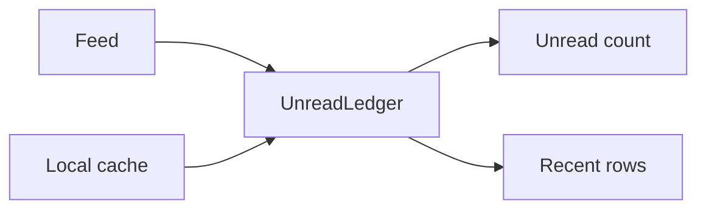

# Unread counts

Each account has one unread count and a list of recent rows. `MailboxSource` (`HybridFeedSource`)
owns both. `UnreadLedger` is the part that turns a feed or cache read into a change. The dock badge,
menu bar, toolbar switcher, popover and widgets all read the source.

## What the ledger keeps

- **Rows.** Read and unread threads with category, subject, sender, snippet, message time and the
  source time that last set the row. Newest first, 20 returned by default, 200 kept. Read rows stay
  in the list until they are archived or deleted; then they are hidden at once.
- **The count.** Total, per-category counts, raw `fullcount`, `activeCount` and `hasState`. In a
  backlog the tracked rows are the newest slice; the total is the whole mailbox.

## Where the inputs come from

### Feed

The feed is Gmail's unread endpoint, fetched with `ses.fetch` on the account's partition. It carries
`<fullcount>`, the whole unread total, and `<entry>` blocks, the newest unread threads. The feed
lists only unread mail, so an id leaving it was read, archived or deleted; the feed cannot say
which.

A complete feed has a `fullcount` no larger than its entry count, so a thread missing from the
entries is not unread. A truncated feed has a larger `fullcount`, so the entries are only the newest
slice. A thread missing from a truncated feed may simply be outside the window.

`sourceAsOf` is the response's `Date`, capped at receipt and falling back to the feed's root
`<modified>`. It is the generation time. The ledger subtracts the read-path grace from it.

| Poll state                    | Interval                                      |
| :---------------------------- | :-------------------------------------------- |
| Mains power, idle             | Configured interval, 60 s by default          |
| Battery, idle                 | Configured battery interval, 180 s by default |
| Window focused on the account | 5 s on mains, 8 s on battery                  |
| Mailbox change hint           | 750 ms after the hint, at most once every 3 s |
| Suspended                     | Paused, then an immediate poll on resume      |

A poll reports `ok`, `auth_required`, `restricted` or `network_error`. Only `ok` changes the ledger.
A failed poll tells the ledger nothing, so the count stays where it was. A response with no
`<fullcount>` is not a feed. The policy-block page is checked first because it is HTML too.

### Local cache

Gmail's local cache supplies the read state the feed lacks. The reader runs in the account's
renderer, decodes Inbox rows that are not in Trash, and returns the newest ones with their real read
flag, category, subject, sender, snippet and time. It also returns the cache's last item-sync time
as `CachedInboxSnapshot.asOf`.

For a row the ledger already has, only a snapshot with a sync time can change its unread flag; a
snapshot without one fills in metadata only. A thread the ledger has not seen is added with the
cache's read state. A cache read runs when the popover pulls rows, on refresh, on a mailbox change
hint, and when the window wakes.

### How they merge

The ledger uses both inputs. The feed says which threads are unread and gives the total. The cache
gives the read state and fills in category and metadata. Each read changes rows and the count. It
does not clear a pending action by itself.

If the feed is complete, its entries are the whole unread set. A cache row for a thread the feed
left out cannot make it unread. The cache may still fill in metadata, and a read row can stay in the
list. If the feed is truncated, it cannot prove a thread is gone, so the cache may still add an
unread thread from outside the window.

A cache read also drops read rows the snapshot no longer lists. It leaves unread rows and rows with
a pending action alone: a missing unread thread is not proof that it was read.

## Two counts

There are two: the raw unread count, and the same count filtered by the notification settings.

- **Raw** counts every category. The menu bar, the tray and the widgets show it.
- **Filtered** counts only categories whose setting is not `off`. The dock badge shows it.

`AccountsManager` chooses which categories the filtered number includes, because it owns the
settings. The ledger reports `byCategory` and the raw total, and answers
`getUnreadCountFor(categories)`. The filtered number is asked for rather than stored because a
backlog needs the feed's `fullcount` and the per-category sub-feed counts, which only the ledger
holds.

## How the count is worked out

The count starts with what the feed says is unread. Subtract each local read, archive or trash the
feed has not confirmed, and add each local mark-unread it has not confirmed. The result never goes
below zero.

- **Complete feed.** Counts the tracked rows, because the feed listed everything it counted.
- **Truncated feed.** Starts at `fullcount` and, for a filtered count, subtracts the sub-feed count
  for each category left out, capped at the total.
- **Before the first poll.** Counts the tracked unread rows.

Across accounts, the dock badge and menu bar sum their own number over the accounts the Focus Filter
includes; the toolbar switcher shows every account's own total, which is the unfiltered one. See
[`focus-filters.md`](focus-filters.md).

## What survives a restart

The counts are written back to `accounts.json` a few seconds after they settle, so a launch draws
the menu bar from the last known number instead of zero while the first poll and cache read are
still in flight. `unreadCount` is the number the menu bar and tray start from; `badgeUnreadCount`
is the dock badge's, so a silenced category is not briefly counted there either. Both are the same
fields the running app updates, so there is no second cache to keep in step.

The write is throttled: a poll changes the count every few seconds and the file is small but not
free. A launch immediately after a change therefore starts from a slightly older number, which is
the same as any other stale read and corrects on the first observation.

## Categories

The feed carries no category per entry, so the poller looks each id up in Gmail's four category
sub-feeds. A message in none of them is primary, because Gmail's tabs do not overlap. Results are
memoised by id and dropped when the thread leaves the feed. Before the poll reports, it fetches only
the sub-feeds the count needs: every category turned off, every category it has not classified yet,
and all four when a new message arrives. The rest are classified afterwards. A failed sub-feed
classifies nothing, and an unclassified entry counts as primary for that poll. The tray and widgets
take category from the ledger rows, which the local cache fills.

## Paging and arrivals

`fullcount` is the whole unread total. The entries are the newest slice, of a size Gmail does not
document. `allUnread` comes straight from `fullcount`; categories turned off are subtracted from
their sub-feeds' `fullcount`. `newArrivals` is built from the entries, so it can fall short when the
feed is truncated. `arrivalsIncomplete` is set when `fullcount` exceeds the entries; the badge then
renders `12+`, and across accounts one short account makes the total a `+`. The arrival set is in
[`notifications.md`](notifications.md).

## Local actions and grace

A local action changes the row at once and records what it did. While the action is being sent,
neither the feed nor the cache can change that row. When it succeeds, the ledger records the
confirmation time and asks Gmail to refresh. When it fails, the ledger puts back the previous read
state and source time, or removes a row the action created, and emits a change.

After that, a feed or cache read can change the row only if it is at least as new as the row's
source time.

- **Feed.** The feed is generated at `G` and trusted from `G - 5s` (`ATOM_READ_PATH_GRACE_MS`).
  Gmail serves it no-store with no `Age`, so the grace covers the read path, not an HTTP cache. An
  entry changed at or after the action's confirmation wins immediately.
- **Cache.** A cache read can update category and metadata, but it cannot clear a pending record.
  The feed may still count the thread, so the adjustment stays until the grace period passes or the
  feed proves the state.

A complete feed that leaves out a pending local read, archive or trash confirms the action. A
truncated feed cannot confirm by omission, because the thread may have moved out of the window; it
waits for the grace to pass. A pending mark-unread is confirmed as soon as the feed lists the
thread; if the thread is absent, it waits.

Archiving or deleting a read row hides it at once and writes a record that does not change the
count, so a failed action can restore it. A stale cache cannot bring it back. Deleting an unread row
hides it at once and keeps its counting record. Marking a read row read again, or marking an
already-unread thread unread, writes no record.

## Refresh

Refresh changes when the feed and cache are read; it does not override the ledger. A pending action
keeps its usual grace period, and a response that still shows the old state may have been generated
before the action, so it is not evidence that the action failed.

`refresh()` polls and then reads the cache. A mailbox change hint reads the cache and asks for a
poll. A window wake presses Gmail's refresh control and refreshes. **Refresh Inbox** does all of
that across every open view and pushes each account's rows to the popover.
