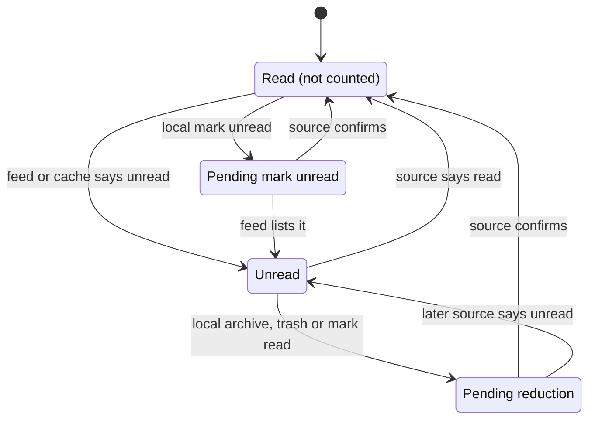

# Unread counts

Magimail keeps one unread count per account, and the recent rows behind it, in that account's
`MailboxSource` (`HybridFeedSource`) and its `UnreadLedger`. The feed and Gmail's local cache observe
the mailbox; the ledger decides what an observation means. The dock badge, menu bar, toolbar switcher,
popover and widgets all read the source.

## What the ledger owns

- **Recent rows.** Read and unread threads with category, subject, sender, snippet, message time and
  the source time that last set the row. Newest first, 20 returned by default, 200 kept; read rows
  stay in the list so a triaged thread remains visible.
- **The count.** Total, per-category counts, raw `fullcount`, `activeCount` and `hasState`. In a
  backlog the tracked rows are the newest slice; the total is the whole mailbox.

## Inputs

### Feed

The feed is Gmail's Atom endpoint, fetched with `ses.fetch` on the account's partition. It carries
`<fullcount>`, the whole unread total, and `<entry>` blocks, the newest unread threads. The feed lists
only unread mail, so an id leaving it was read, archived or deleted, and the feed cannot say which.

A complete feed has `fullcount` no larger than the entry count, so the entries are the whole unread
set and absence is evidence. A truncated feed has a larger `fullcount`, so entries are only the newest
slice and absence proves nothing.

`sourceAsOf` is the response's `Date`, capped at receipt, falling back to the feed's root `<modified>`.
It is the generation time; the ledger subtracts the read-path grace from it.

| Poll state                    | Interval                                      |
| :---------------------------- | :-------------------------------------------- |
| Mains power, idle             | Configured interval, 60 s by default          |
| Battery, idle                 | Configured battery interval, 180 s by default |
| Window focused on the account | 5 s on mains, 8 s on battery                  |
| Mailbox change hint           | 750 ms after the hint, at most once every 3 s |
| Suspended                     | Paused, then an immediate poll on resume      |

A poll reports `ok`, `auth_required`, `restricted` or `network_error`. Only `ok` reconciles the
ledger. A failed poll is an absence of news, not news that the mail has gone, so it leaves the count
where it was. A response with no `<fullcount>` is not a feed; the policy-block page is tested first
because it is HTML too.

### Local cache

Gmail's local cache supplies the read state the feed lacks. The reader runs in the account's
renderer, decodes Inbox rows that are not in Trash, and returns the newest ones with their real read
flag, category, subject, sender, snippet and time. It also returns the cache's last item-sync time as
`CachedInboxSnapshot.asOf`.

For a row the ledger already has, only a snapshot with a sync time can change its unread flag; a
snapshot without one fills in metadata only. A thread the ledger has not seen is added with the
cache's read state. A cache read runs when the popover pulls rows, on refresh, on a mailbox change
hint, and when the window wakes.

## How the total is composed

`total = displayed base - pending reductions + pending mark-unreads`, with disabled categories
excluded and the result clamped at zero.

- **Displayed base.** A complete feed counts the entries whose category is enabled. A truncated feed
  starts at `fullcount` and subtracts each disabled category's sub-feed count, capped at the total.
- **Before the first poll.** The total is the tracked unread rows in enabled categories.

Across accounts, the dock badge and menu bar sum the totals of the accounts the Focus Filter includes;
the toolbar switcher shows every account's own total. See [`focus-filters.md`](focus-filters.md).

## Categories

The feed carries no label per entry, so the poller resolves each id from Gmail's four category
sub-feeds. A message in none is primary; Gmail's tabs are mutually exclusive, so primary is the
residue. Verdicts are memoised by id and dropped when the thread leaves the feed. Only the sub-feeds
the count depends on are fetched before the report: every `off` category, every absent category, and
all four when a new message arrives. The rest is classified after the report. A failed sub-feed
classifies nothing; an unclassified entry is primary for that poll. The tray and widgets take
category from the ledger rows, which the local cache fills.

## Paging and arrivals

`fullcount` is the whole unread total; the entries are the newest slice, of a size Gmail does not
document. `allUnread` is exact from `fullcount`, and silenced categories are subtracted from their
sub-feeds' `fullcount`. `newArrivals` is built from the entries, so it can fall short when the feed is
truncated. `arrivalsIncomplete` is set when `fullcount` exceeds the entries, and the badge renders
`12+`; across accounts, one short account makes the total a `+`. The arrival set is in
[`notifications.md`](notifications.md).

## Local triage and freshness

A local action changes the row immediately and writes a record. The record is in flight until the
driver confirms it; no source may change that thread while it is in flight. On success the ledger
stamps the confirmation time and presses Gmail's refresh control. On failure it restores the row's
previous unread flag and source time, or removes a row the action created, and emits a change.

A source may change a row only when its observation is at or after the row's own source time:

- **Feed.** Generated at `G`, trusted as of `G - 5s` (`ATOM_READ_PATH_GRACE_MS`). Gmail serves the feed
  no-store with no `Age`, so this bounds the read path's lag, not an HTTP cache age. An entry changed
  at or after the action's confirmation is a later truth and wins immediately.
- **Cache.** Trusted as of its last item-sync time. A cache that predates the confirmation is ignored for
  that thread.

For a pending reduction, a complete feed that omits the thread confirms it. A truncated feed cannot
confirm by omission, because the thread may have moved out of the window, so it waits for the
freshness boundary. For a pending mark-unread, the feed listing the thread confirms it at once;
absence waits. A reduction of an already-read row writes no record, and marking an already-unread
thread unread writes none either.

## Per-thread states

A read row stays in the recent list; “Read” here means not counted, not absent from the popover.
Reduction and addition are mirrors: presence confirms unread, absence confirms not-unread, and the
opposite observation waits for the freshness boundary.

## Refresh

Refresh changes when the inputs are asked, never what the ledger already knows. `refresh()` polls and
then reads the cache; a mailbox change hint reads the cache and asks for a poll; a window wake presses
Gmail's refresh control and refreshes; **Refresh Inbox** does all of that across every open view and
pushes each account's rows to the popover. None of these clears a pending record: a response that
still shows the pre-action state is not fresh enough to have seen the action.
