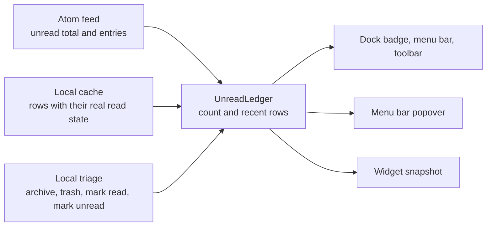
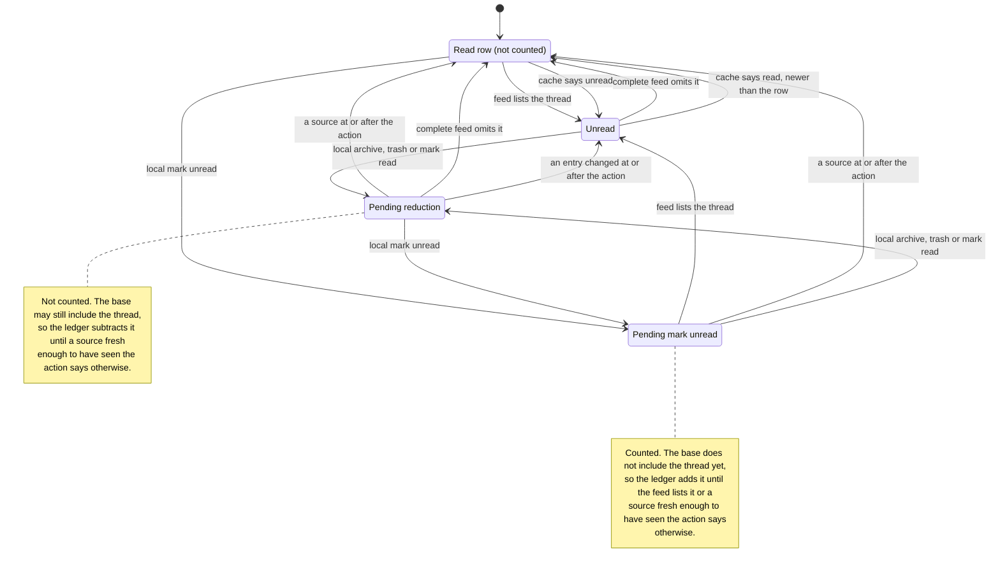
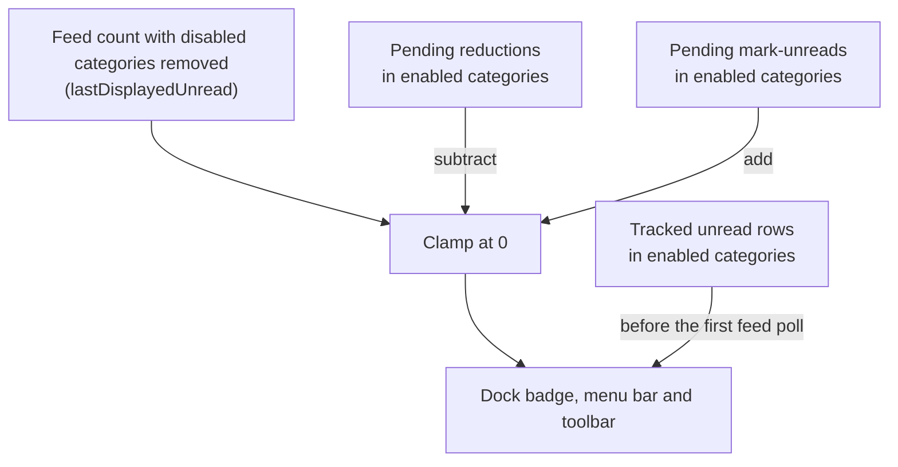

# Unread counts

Magimail keeps one unread count per account, and the recent threads behind it, in a single place: the
`UnreadLedger` inside that account's `MailboxSource` (`HybridFeedSource`). Gmail's Atom feed and
Gmail's own local cache are inputs that observe the mailbox; the ledger decides what an observation
means. The dock badge, the menu bar count, the toolbar switcher, the popover's thread list and the
widget snapshot all read the source, and none of them reads the feed or the cache directly.

## What the ledger owns

The ledger holds two related things, and they answer different questions.

- **The recent rows.** Read and unread threads with their category, subject, sender, snippet, message
  time, and the source observation that last set each row's state. The popover and the widgets ask for
  these, newest first by message time and falling back to when the row was first seen, 20 at a time by
  default. Read rows stay in the list, which is what lets a triaged thread remain visible while its
  neighbour is untouched. At most 200 rows are kept; beyond that the read rows are dropped first, then
  the oldest.
- **The count.** An `UnreadBreakdown` of the badge total, the per-category counts, the raw
  `<fullcount>`, and whether the total may be short. The tracked unread rows are a sample of the
  mailbox while the total is the whole backlog, so in a mailbox with more unread than the feed lists,
  `activeCount` and `byCategory` describe the newest slice and `total` describes everything.

## Feed

The feed is Gmail's Atom endpoint, `https://mail.google.com/mail/feed/atom`, fetched with `ses.fetch`
on the account's own partition session and the same user agent the views present. The request carries
that partition's cookies, so it authenticates itself and there is no token to hold. Fetching through
the session rather than through a view is what keeps counts and notifications arriving while an
account's `WebContentsView` is suspended or unloaded.

A response carries two different answers:

- `<fullcount>`, the mailbox's whole unread total.
- `<entry>` blocks, the newest unread threads with subject, sender, snippet and modified time. The
  feed lists only unread mail, so an id leaving the feed was read, archived or deleted — and the feed
  cannot say which.

A poll also records `sourceAsOf`: the response's `Date` header, capped at the time of receipt, falling
back to the feed's root `<modified>`. That is when the response was generated, not a promise that the
data is current; the ledger subtracts the read-path grace from it.

### Poll cadence

| State                          | Interval                                                  |
| :----------------------------- | :-------------------------------------------------------- |
| Mains power, idle              | The configured interval, 60 seconds by default            |
| Battery, idle                  | The configured battery interval, 180 seconds by default   |
| Window focused on this account | 5 seconds on mains power, 8 seconds on battery            |
| Mailbox change hint            | A poll 750 ms after the hint, at most one every 3 seconds |
| System suspended               | Paused; the resume handler polls immediately              |

Settings sets `pollIntervalSeconds` (default 60) and `pollIntervalBatterySeconds` (default 180). The
source passes both to the poller when it is created and whenever they change.

A mailbox change hint comes from the renderer, which watches Gmail's sidebar and thread list. It is a
trigger and nothing more: editing a draft also rewrites Gmail's title, so a hint can be spurious, and
the feed response remains the only thing that sets a count. Hints are rate-limited rather than
dropped — a hint arriving inside the 3-second cooldown is deferred to the end of it.

The accelerated interval exists so a category whose count the app cannot read locally still updates
quickly while you are looking at it; see [categories](#categories).

### Poll statuses

A poll reports one of four statuses, and only one of them is a feed.

| Status          | Cause                                                              | What changes                                                                       |
| :-------------- | :----------------------------------------------------------------- | :--------------------------------------------------------------------------------- |
| `ok`            | A feed parsed                                                      | Ledger reconciled; the account's sign-in flag clears; counts and arrivals recorded |
| `auth_required` | HTTP 401, or a 200 with no `<fullcount>` that is not a policy page | The account's sign-in flag is raised and the count is held                         |
| `restricted`    | HTTP 403, or a 200 HTML page naming an administrator block         | The popover draws its policy banner with no sign-in offer; the count is held       |
| `network_error` | Any other HTTP status, or the fetch threw                          | Nothing on the account; the tray reports offline if the system says so             |

A failed poll leaves the ledger untouched. The count is state, and a fetch that did not happen is an
absence of news rather than news that the mail has gone, so a dropped connection cannot empty the
badge.

A missing `<fullcount>` is not a count of zero. Gmail answers an expired session with a sign-in page
served as HTTP 200, and the poller reads a response with no `<fullcount>` as "not a feed". The policy
page is tested for first, because it is HTML too.

`auth_required` is what raises the account's sign-in flag, which surfaces on the toolbar segment, in
the popover's banner and on the Settings account row, all of which route back to the Gmail sign-in for
that partition. `restricted` is a tenant refusing the feed, generally by administrator policy: the
credentials are valid and signing in again will not help, so it gets its own banner rather than a
sign-in offer. It is kept per launch rather than on the account, because a restart re-learns it from
the first poll.

## Local cache

Gmail keeps its own offline cache inside the account's renderer. Magimail reads it by running a script
in that renderer: the script opens the cache's item store, decodes each row, and keeps the rows that
are in the Inbox and not in the Trash, newest first, up to the number asked for.

What those rows add is read state the feed does not have. A row carries the thread's real read flag,
its category label, subject, sender, snippet and time, so a thread that was read, archived or deleted
is reported as read rather than merely disappearing from a list of unread mail. Gmail's data worker
keeps the cache synchronised, so a restart paints the popover from data already on disk.

The cache records when its own item sync last completed, and the reader returns that as
`CachedInboxSnapshot.asOf`. That timestamp is the cache's freshness boundary. For a row the ledger
already has, only a snapshot with a sync time can change its unread flag; a snapshot without one can
fill in subject, sender, snippet, category and time, but not the flag. A thread the ledger has not
seen is added with the cache's read state.

A cache read runs whenever the popover pulls its rows, on a refresh, on a mailbox change hint, and
when the window wakes or is unhidden. It needs a live renderer: a destroyed or still-loading view
answers nothing and the ledger keeps what it has. When Gmail has never created the cache database, the
read reports no database, the app shows its offline-mail banner pointing at Gmail's offline settings,
and the poller covers the category counts the cache would have supplied.

## Complete and truncated feeds

`<fullcount>` and the entry list can disagree, and which one is authoritative depends on that.

- **Complete feed.** `<fullcount>` is no larger than the number of entries returned, so the entries are
  the whole unread set. Absence is then positive evidence: a thread the ledger tracks as unread and
  the feed does not list has been read.
- **Truncated feed.** `<fullcount>` is larger than the entry list, so the entries are only the newest
  slice of a backlog. Absence proves nothing — the thread may simply have been pushed out of the
  window — and the total comes from `<fullcount>` instead.

The ledger treats a feed as complete only when `<fullcount>` is at most 20 and no larger than the
entry count, so a mailbox with a larger backlog is always read as truncated.

`UnreadBreakdown.arrivalsIncomplete` reports that the count may be short: it is true when the raw
`<fullcount>` exceeds 20, or exceeds the number of unread rows the ledger is tracking. The unread
total is drawn without a `+`; the arrival count carries its own incompleteness, which
[`notifications.md`](notifications.md#paged-feed) covers.

## Categories

Gmail's five category tabs — primary, updates, promotions, social and forums — are also the keys of
the notification settings, each set to `all`, `primary` or `off`. A category set to `off` is left out
of the count entirely, so silencing promotions lowers the badge rather than merely muting banners.

The feed carries no label per entry, so the category is resolved by fetching Gmail's four category
sub-feeds (`^smartlabel_notification`, `^smartlabel_promo`, `^smartlabel_social`,
`^smartlabel_group`) and asking which one contains the message id. A message in none of them is
primary: Gmail's tabs are mutually exclusive, so primary is the residue, and fetching its own sub-feed
would cost a request to learn nothing. Each verdict is memoised by message id and dropped when the
thread leaves the feed, so a returning thread is classified again.

A sub-feed that failed classifies nothing, because a refused fetch is indistinguishable from an empty
one. An entry left unclassified is read as primary for that poll only.

Only the sub-feeds whose answer the count depends on are fetched before the count is reported: every
category set to `off`, every category marked absent, and all four when the poll announced a new
message. Everything else is classified after the report, so a mark-unread reaches the badge without
four fetches in front of it.

With the local cache available, its labels cover every category. With no cache, the enabled
non-primary categories are marked absent, the poller fetches their sub-feeds, and the account polls at
the accelerated interval while its window is focused.

### Count after filtering

- **Complete feed:** count the entries whose category is enabled. The entries are the exact set.
- **Truncated feed:** start from `<fullcount>` and subtract each disabled category's sub-feed
  `<fullcount>`, each capped at the total, clamped at 0. A category outside the entry window is still
  subtracted, which is why the sub-feeds are fetched at all.

That figure is the ledger's `lastDisplayedUnread`, and it is the base the badge total is built from.
`rawFullCount` is the unadjusted `<fullcount>`, exposed for callers that need it and not used for the
badge.

## Freshness, and the read-path grace

A local action and a source observation race, and the ledger resolves the race with one rule: a source
may only overwrite a row when it is fresh enough to have seen the action.

`ATOM_READ_PATH_GRACE_MS` is 5000. A feed response generated at `G` is trusted as of `G - 5s`, because
Gmail's read path may still show the pre-action state for that long after the server has accepted a
mutation. Gmail serves the feed no-store with no `Age`, so this is not an HTTP cache age: it is a bound
on how long a generated feed may lag.

The cache's boundary is its last item-sync time. A cache whose sync time is at or after the action wins
immediately; one that predates the action is ignored for that thread.

Each row also carries `sourceAsOf`, the observation that last set its state, and no source older than
that may change the row. The feed compares its grace-adjusted generation time, the cache compares its
sync time, and the newer of the two owns the row.

A local record carries both the dispatch time and the confirmation time. While the action is in
flight, after dispatch and before the driver confirms it, no source may change that thread. Once
confirmed, only a source observation at or after the confirmation time can change the row. That is
conservative in the safe direction: the hold can last slightly longer than necessary, never shorter,
and a failed action rolls back instead of waiting for the grace.

A freshness boundary is not a timer. It is evaluated when that source is reconciled, so a record
persists between events and no code path can shorten it.

## Local triage

Triage from the popover, a banner or a shortcut takes the optimistic path, and the ledger is the thing
being optimistic:

1. `recordLocalTriage` flips the row's unread flag and writes a record. The change event goes out
   immediately, so the badge moves with the click.
2. `markLocalTriageInFlight` clears the record's acceptance time, which puts every source on hold for
   that thread.
3. The driver performs the action: a direct sync mutation, falling back to the page's own controls.
4. On success, `acceptLocalTriage` stamps the confirmation time and Gmail's refresh control is pressed
   so the mailbox catches up with the change.
5. On failure, `rollbackLocalTriage` restores the row's previous unread flag and source time — removing
   the row entirely when the action had created it — and the change event goes out again.

Inside the ledger:

- Marking an already-unread thread unread writes no record; it is already in the count.
- Archiving or trashing a row that is already read writes no record and moves no count. It was never
  counted, so there is nothing to subtract.
- Mark unread and a reducing action supersede each other on the same thread; only the latest stands.
- A record is filed under every id the thread was seen by, message id and thread id alike, and a
  lookup tries the message id first. A thread marked unread before the feed has listed it adopts the
  feed's message id when it arrives, which is what stops it being counted twice.
- A record carries the row's category, and adjusts the total only while that category is enabled.

## Per-thread states

Each thread the ledger knows about is in exactly one of four states. A read row can stay in the recent
list, so "read" here means not counted rather than not shown.

### What confirms a record

Reduction and addition are not special-cased. The confirming observation is the desired state:
presence for unread, absence for not-unread.

| Observation                                           | Pending reduction                           | Pending mark unread                         |
| :---------------------------------------------------- | :------------------------------------------ | :------------------------------------------ |
| Feed lists the thread, changed at or after the action | Record cleared; the thread counts as unread | Record cleared; the thread counts as unread |
| Feed lists the thread, older than the action          | Entry suppressed, record kept               | Record cleared; the thread counts as unread |
| Feed freshness passes the action                      | Record cleared; the base wins               | Record cleared; the base wins               |
| Complete feed omits the thread                        | Record cleared early                        | Record kept until the boundary passes       |
| Truncated feed omits the thread                       | Record kept until the boundary passes       | Record kept until the boundary passes       |
| Cache sync time at or after the action                | Record cleared; the cache wins              | Record cleared; the cache wins              |
| Cache older than the action, or no sync time          | Row ignored for that thread                 | Row ignored for that thread                 |

A complete feed enumerates the whole unread set, so its absence of a reduced thread is proof the
reduction landed; a feed whose read path had not caught up would still list it. A truncated feed
cannot prove absence, which is why a backlog reduction waits for the grace to pass even when the
thread disappears from the entries. Addition is the mirror: presence confirms at once, absence waits.

## How the badge total is composed

The total is `lastDisplayedUnread`, minus the pending reductions whose category is enabled, plus the
pending mark-unreads whose category is enabled, clamped at 0. A record only adjusts the total while its
category is enabled: triaging a promotions thread with promotions set to `off` changes nothing, which
is what keeps the two halves of the filter in step.

Before any feed poll has succeeded, the total is the tracked unread rows in enabled categories. That
covers a launch that reads the cache first, and it is why the ledger reports `hasState`: until it has
any observation or pending record, the account's stored count stands.

Across accounts, the dock badge and the menu bar sum the totals of the accounts the Focus Filter
includes. The toolbar switcher shows every account's own total, with an excluded account's dot dimmed
rather than its count hidden; see [`focus-filters.md`](focus-filters.md). The badge's `newArrivals`
mode counts something else entirely, which [`notifications.md`](notifications.md#what-the-dock-badge-counts)
covers.

## Refresh

Refresh changes when the inputs are asked, never what the ledger already knows.

- `refresh()` polls immediately, then reads the cache, and emits a change only if the total moved.
- A mailbox change hint reads the cache and then asks for a poll within 750 ms, at most once every
  3 seconds.
- A window wake or unhide presses Gmail's refresh control and then refreshes, so the page and the feed
  are asked together.
- **Refresh Inbox** in the popover's gear menu, on ⌘R, presses the refresh control in every open view,
  refreshes every source, and then pushes each account's rows to the popover.

None of these clears a pending record. A response that still shows the pre-action state is not fresh
enough to have seen the action, so it cannot undo it.

## Invariants

- One mailbox state per account: a `MailboxSource` backed by an `UnreadLedger`. Every surface reads it,
  and nothing reads the feed or the cache for display.
- A record is cleared only by an observation that proves the action, or by a source boundary passing
  the action.
- An observation older than a row's own source time cannot change that row.
- A local action never edits the base count. It writes a record, and the total is recomputed from the
  base each time, so a record cannot leave a stale delta behind.
- Every record carries a category and counts only while that category is enabled.
