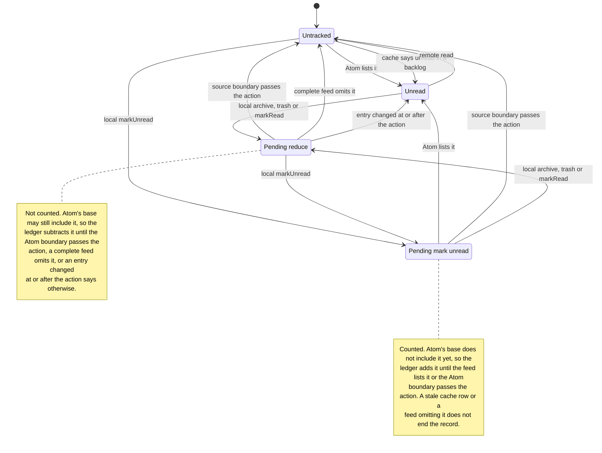
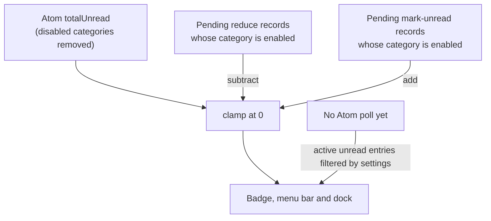

# Unread reconciliation

`UnreadLedger` owns the unread count for one account. It combines the Atom feed, Gmail's local
`_xdb` cache, and local triage actions. It is the only writer of the account's unread count; the
poller and cache reader supply evidence, not decisions.

The ledger answers two separate questions:

- **Which threads are unread right now?** The tracked set, used for category counts, the popover,
  and remote-triage detection.
- **What number goes on the badge?** A base count from Atom, adjusted by local actions the sources
  have not caught up with yet.

Those are not the same number. In a backlog Atom lists only the first twenty unread threads, so the
tracked set is a sample while the badge is a total.

## Freshness belongs to the source

A local action is held against a source only while that source may predate the action. There is no
per-action grace state; there is a freshness boundary per source.

| Source                  | Freshness boundary                                               | Effect                                                                                                                                                            |
| :---------------------- | :--------------------------------------------------------------- | :---------------------------------------------------------------------------------------------------------------------------------------------------------------- |
| Atom                    | response generation time minus `ATOM_READ_PATH_GRACE_MS` (5s)    | Gmail serves the feed no-store with no `Age`. A response generated at `G` is trusted as of `G - 5s`, a bound on how long its read path may lag a server mutation. |
| Atom entry              | the entry's `modified` time                                      | An entry changed at or after the action is a later truth and wins immediately, even inside the 5s window.                                                         |
| Cache                   | the cache update time, falling back to the row's `modified` time | A cache updated at or after the action wins immediately. A cache that predates the action is ignored for pending threads.                                         |
| Cache with no timestamp | none                                                             | The row cannot prove it postdates the action, so it is ignored for a pending thread. Atom's boundary eventually releases the action.                              |

Gmail's `_xdb` records when its item sync last completed. The reader returns that as
`CachedInboxSnapshot.asOf`, and that is the cache boundary. When the metadata is missing, as it is
on an older schema, the row's `modified` time is the fallback. The source was verified against a
live profile rather than guessed from Gmail's JavaScript.

The Atom feed was also probed live. It returns `Cache-Control: no-cache, no-store, must-revalidate`,
no `Age`, and a root `<modified>` equal to the response `Date`. That timestamp is generation time,
not a data-correctness window, so the read-path grace is the remaining assumption. It bounds how
long Gmail's read path may still show a state the mutation path has already changed.

A local record is timestamped when the action is dispatched, not when the server acknowledges it.
That is conservative: the source must be at least as fresh as the dispatch, so the hold can be
slightly longer than necessary but never shorter.

The consequence is the one that matters: a local action followed by a refresh is not undone when
Atom returns its pre-action state, because that response's freshness boundary is still behind the
action. Refresh changes when the sources are asked, never what the ledger already knows.

## Per-thread states

Each thread is in exactly one state. The tracked set contains `Unread` and `PendingMarkUnread`
threads.

### Transitions that do not exist

- **Refresh does not clear a pending record.** It asks for a new poll and reads the cache. Neither
  may overwrite a decision they are not yet fresh enough to represent.
- **A read row archived from the popover does not create a pending reduce.** It was never counted,
  so the badge must not move and no record may subtract from the feed.
- **Marking an already-unread thread unread does not create a pending addition.** It is already in
  the base.
- **A local action never edits the Atom base.** It creates a record. The count is recomputed from
  the base each time, so a record cannot leave a stale delta behind.

## How the badge number is composed

The base is Atom's `totalUnread`, not the raw `<fullcount>`. The poller already subtracts disabled
categories, including categories outside the entry window. A pending record only adjusts the base
when its category is enabled; triaging a promotions thread while promotions are off changes nothing.

When no Atom poll has succeeded yet, the badge falls back to the tracked set filtered by settings.
That covers cache-only startup and the first poll after launch.

## Confirmation

| Observation                                          | Reducing triage                       | Mark unread                                |
| :--------------------------------------------------- | :------------------------------------ | :----------------------------------------- |
| Atom entry changed at or after the action            | Clear the record; the entry wins.     | Clear the record; the feed lists it.       |
| Atom entry older than the action, boundary behind it | Suppress the entry; keep the record.  | Clear the record; the feed lists it.       |
| Atom freshness passes the action                     | Clear the record; the Atom base wins. | Clear the record; the Atom base wins.      |
| Complete feed omits the thread                       | Clear the record early.               | Keep the record until the boundary passes. |
| Truncated feed omits the thread                      | Keep until the boundary passes.       | Keep until the boundary passes.            |
| Cache update time at or after the action             | Clear the record; the cache wins.     | Clear the record; the cache wins.          |
| Cache update time older than the action              | Ignore the row for that thread.       | Ignore the row for that thread.            |
| Cache timestamp unknown                              | Ignore for a pending thread.          | Ignore for a pending thread.               |

Reduction and addition are not special-cased. The confirming observation is the desired state:
presence for unread, absence for not-unread. A complete feed enumerates the whole unread set, so
absence is positive evidence that a reduced thread is no longer unread; a read path that had not yet
seen the mutation would still list it. A truncated feed cannot prove absence, because the thread may
have been pushed out of its twenty-entry window. That is why a backlog reduction waits for the
read-path grace even when the thread disappears, while a complete-feed reduction confirms
immediately. Addition is the mirror: presence confirms at once, absence waits.

A source boundary is not a timer. It is evaluated when that source is reconciled, so the record
persists between events and no code path can shorten it.

## Thread identity

The Atom feed's message id and Gmail's URL thread id are different forms of the same thread. The
ledger records a pending action under every key it presented, and looks a thread up by message id
first, then by thread id. When a feed entry arrives for a preemptively keyed thread, the entry adopts
the feed's message id. That is what stops a thread marked unread from being counted twice.

## What this means for a backlog

- The badge is Atom's filtered total, plus or minus pending records. It does not scale a ratio from
  the twenty sampled entries.
- A pending action for a thread outside the entry window is released by the Atom boundary, not by
  looking for an entry that a truncated feed will never list.
- Until that boundary passes, the local record adjusts the total even though the thread is not in
  the entry list. That is what makes the action visible immediately.

## Current limits

- Local records use dispatch time, not the server's acknowledgement time. The badge is safe but the
  hold can last slightly longer than the server actually needs.
- Atom and cache are ordered against local records, not against each other for the tracked set. The
  badge base is Atom, so the total is unaffected, but a stale cache row can still change category
  counts or the popover list until the next Atom poll corrects it.

## Invariants

- One account count writer: `MailboxSource.getUnreadCounts()`. Accounts and the poller never apply
  Atom's number directly.
- A local record is cleared only by an observation that proves the action, or by the source
  boundary passing the action.
- Refresh changes when the sources are asked, never what the ledger already knows.
- Every pending record carries a category and is counted only when that category is enabled.
