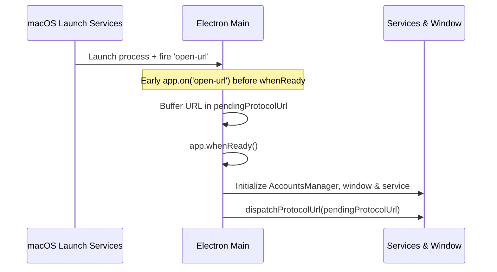

# Deep link routing

Both Magimail and Magical register custom macOS URL schemes (`magimail://` and `magical://`) so native
extensions (WidgetKit, Share Sheet) and external macOS tools (Raycast, Alfred, Apple Shortcuts, Focus
Filters, terminal scripts) can trigger actions and navigate directly.

## Protocol registration and launch lifecycle

Electron and macOS communicate custom URL schemes via the `open-url` event on `app`. Because an external
deep link can trigger the application from a cold launch (when the app process is closed), registration
timing determines whether a launching link is handled or silently dropped.

### The three lifecycle invariants

1. **Early registration before `whenReady`**: `app.setAsDefaultProtocolClient(scheme)` and `app.on('open-url')`
   must both run at module load time before `app.whenReady()`. macOS fires `open-url` during initial process
   bootstrapping; if the listener is deferred to `whenReady()`, the event has already fired and is lost.
2. **Cold-launch buffering**: If an `open-url` event arrives before `AccountsManager`, the window, or the
   background services exist, the raw URL is stored in memory (`pendingProtocolUrl` / `pendingMailtoUrl`).
   Once `whenReady()` has created the window and initialized account partitions, the pending URL is
   replayed. Both apps then stop buffering once their launch pass has completed — Magical once its
   `CalendarService` exists, Magimail on an explicit flag — so a link arriving with the window closed is
   dispatched rather than waiting for a cold launch that already happened. Magimail's triage links need
   no window at all: they take the direct `/sync/` write first and build one in the background only when
   that cannot land ([`../magimail/actions.md`](../magimail/actions.md)).
3. **Second-instance hand-off**: On macOS, a link opened against an existing instance may arrive either via
   `open-url` or forwarded via `second-instance` `argv`. Both apps inspect `argv` in `app.on('second-instance')`
   and route matching URLs to `dispatchProtocolUrl`.

### Cold-launch account selection

The launch picks the account before the account manager builds its first view. Both apps read the
`?account=...` the launch URL names and pass it in as the initial account; a launch without one restores the
last active account from `lastActiveAccountId` in `settings.json`, written on window close and on quit. An id
that no longer names an account falls through to the first account.

## Focus and triage semantics

A deep link can be either an inspection request (looking at a thread, event, day, or search results) or a
background triage command (marking an email read/archived, replying to an invite, deleting an event):

- **Inspection requests**: Bring the application forward (`mainWindow.show()`, `mainWindow.focus()`,
  `app.focus({ steal: true })`) and navigate the requested account's view.
- **Triage actions**: Execute against the target account view without raising or focusing the window.
  Magimail tries the direct write first, so a triage link can land with no window built at all and only
  reach for a background one when the write cannot. External automations (such as a shortcut batch-triaging
  morning alerts or a script archiving notifications) can operate without disrupting what the user is
  currently working on.

A triage that arrives with no window runs through `routeAcrossWindow`, `WindowRoute` and
`openWindowForAction`. The mechanism is in
[`window-lifecycle.md`'s Routing an action across the window boundary](window-lifecycle.md#routing-an-action-across-the-window-boundary).

## App-specific schemes

- **Magimail**: [`../magimail/deep-links.md`](../magimail/deep-links.md) records the `magimail://` routes
  (`thread`, `inbox`, `search`, `compose`, `share`) and `mailto:` integration.
- **Magical**: [`../magical/deep-links.md`](../magical/deep-links.md) records the `magical://` routes
  (`event`, `date`, `search`, `quick-add`, `open`).

## Outbound links and desktop apps

Outbound links clicked inside email bodies, event descriptions and tasks are unwrapped via `@magimail/core`
to strip Google tracking prefixes and restore Apple Universal Links for external tools (such as Todoist,
Notion, Linear, Figma, and Slack). See [`third-party-links.md`](third-party-links.md).
