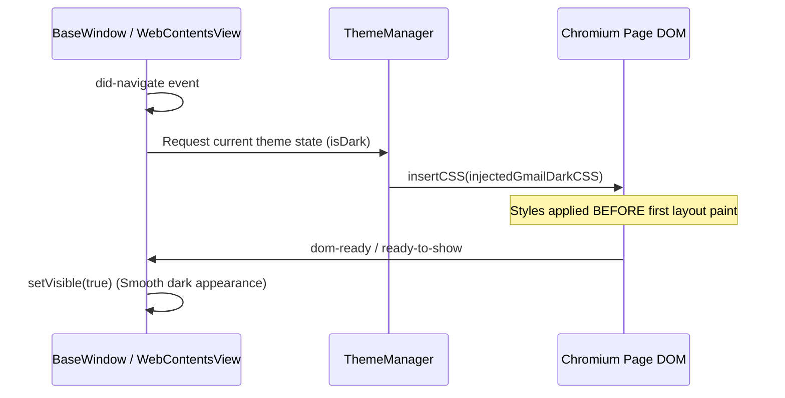

# Design

## Looking like first-party macOS software

Magic Apps should look and feel like first-party macOS software, not a website wrapped in Electron.
Four principles follow from that.

1. **Follow the Apple HIG where it applies.** Spacing, typography hierarchy, control layout, keyboard
   shortcuts and window materials follow Apple's Human Interface Guidelines.
2. **Use the system fonts.** `SF Pro`, `SF Pro Display` and `SF Pro Rounded` tabular numbers for
   dates and countdowns. The project never bundles or injects a web font that imitates macOS.
3. **Stay quiet until there is something to do.** Status items, badges and notifications appear only
   when the user can act on them, such as an unread count changing or a meeting waiting for an RSVP,
   and they dismiss cleanly.
4. **Let the OS draw itself.** macOS changes its look across releases; Sonoma, Sequoia and Liquid
   Glass on Tahoe all differ. Native controls track whichever one is running, and a hand-rolled
   mockup dates as soon as the next release ships.

The surfaces those principles apply to, and who draws each one, are in [`native-ui.md`](native-ui.md).
Web technologies render the Google Workspace views, Gmail and Google Calendar, and nothing else.

## Window translucency & vibrancy (transparent backgrounds)

Native vibrancy lets the desktop show through the window's chrome.

### AppKit materials

Native AppKit `NSVisualEffectView` materials back every translucent surface:

- **`vibrancy: 'sidebar'`** on the main `BaseWindow`, for standard macOS sidebar translucency.
- **`vibrancy: 'under-window'`** on pop-out compose and thread windows.
- **The `.popover` material** behind the native SwiftUI menu bar popover, inside the Swift helper.

### Transparency in CSS

Electron window chrome and HTML containers pair transparency in CSS with native AppKit blur:

- HTML `body` and top-level containers declare `background-color: transparent`, so desktop vibrancy
  shows through the window chrome.
- **Never apply a CSS blur filter.** No `backdrop-filter` and no `-webkit-backdrop-filter`. AppKit
  already blurs vibrancy at the GPU compositor layer, and a CSS filter on top stalls the compositor,
  drives GPU use up and renders muddy.

### Solid & opaque boundaries

Reading and action surfaces stay solid and opaque, whatever the chrome around them does: settings
panels and account configuration modals, the Google Tasks card and companion sidebars, and email
thread reading panes and compose editors. Wallpaper, icons and background windows showing through
body text or an input field wreck legibility and contrast.

## Theming & dark mode

The project watches `electron.nativeTheme.shouldUseDarkColors` and pushes every change out to all
windows and views.

### Magimail: inverting the page

Gmail ignores `prefers-color-scheme`, and its own dark theme is a server-side account preference with
no cookie, URL parameter or local switch. There is nothing for Magimail to drive, so the page is
inverted instead. That inversion, every element exempted from it and the reasoning behind each are in
[`magimail/dark-mode.md`](../magimail/dark-mode.md). Read it before proposing that Magimail toggle
Gmail's own theme.

Its one project-wide consequence is the injection timing:



`webContents.insertCSS()` runs as soon as `did-navigate` fires. Waiting for `dom-ready` flashes
unstyled content, so a dark-mode user gets a white screen on first load and on every account switch.
The window therefore looks the same through a cold start, a page reload and an account swap.

### Native dark mode sync (Magical)

Google Calendar supports dark and light appearances natively, so Magical synchronises Google
Calendar directly with `nativeTheme.shouldUseDarkColors`. On `did-navigate` it injects a small amount
of structural CSS that clears the redundant Google web headers and makes the body background
transparent, so AppKit vibrancy shows through while Google Calendar renders its own palette.

## DOM selection & CSS hygiene

When injecting CSS or interacting with web contents:

- **Never target a minified class name.** Google generates them (`.aeN`, `.wT`, `.bkK`, `.aUx`,
  `.bAw`, `.brC-brG`, `.bq9`) and changes them without warning on any Workspace deployment.
- **Target semantic HTML and ARIA selectors instead:**

  ```css
  [role="navigation"] { ... }
  [role="main"] { ... }
  [role="complementary"] { ... }
  [role="region"] { ... }
  [role="dialog"] { ... }
  [aria-label="..."] { ... }
  ```

- **Scope every rule you inject**, so it cannot leak into a Google Workspace dialog, a third-party
  add-on or the user's own mail.

An English `aria-label` or a minified class is not the only bad handle: a localised label breaks on
a non-English account. [`dom-labels.md`](dom-labels.md) defines the bands a handle may fall in — a
strong hook wherever one exists, a localised label only where none does, and never a generated name.

## Account colour language across surfaces

Colour is how the user keeps track of which account they are in, so it means the same thing on every
surface. Every account carries a dedicated accent colour (Work `#039be5`, Personal `#f4511e`), and
that colour appears everywhere the account does:

- Native `NSToolbar` segment control dots.
- Menu bar status popover account selector and message/event row pills.
- WidgetKit agenda cards and month density dots.

In Magimail the colour follows the user's primary calendar in Google Calendar, through
`group.com.magicappsuite/accounts.json`; the macOS colour picker overrides it. The menu bar and dock
surfaces that carry it, and their rules, are in [`menu-bar.md`](menu-bar.md) and
[`brand-and-icons.md`](brand-and-icons.md).
