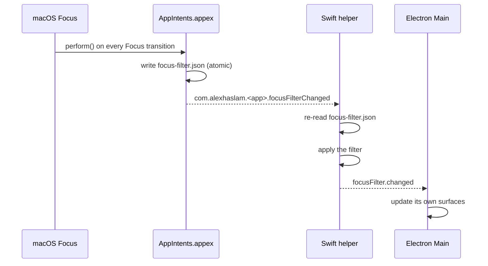

# Focus filters

A Focus is the user telling macOS what they are doing. A Focus Filter is the app being told, so that
turning on a Work Focus can quieten the app without the user reconfiguring it. Both apps vend one from
an App Intents extension, and both receive it the same way. What each app silences is its own: the
table is in [`../magimail/focus-filters.md`](../magimail/focus-filters.md) for Magimail and
[`../magical/focus-filters.md`](../magical/focus-filters.md) for Magical.

## How the filter reaches the app

Three processes, because no one of them can do all three jobs. Only an ExtensionKit bundle is
enumerated by the AppIntents runtime, so only the `.appex` can vend the filter, and it is sandboxed
and cannot call into anything. The Swift helper draws the surfaces the filter affects. Electron owns
the surfaces that are neither.

The notification says _when_ and the file says _what_. Both halves are needed: a distributed
notification carries no payload worth trusting, and a helper that has just restarted has no
notification to have missed. The helper's setup path reads the file at launch for exactly that reason,
so a Focus that was already on when the helper came back is still applied.

The notification carries no payload because a sandboxed process cannot deliver a `userInfo` dictionary
over `DistributedNotificationCenter`; it is dropped without error. The name alone is the signal, and the
file is the state. `perform()` writes with `try`, not `try?`, so a sandbox denial shows up as a
presentable error instead of a filter that silently does nothing.

## Intent is declared only inside the appex

An `extraResources` entry that also places `Metadata.appintents` at `Contents/Resources` tells the
system the _app_ vends the intent. The Focus settings extension then asks the app to resolve it and
fails with `Failed to map …FocusFilter … to a concrete AppIntent type`, because the main executable is
Electron and holds no Swift intent types. With the appex as the only declaration the policy reads
`only implemented in extension …, using it`. A host app written in Swift can declare it in both places
and ship the intent in each binary; an Electron host cannot.

A banner is not silenced by matching the notification's `content.filterCriteria` against an
`appContext` predicate. The helper that posts it checks the filter first, so the predicate could only
agree or be out of date. The helper must still share the app's bundle identity, because
`UNUserNotificationCenter` aborts without one; see
[`notifications.md`](notifications.md).

The extension is sandboxed and holds only `app-sandbox` and the App Group. `accounts.json` and
`focus-filter.json` live in the App Group container, and the Swift helper is entitled for the same
group so it can read `focus-filter.json` there. The packaging and signing rules are in
[`building-and-signing.md`](building-and-signing.md) and
[`process-model-and-ipc.md`](process-model-and-ipc.md).

## Accounts and calendars model

A filter asks two questions: which accounts you are working in, and then which of their calendars
matter. Both start with everything on, so a filter nobody has touched silences nothing.

**Both lists empty is read as no filter rather than as silence everywhere**, and that is the ordinary
case rather than an edge one. The sheet stores only what the user actually sets: it shows every
account and calendar ticked, but adding a filter without touching either list performs the intent with
both empty. Reading that as no filter is what makes the sheet honest, because it said everything was
on and everything stays on.

Each calendar key is `<accountId>|<calendarId>`, both halves, because a Google calendar id does not
identify a calendar on its own: Birthdays, Tasks and each locale's holidays carry the same id in every
account. `|` appears in neither half.

Only the primary calendar is expanded through aliases. Google reports an account's primary calendar
under three names, `primary`, the account id, and the account's own email address, and which one
arrives depends on the endpoint that returned the event. A filter naming the email would otherwise
silence the events that came back as `primary`. A secondary calendar's id is already unique within its
account.

### An account is silenced as a consequence, never directly

An account is silenced when nothing it has is left on, whether because the filter turned the account
off or because its calendars went one by one. That is the only account-level state there is, because a
switcher segment is one account and cannot be half-disabled. An account whose calendars have not been
discovered counts as wholly on, for the same reason a wholly-on account does: there was nothing to
tick, so silence would be the app's decision rather than the user's.

## Picker, and what a new calendar does

A system-rendered picker holds none of the app's controls. Three parameters are available:
`Accounts`, then `Calendars`, then `Prevent Access to Silenced Accounts`. Both lists start with
everything ticked, so setting up a Work Focus means unticking what should go quiet rather than
ticking back the fifteen things that should not.

- **Accounts are asked separately rather than mixed into the calendar list**, because the account list
  is the only one the access toggle can act on.
- **Turning an account off does not shorten the calendar list.** The two parameters are independent,
  and an `EntityQuery` cannot see what another parameter holds, so every calendar stays in the second
  list whether or not its account is still on. Nothing is lost by it: an account that is off silences
  its calendars whatever their own ticks say.
- **The sheet renders a short entity list inline and a long one behind a Choose button**, which matters
  because the two scale the row's image differently.
- **Within the calendar list each account's rows are contiguous.** With more than one account every row
  is prefixed with the account's name, since a flat list otherwise offers two rows called `Birthdays`
  and nothing to say which account either belongs to. A single account needs no prefix.
- **Every row carries a filled circle in the calendar's own colour**, handed to
  `DisplayRepresentation.Image`. The picker takes an image per row and offers no tint, so the colour
  has to be drawn, and it is what makes a list of nine calendars scannable.

### What a calendar added later does

A calendar created after the filter was configured cannot be in it, so an account whose calendars are
_all_ on is treated as wholly on and its new calendars are audible. That is the case where the user
plainly did not mean to hold anything back; an account they have partly filtered is one they are
curating, so a new calendar there stays quiet until they say otherwise.

### What an account removed later does

An account that has been removed takes its entries out of the filter. The picker offers what
`accounts.json` holds, so an id left in the stored Focus points at nothing — and because the account
list is an allow-list, a filter that named only that account would otherwise silence every account
that remains, which is the lock-out the surfaces are never supposed to produce. The helper drops the
removed account from `activeAccounts` and its `${accountId}|…` calendars every time it reads the
filter and every time the account list changes, then reports the pruned filter to Electron as usual.

`focus-filter.json` itself is left alone. It is the App Intents extension's mirror of the macOS Focus
configuration, rewritten whenever the Focus next runs; by then the removed account is no longer in the
picker, so the mirror heals on its own. Nothing an app writes into it would survive, and writing a
user's Focus choices is the one thing the filter is not allowed to do.

## Focus only ever silences

A Focus is not a request for alerts. Ticking a calendar in the picker means "this is in scope while
this Focus is on", not "turn alerts back on", and neither app writes a Focus exclusion into user state:
a setting the user chose stays as they left it, and a filter writing into it would edit a choice the
user made and not give it back when the Focus ended.

The scheduler is deliberately left unaware. A Focus lasts an afternoon and an alert is armed minutes to
hours ahead, so an alert never armed is one that cannot fire when the Focus ends, and one that cannot
be withdrawn when the meeting moves. The filter is applied at the moment a banner would be posted
instead.

## Nothing is ever removed from the surfaces you navigate with

An excluded account is always silenced and dropped from the surfaces whose job is to pull attention,
and stays, listed, on the surfaces you navigate with. In code that is two lists, not one: one holds
what the filter includes and feeds the glanceable surfaces, the other holds every account, always, and
feeds the switcher and the menu. Focus state reaches the navigation surfaces as emphasis instead.

Removing excluded accounts outright lets a Focus setting lock you out of a mailbox, with the only route
back through System Settings and nothing on screen to explain why. Removal also moves the window
without asking, so turning on a Focus while reading an excluded account switches away mid-read. Keeping
the row and only disabling it when `Prevent Access` asks forces a move only in that case, and leaves
the reason on screen.

### A dimmed dot, not grey text

The switcher is a real `NSSegmentedControl`, so each OS draws its own appearance. A segment is not a
view: it is one image plus one plain-string label, with no attributed text, so a segment's title can
only be greyed by making the segment unclickable. `setEnabled(_:forSegment:)` greys a segment exactly
that way, which is wrong for de-emphasis and exactly right for `Prevent Access`, so the two states use
different mechanisms:

| State                | Mechanism                        | Result                         |
| :------------------- | :------------------------------- | :----------------------------- |
| Excluded             | dot drawn at reduced alpha       | recedes, still selectable      |
| Excluded + prevented | `setEnabled(false, forSegment:)` | AppKit greys it, not clickable |

The dot already carries identity and unread state, so dimming it extends an existing language rather
than inventing a second one.

## Known limitation: only a Focus transition applies an edit

Adding a filter runs `perform()` at once. Editing one never does, whether or not its Focus is running:
the system stores the new configuration and re-runs the filter on the next transition, so the state
file is not rewritten when the sheet's Done button is pressed. Turning the Focus on or off applies the
edit, which is the path people actually use. The consequence worth knowing is for testing rather than
for use: a filter edited and saved looks like it has done nothing until the Focus is cycled.
