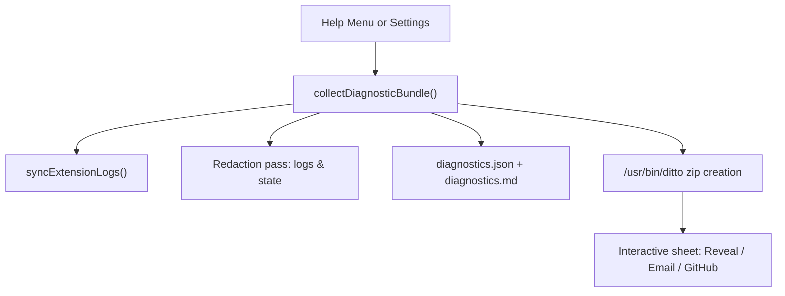

# Logging and diagnostics

Without a log, every bug report from a stranger arrives as "it stopped working" and every diagnosis
is a guess. The log earns its place in a report by holding what a diagnosis needs, and stays safe to
attach by holding nothing private.

## Where the log lives

`electron-log` v5 writes `~/Library/Logs/<AppName>/main.log`, in a directory named after the app, so
Magimail and Magical never share a file. A hand-rolled writer would re-solve rotation, levels and
transports for no gain.

The file is `main.log`, not `app.log`, because it names the _process_. That matters once other
processes write their own files beside it: a directory of per-process logs reads coherently, an
`app.log` sitting among them would not.

Application Support is the wrong home for it, because the app deletes what is kept there. **Remove
All App Data and Quit…** in the app menu removes the whole directory, and **Reset Session…** and
**Remove Account…** in Settings → Accounts, the first thing a confused tester is told to try, clear
an account's cookies and storage. A log kept under Application Support would go with them, taking the
evidence away exactly when that log was about to be useful. Three smaller reasons point the same way:

- `~/Library/Logs/<App>` is where Console.app looks, so a tester who cannot navigate Finder can still
  find it by name.
- Application Support is data you back up. Logs are disposable, and 10MB of rolling archives should
  not ride along in every Time Machine snapshot or migrate to a new Mac.
- It is `electron-log`'s own macOS default, so there is no `resolvePathFn` to maintain.

The logger rotates at 10MB into dated archives kept for 7 days. `electron-log` rotates on size alone
and keeps one `.old`, which cannot answer "which day?".

## What gets logged

Levels carry meaning. A packaged build keeps `info` and above in the file.

| Level   | Means                                                                |
| :------ | :------------------------------------------------------------------- |
| `error` | Something failed that the user will notice: a crash, a dead helper   |
| `warn`  | Degraded but working: a missing binary, a taken shortcut, a retry    |
| `info`  | Lifecycle worth reconstructing afterwards: startup, spawns, dispatch |

Renderer console output is not captured: the hosted web app logs continuously and would bury
everything else within a minute.

The first line of every run is the startup banner: app version, Electron, Chromium, Node, and the
macOS version, build and architecture. It exists because "works on my machine" is usually one of
those, and no reporter thinks to mention them. The macOS **build** is there because Apple ships more
than one under a single version string, so two reporters both on "15.6.1" can be on different systems.
It is read from `/System/Library/CoreServices/SystemVersion.plist`; nothing in Node or Electron
exposes it, and `sw_vers` would mean spawning a process at launch.

A second line follows on `whenReady`: the resolved appearance, the theme source the user chose,
whether high contrast is on, and the primary display's size and scale factor. Appearance and scale are
what the vibrancy and toolbar defects depend on, and a reporter describing one never says which mode
they were in or whether the screen was Retina. It cannot go in the banner, because `screen` throws
before the app is ready and the banner has to stay first, so that a startup failure has the versions
above it.

### Crash capture

`electron-log`'s handler covers `uncaughtException` and unhandled rejections in Main, with
`showDialog: false`; the log entry is what matters, and a modal loses the window the user was working
in. It does not cover a **child** process dying, and in a project this shape most processes are
children. `crash-handlers.ts` adds `render-process-gone` and `child-process-gone`. These are the
failures nothing else records: a dead renderer leaves a blank pane, a dead GPU process leaves the
window rendering wrong, and neither writes anything anywhere else.

A `clean-exit` reason is logged at `info`. Ordinary teardown must not read as a crash, or the level
stops meaning anything.

A hosted crash reporter such as Sentry is not wired up: it adds a network dependency and a privacy
story for a volume that does not exist yet, and can be revisited after launch.

### Helper exits

A Swift helper exiting non-zero takes the menu bar item, the settings window and notifications with
it, so it is an `error` with its exit code. A `SIGTERM` from the app's own `killHelper()` on quit is
the normal path and is `info`.

## Redaction

The log is written to be attached to a bug report, so it leaves the machine. Nothing that identifies
a person, or the content of their mail, may be in it.

**Two layers, because either alone fails open.** A transform-only design leaks the moment someone
adds a call site; a call-site-only design leaks the moment someone forgets.

1. **`redactUrl` at the call site.** Structural, not pattern-matched. A `mailto:` carries the
   recipient in its path and the subject and body in its query, so the whole thing becomes
   `mailto:<redacted>`. Other URLs keep scheme, host and path, which answers "which protocol fired, at
   what route", and lose the query and fragment entirely.
2. **The transport transform.** Prepended to `transports.file.transforms` so it sees raw arguments
   rather than a formatted line. It replaces email addresses with `<email>` and the user's home
   directory with `~`, walking arrays, plain objects and `Error`s. Errors are rebuilt rather than
   mutated: the caller may still rethrow the original.

### What is deliberately **not** redacted

Over-redaction produces a log that is private and useless. Account **index**, partition name, error
codes, HTTP statuses, counts and timings all stay; they are the diagnosis.

The test for a field is: _does it identify a person, or the content of their mail?_
`persist:account-1` passes. `taylor@example.com` does not. A filename does not either, which is why the
share handler logs an extension and a byte count instead of a basename.

`packages/core/tests/redact.test.ts` holds a corpus of realistic records drawn from the real call
sites, asserting no address and no home path survives. That test is the one that must never regress:
everything else in the logger can break and produce a bad log, but a regression there produces a
leaked one.

## Swift side

There is no single "Swift side". The Swift helpers write to stderr with a level marker and mirror
every line to OSLog; the N-API addon writes to OSLog alone; the three `.appex` bundles write a file in
the App Group container and mirror that to OSLog. The Swift dylib in `packages/swift-native` logs
nothing at all, so an AppKit toolbar fault leaves no trace of its own.

### Helper processes: stderr, with a level marker

`print()` in a helper goes to **stdout, which is the JSON-RPC pipe**. `handleLine` drops anything on it
that does not parse as JSON, so a bare `print()` is invisible and interleaves with the protocol. Every
helper diagnostic goes through `HelperLog` in `packages/swift-rpc`, which writes to stderr as:

```plain text
LEVEL|Category|message
```

`SwiftHelper.handleStderr` splits it and maps the level back. Without the marker every helper warning
would arrive as an info line that happens to read like a warning. An unstructured line, such as a Swift
runtime trap or a crash trace, is kept at `info` rather than dropped.

`HelperLog` also mirrors each line to Apple's Unified Logging, through `os.Logger` with
`Bundle.main.bundleIdentifier ?? "com.alexhaslam.magimail"` and the diagnostic category. You can then
watch a helper live in Console.app, or with `log stream --predicate 'subsystem == "com.alexhaslam.magimail"'`,
and the same lines still land in `~/Library/Logs/Magimail/main.log`.

### N-API addon: in-process

`magimail_addon.mm` runs inside Electron Main, so there is no pipe to tap. It logs to OSLog instead,
under the subsystem `com.alexhaslam.magimail` and its own category `NativeToolbar`, and writes no file
of its own; `log stream --predicate 'category == "NativeToolbar"'` follows it live. Every call site is
on the drag-and-drop path: which view was picked to accept a drop, what `draggingEntered` returned, and
whether `performDragOperation` succeeded.

### Extensions: App Group files and OSLog, folded into reveal logs

The three `.appex` bundles are OS-hosted and sandboxed. They **cannot** write directly to
`~/Library/Logs/Magimail/`, but all three share the App Group container:

- **Each extension logs twice.** It appends a structured line to `<groupContainer>/logs/<name>.log`,
  and mirrors the same diagnostic to
  `os.Logger(subsystem: "com.alexhaslam.magimail", category: <name>)`, so Console.app and `log stream`
  can watch it live. Each extension keeps its own file, because several sandboxed writers on one file
  have no way to coordinate.
- **Disk writes go to a background queue.** WidgetKit holds the Widgets extension to a strict
  execution budget for a snapshot, and blocking on disk inside it risks having the process killed.
  Every log file write is dispatched onto a background serial queue (`qos: .utility`), so the snapshot
  or timeline call returns immediately.
- **What each extension records:**
  - `share-extension.log`: attachment loading, staging, URL dispatch and error descriptions.
  - `widgets-extension.log`: container resolution, missing cache files, cache load statistics, and the
    exact `DecodingError` breakdown when the JSON is corrupt or does not match.
  - `app-intents-extension.log`: Focus Filter parameter changes, `focus-filter.json` state writes and
    distributed notification posts.
- **Redaction.** Dynamic `OSLog` values are marked `.public`, or the system log shows `<private>` where
  the value should be. File writes replace email addresses with `<email>`, rewrite the user's home
  directory to `~`, scrub URL query parameters, and record only a file's extension and size and a
  text's character count.
- **Main folds them into the logs folder.** The App Group container is readable by the unsandboxed
  Main process, so Main copies every `<groupContainer>/logs/*.log` into `~/Library/Logs/Magimail/` on
  startup, when it handles a deep link, and whenever **Help → Reveal Logs in Finder** is clicked.
  Finder then opens on one folder holding `main.log` and the extension logs together, ready to attach.
  **Remove All App Data and Quit…**, on its own above Quit in the app menu, is the other end of that
  folder: it takes the whole install, logs included, once the app has quit; see
  [`sessions-and-security.md`'s Removing an app](sessions-and-security.md#removing-an-app).

Magical folds in the same way, from its own App Group: its widgets extension writes
`widgets-extension.log` and its `MagicalAppIntents.appex` writes `app-intents-extension.log` into
`<groupContainer>/logs/`, and Main copies both across on startup and on **Help → Reveal Logs in
Finder**. The App Intents extension mirrors to
`os.Logger(subsystem: "com.alexhaslam.magical", category: "AppIntents")` and records the filter's
parameters, the `focus-filter.json` write, and the distributed notification it posts afterwards.

## Diagnostic bundle collection

Both apps provide a one-click action to assemble and share a complete, redacted diagnostic bundle.
Users can trigger collection through **Help → Collect Diagnostics…** or from **Settings → Advanced →
Diagnostics → Collect Diagnostics…**.



### What the bundle contains

The bundle creates a timestamped zip archive in `~/Downloads` (`<AppName>-Diagnostics-YYYYMMDD-HHmmss.zip`)
holding:

1. **`diagnostics.json`**: structured machine-readable snapshot containing:
   - macOS version, product build number, Darwin kernel release and architecture.
   - Electron, Chromium, Node.js and Swift compiler versions.
   - Display counts, primary resolution, scale factor, appearance (dark or light), and high-contrast status.
   - Hardware metrics: total RAM, free RAM, process memory usage (RSS, heap), and system/process uptime.
   - Application state: account counts, active account index, helper process status and PID.
2. **`diagnostics.md`**: human-readable summary of the above facts, accompanied by a privacy statement.
3. **Application and extension logs**: live `main.log`, dated log rotations, and synced extension logs
   (`share-extension.log`, `widgets-extension.log`, `app-intents-extension.log`).

### Privacy and redaction guarantee

Every log file in the bundle passes through a secondary redaction pass at collection time:

- Email addresses are replaced with `<email>`.
- Personal user home directories are truncated to `~`.
- URL query parameters and authorization tokens are removed.
- Passwords, cookies, session tokens and email bodies are never collected.

### Sharing workflow

Once assembled, the app presents an interactive dialog offering:

- **Reveal in Finder**: highlights the `.zip` archive in Finder.
- **Copy System Info**: copies the plain-text environment summary to the macOS clipboard.
- **Report on GitHub…**: opens GitHub with a new issue pre-filled with the bug report structure, environment summary, and archive instructions, and reveals the archive in Finder.
- **Email to Support…**: opens a `mailto:support@macmagic.app` draft with the system summary pre-filled in the message body and reveals the archive in Finder for attachment.
- **Done**: closes the dialog while leaving the archive saved in `~/Downloads`.

## Adding a call site

```ts
import { createLogger, redactUrl } from '@magimail/core/logger';

const log = createLogger('Share');

log.info('Handling share URL:', redactUrl(url));
```

The scope is the subsystem name and renders as `(Share)` in the line, so it does **not** belong in
the message too. Import from `@magimail/core/logger`, never the barrel: the logger pulls in Electron,
and `@magimail/core` is loaded in plain Node contexts where that fails.

Code inside `packages/core` cannot import the logger for the same reason. Those modules take an
injected `LogSink` (`SwiftHelper`, `NativeToolbarManager`) and fall back to `console`, which is what a
test sees.
