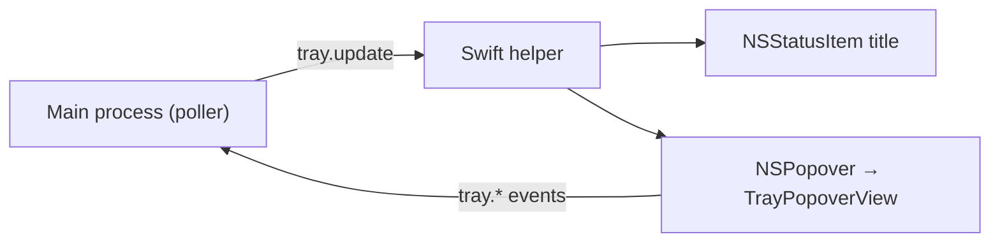

# Menu bar status item and popover

Both apps put a status item in the menu bar, and both open a native popover from it. The mechanism is
shared; what each app shows in the popover is not. Magimail's unread feed is in
[`../magimail/menu-bar.md`](../magimail/menu-bar.md), Magical's agenda in
[`../magical/menu-bar.md`](../magical/menu-bar.md).

## Status item and the popover run in the helper

The `NSStatusItem` and its `NSPopover` both live in the Swift helper process, not in Electron. The
main process serialises the state the item and popover need into one `tray.update` push and the
helper renders from it:



Opening the popover never waits on a request, because everything it shows arrives in the push. A
helper that is missing or has crashed leaves the status item absent for the run, which is a packaging
failure rather than a runtime one.

## Glyph

**AppKit inverts a template image to suit the menu bar it lands in, over a light desktop, a dark
desktop or a fullscreen menu bar, and keeps only the alpha.** Rendering the brand's full-colour
artwork with `isTemplate = true` is pixel-identical to rendering a black copy of it, so neither app
keeps a black copy: both draw one `MarkArtwork` from `packages/swift-brand`, and a surface differs
only in that flag and in width. Everywhere but the menu bar the flag stays false and the image is
pinned `.renderingMode(.original)`, or SwiftUI flattens the brand's colours to a single tint.

Each app's glyph is compiled into the Swift helper binary (`MenuBarGlyph`, in
`packages/swift-brand`), so there is no external resource bundle to load it from. If vector
rasterisation fails, the status controllers fall back to a standard SF Symbol such as `envelope` or
`calendar`.

The box sizes, the glyph grid and the shared line weight are in
[`brand-and-icons.md`](brand-and-icons.md).

## Lining the glyph and the bar up with the text

A status item's title sits beside the glyph, and Magical adds an account-colour bar inline. Both sit
on the middle of the title's capitals, which is the line that makes the two menu bar items look level
with each other.

**An inline bar shares the line with the words rather than the button**, so AppKit places it from the
baseline up instead of centring it. The attachment drops it below the baseline by half the difference
between the bar's height and the font's cap height.

## Sizing the status item

The status item is `variableLength`, so every item to the left of it moves whenever the title's width
changes. A title that changes on its own therefore has to be drawn into a field of a constant width,
with whatever the reading leaves over appended as a transparent `NSTextAttachment` of the measured
difference. The reserve trails the title rather than leading it: in front it would hold the item's
width just as well, but the words would slide rightwards as the text shortened; at the end it is empty
space against the neighbouring item and nothing visible moves.

The item keeps `variableLength` rather than taking a fixed `length`. A fixed width has to fit the
longest title the mode can draw, and macOS hides menu bar extras when it needs the room for app menus,
so that width comes out of whatever else the user keeps up there.

Magical's countdown is the title that changes on its own, and how its constant width is measured and
why is in [`../magical/menu-bar.md`](../magical/menu-bar.md).

## Popover

The popover is a native `NSPopover` with `.transient` behaviour, so clicking outside dismisses it, and
it takes the system `.popover` material, which follows the light and dark appearances on its own.

The width is a constant, set both on the `NSPopover` and on the popover view's own frame. Left to
disagree, the smaller of the two wins and AppKit clips what the other asked for.

Nothing sets a height. The hosting controller is given `sizingOptions = [.preferredContentSize]`, so
SwiftUI reports the height of what it has laid out and the popover takes it:

```swift
let host = NSHostingController(rootView: view)
host.sizingOptions = [.preferredContentSize]
pop.contentViewController = host
```

- **The popover is as tall as what it holds**, rather than a fixed frame with a void under the list.
- **It follows the content while it is open**, so it grows as state arrives rather than waiting to be
  closed and reopened.
- **A long list stops at `maxListHeight` and scrolls past it.** It is the only part of the popover
  held to a height; the header, search field, banners and footer each take what they need.

A popover whose width would vary with its content measures its widest label to size the window, which
is why both apps filter by a control that costs a fixed width rather than by a segmented control that
grows with the names.
