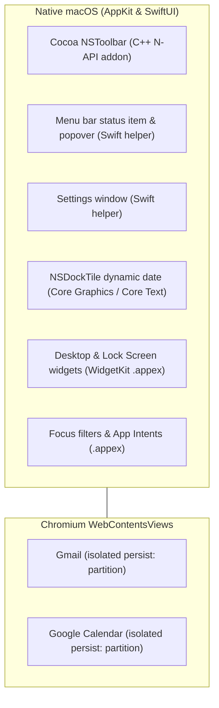

# Native UI outside the web views

Both apps render the Google Workspace page in Chromium and draw every other macOS surface with real
system controls. The ownership rule, the native toolbar and the helper-hosted settings window are
their subject. Each surface's own mechanics live elsewhere: the menu bar in
[`menu-bar.md`](menu-bar.md), notifications in [`notifications.md`](notifications.md), widgets in
[`widgets.md`](widgets.md), and Focus filters in [`focus-filters.md`](focus-filters.md).

## Who draws what

Electron renders the Google page and nothing else. Everything outside those web contents is a real
macOS control:

| Surface                 | Drawn by                       | Where     |
| :---------------------- | :----------------------------- | :-------- |
| Toolbar                 | Native N-API addon, in-process | `native/` |
| Dock tile               | Native N-API addon, in-process | `native/` |
| Settings window         | Swift helper                   | `swift/`  |
| Menu bar item & popover | Swift helper                   | `swift/`  |
| Notifications           | Swift helper                   | `swift/`  |
| Widgets                 | WidgetKit extension            | `.appex`  |
| Focus filters           | App Intents extension          | `.appex`  |

The helper and the addon are separate processes, and the extensions are OS-hosted bundles nothing can
call into. [`process-model-and-ipc.md`](process-model-and-ipc.md) covers how each is reached. The
project draws with real system controls rather than hand-rolled lookalikes, because native controls
track whichever macOS release is running; the principle is in [`design.md`](design.md).

## Toolbar

Both apps host an in-process native AppKit `NSToolbar` (`.unified` style), built in the app's
`native/` package and reached through the N-API addon. It draws over the window's titlebar rather
than inside a web view.

- **`NSSegmentedControl`** is the multi-account switcher, set as an `NSToolbarItem`'s view. It is a
  real AppKit control rather than a hosted SwiftUI view, so it renders with each OS's own chrome; a
  hosted SwiftUI view gets no chrome of its own and renders its segments as loose, unaligned labels
  in the titlebar.
- **`NSToolbarItemGroup`** groups related buttons. It is built by assigning real `NSToolbarItem`
  subitems rather than with the `images:` convenience initialiser, whose segments do not reflect a
  subitem's `isEnabled`, so the group could only grey out as a whole. `controlRepresentation =
.expanded` keeps every member visible and preserves the dividers.
- **SF Symbols** load from the OS with
  `[NSImage imageWithSystemSymbolName:symbolName accessibilityDescription:nil]`.

### Localised labels

Every user-visible string in the toolbar — item labels, tooltips, the Print and Share menu entries and
Magical's invitation dropdown — comes from the app's UI catalogue rather than the addon's Swift. The
app resolves `ui-strings.json` and pushes the result over the same JSON bridge that carries the
accounts and invitations (`toolbar_update_labels`), before the toolbar is built, so the items AppKit
creates already carry their final labels.

The addon cannot take the native route. It is a dylib loaded into Electron, not a bundle of its own,
so there is no resource bundle for Foundation to localise from — and SwiftPM's command-line
`swift build`, which is what builds it, copies a `.xcstrings` into a resource bundle without compiling
it, so `String(localized:bundle:)` would return the key. The app already authors, validates and
resolves these strings for its menus and dialogs, so the label the toolbar renders is the same string
the rest of the app would render.

The strings `SuiteNative` itself reads — the Search field's placeholder, the account switcher's
tooltips and the “Sign in required” description — are supplied the same way; an app asserts they
exist through `SHARED_TOOLBAR_LABEL_KEYS` and `SHARED_TOOLBAR_TEMPLATE_KEYS`. A label the app did not
send renders as an empty string rather than an English fallback, so a gap is visible rather than
silently merged.

The locale is read once from `app.getLocale()` in `whenReady` and the labels are pushed once before
the toolbar is built, so a language change takes effect on the next launch. macOS applies a system
language change at launch anyway, and every other shell surface the catalogue renders is built the
same way.

### Enabled state

The main process owns an item's enabled state and pushes it over `toolbar_set_item_enabled`. Items
override `validate()` and read from a shared store, because assigning `isEnabled` once does not hold:
AppKit revalidates on its own schedule, and its default validation enables any item whose target
responds to its action, undoing the assignment. The lookup descends into groups, because
`toolbar.items` holds a group rather than its members and `validateVisibleItems()` only validates the
items it lists.

### Sheet anchoring

Electron hangs sheets from the top of the content view, which on a `hiddenInset` window spans the
titlebar, so a sheet covered the toolbar it belonged to. `attachNativeToolbar` offsets them with
`BaseWindow.setSheetOffset(TOOLBAR_HEIGHT)`, the same constant the web view is inset by.

### Click dispatch

AppKit fires the Objective-C action selector, which calls an N-API `ThreadSafeFunction` to send the
action string and parameters back into the Node event loop.

### Back and forward input

macOS delivers a mouse's side buttons three different ways, and none of them reach the web view.
`MouseNavigationMonitor` translates all three into `goBack` and `goForward` actions:

| Input                                                                                                                     | NSEvent                         | Reads as                                         |
| ------------------------------------------------------------------------------------------------------------------------- | ------------------------------- | ------------------------------------------------ |
| A plain HID mouse                                                                                                         | `otherMouseDown`/`otherMouseUp` | `buttonNumber` 3 is back, 4 is forward           |
| The HID consumer codes `AC_Back` and `AC_Forward`, which is what a Logitech mouse sends with no vendor software installed | `swipe`                         | a positive `deltaX` is back                      |
| A driver that translates the buttons itself                                                                               | `systemDefined`, subtype 7      | `data1` of `1 << 3` is back, `1 << 4` is forward |

One press is reported on up to three of the paths at once: a Logitech mouse sends `otherMouseUp` and
then an aux-button release a few milliseconds apart. The first report within 150 ms moves, and the rest
of the group is dropped.

The trackpad arrives two ways depending on the Trackpad setting, and both are answered here. On
**Swipe with two fingers** macOS sends a `swipe` event, the middle row above. On the default **Scroll
left and right with two fingers** the gesture arrives as `scrollWheel` events that carry phases —
`began`, `changed`, `ended`, and then a separate run of momentum. The monitor accumulates the travel
while the phase says the hand is on the trackpad, ignores the momentum, and acts at `ended`: the finger
lifting, which is the boundary a page cannot see, since all it is told about is wheel deltas, where
momentum is indistinguishable from the hand. A wheel notch carries no phase, so that gesture ends after
a quiet 200 ms instead.

A gesture is claimed once it has travelled 16 points, and its events are consumed from then on. A
sideways scroll of a wide element therefore scrolls as usual until that point; the alternative is a
swipe that sometimes scrolls instead. A swipe towards the right steps back, as it does in Chrome and
Safari, and the two devices report a direction with opposite signs — a trackpad's sideways scroll is
negative towards the right and a wheel's positive — so the phase that separates the two kinds of gesture
is also what picks the sign.
The monitor acts on release rather than press, which is what Chrome and AppKit both do for a click.
It is a local monitor, so it sees an event before the responder chain does; returning nil consumes
the event, and the same press cannot also reach the web view.

The View menu's Back and Forward move the active account through its history, and both items are
enabled from `canGoBack()` and `canGoForward()`, so they grey out when there is nowhere to go, as a
browser's do. When an account view in Magimail is in a thread with no prior session history entry
(such as a deep-linked message from a notification), Back falls back to clicking Gmail's own Back button
to return to the mailbox list. Which inputs an app answers, and what they mean, is the app's to decide,
and the recognition is shared:

|          | Trackpad | Mouse side buttons | Mouse wheel                                       |
| -------- | -------- | ------------------ | ------------------------------------------------- |
| Magimail | history  | history            | scrolls: a wheel notch is a scroll, not a gesture |
| Magical  | a period | history            | a period                                          |

Magical moves a period on sideways gestures because Calendar adds no history entry when a day
or a week changes, so there is nothing for a history move to traverse outside the month view.

### Shared building blocks

Both apps build on `SuiteNative` (`packages/swift-native`):

- **`AccountSegmentedControl`**: a real AppKit `NSSegmentedControl`, so the segmented chrome is
  whatever the running OS draws.
- **`ToolbarManagerBase`**: manages the window lifecycle, re-attaches the toolbar when the window is
  re-created, and persists palette customisation. It installs the mouse navigation monitor, because
  that is bound to a window.
- **`MouseNavigationMonitor`**: turns the mouse and trackpad input described above into `goBack` and
  `goForward` actions across the native bridge.
- **`ItemValidation`**: a central validation registry that preserves enabled states through AppKit
  validation cycles.

Each app supplies its own item set: Magimail's is in
[`../magimail/overview.md`'s Native toolbar](../magimail/overview.md#native-toolbar), Magical's in
[`../magical/overview.md`'s Native toolbar](../magical/overview.md#native-toolbar).

## Settings window

The Swift helper renders Settings as SwiftUI views inside an `NSTabViewController`. The main process
does nothing but forward the request: there is no HTML settings window to fall back to, so when the
helper binary is missing there is no settings window at all.

The helper is restarted freely, so it holds no authority over what Settings shows. The main process
pushes the settings file, the account list and the app version with the request, and the window draws
from whatever that push last carried. Opening Settings from the helper's own menu therefore goes
through the main process rather than instantiating the window locally, which would show the built-in
defaults on a fresh helper and miss an account added since.

Both helpers build that window on `HelperUI` (`packages/swift-ui`): the `NSWindow` and
`NSTabViewController` host, the account list editor and its row, the default-handler row, and the
`#rrggbb` colour helpers. An app describes its own window with a `SettingsWindowSpec` — a title and a
list of `SettingsTab` values, each carrying a pane id, label, SF Symbol and height — so the two
windows cannot drift apart in their chrome. The panes themselves stay in the app, because they read
the app's own `SettingsModel`; the account list editor is generic over an `AccountListModel` protocol
(`accounts` plus a `transport`) both models satisfy, and an app that outgrows it can point its spec at
its own view instead. The package carries no catalog of its own; the sentences it draws sit in each
app's catalog and resolve against the app bundle the helper runs inside — see
[`ui-strings.md`](ui-strings.md).

## Dock tile

The Dock tile is drawn in-process rather than from static image files. Magical's date tile, its
midnight rollover and its badge are in [`../magical/dock-icon.md`](../magical/dock-icon.md), and the
drawing rule and the badge-triage rule are in [`brand-and-icons.md`](brand-and-icons.md).
