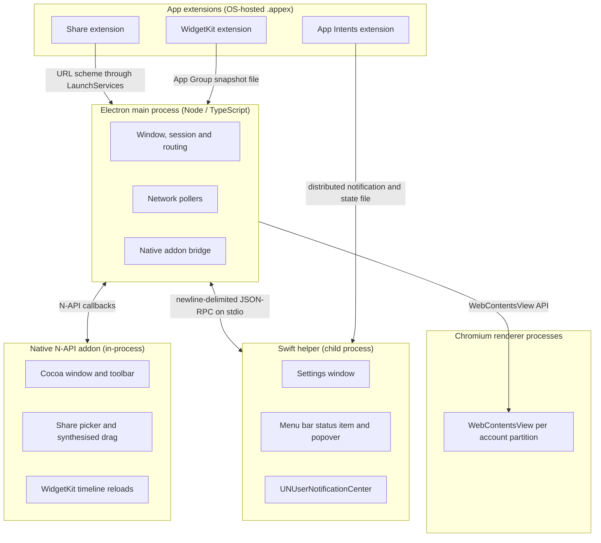

# Process model and IPC

Both apps run the same shape. An Electron main process orchestrates; a Swift helper draws the native
UI in a child process; a C++ N-API addon reaches the window from inside Electron; and OS-hosted
extensions, which nothing can call into, are reached through files, URL schemes and notifications.
The Google Workspace pages run in Chromium renderers, isolated one per account.

## Process shape



## Process roles

| Process            | Runtime                           | Role                                                                        | Lifetime                                                                                                |
| :----------------- | :-------------------------------- | :-------------------------------------------------------------------------- | :------------------------------------------------------------------------------------------------------ |
| Electron main      | Node.js / Electron                | Orchestration, window management, session storage, routing, network pollers | The application                                                                                         |
| Chromium renderers | Chromium / V8                     | Isolated views for the Google Workspace pages                               | Per partition, [released once the account has been idle](window-lifecycle.md#account-renderer-lifetime) |
| Swift helper       | Swift / AppKit / SwiftUI          | Settings, the menu bar item and popover, notifications                      | Child of main, over stdio                                                                               |
| Native N-API addon | Objective-C++ / C                 | Cocoa window and toolbar controls, share picker, synthesised drag           | In-process with main                                                                                    |
| Share extension    | Swift app extension               | The system Share Sheet target                                               | Ephemeral, OS-managed                                                                                   |
| Widget extension   | SwiftUI / WidgetKit               | Desktop and Notification Centre widgets                                     | Ephemeral, `chronod`-managed                                                                            |
| App Intents        | Swift / AppIntents / ExtensionKit | Focus Filters and their account pickers                                     | Ephemeral, `linkd`-managed                                                                              |

Not every app ships every extension; the shape is shared, the set is not.

## Swift helper

Main spawns the helper with `child_process.spawn(helperPath, [], { stdio: ['pipe', 'pipe', 'pipe'] })`
and exchanges newline-delimited JSON on it. Three envelopes carry everything:

- **A request** from main to the helper is `{ method, params }`. `id` is optional and most calls are
  fire-and-forget.
- **A response** from the helper is `{ id, result }`, sent only when the request carried an `id`.
- **An event** from the helper is `{ method, params }` with no `id`. That missing `id` is how the
  main process tells an event from a response.

Method names are dotted and namespaced by surface, so `settings.show`, `tray.update` and
`notify.dispatch` name both the surface and the call.

Two rules keep the pipe intact:

- **stdout is the protocol.** A bare `print()` in the helper interleaves with it and is dropped as
  unparseable. Helper diagnostics go to stderr as `LEVEL|Category|message`; see [`logging.md`](logging.md).
- **The helper is a child process, so it can go away.** It is respawned transparently on the next
  call, and anything the main process needs it to know again, such as the current tray contents, is
  replayed from state the main process holds. A helper that was never found leaves the native
  surfaces absent for the run, which is a packaging failure rather than a runtime one.
- **The helper shares the app's bundle identity.** Both register with LaunchServices under the same
  bundle id, so a quit addressed by name can reach the helper instead of the app. The helper
  implements `applicationShouldTerminate` and forwards the request as an `app.quit` event, which
  main answers by quitting. Cmd-Q is unaffected, because it reaches the frontmost application.

## Reaching an app extension

An `.appex` runs in a sandbox of its own, launched by the system when it decides to. There is no pipe
to it and no call back, so every channel is one of three:

- **A file the extension reads.** The widget extensions render from a snapshot the app leaves in the
  App Group container, because `chronod` can launch them long after the poll that produced the data.
- **A URL scheme through LaunchServices.** The Share extension and deep links arrive as a custom
  scheme the app registers, and main handles them in `open-url`.
- **A distributed notification carrying a name only.** A sandboxed process cannot deliver a
  `userInfo` payload, so the notification says which file changed and the state lives in the file.
  An App Intents extension writes its decision, then posts the notification the helper is watching.

## Extension mechanics both apps share

The three channels above are how the app and an extension reach each other. What follows is the
machinery behind them, all of it shared by every `.appex` in the project.

### App Group container

The widget snapshot, the focus state and each extension's log live in an App Group container every
process is entitled for:

```plain text
~/Library/Group Containers/<TEAM_ID>.group.com.alexhaslam.<app>/
```

Resolving the path goes through the native addon, because only
`containerURL(forSecurityApplicationGroupIdentifier:)` makes `containermanagerd` create and bless a
directory a sandboxed extension can open. A `mkdir` from Node produces one the extension cannot open.
The extension resolves the same container the same way.

That call carries no bundle-identity requirement, unlike the WidgetKit reload below: it reads the
code signature's entitlements and team prefix, not `CFBundleExecutable`, and it lives in the addon
only because Node cannot make the call.

**Neither side names the group.** Its team prefix is fixed when the app is signed, and only the
certificate knows it. The app reads `com.apple.security.application-groups` back out of its own
signature through `SecCodeCopySigningInformation`; each extension reads the identifier its `build.sh`
stamped into `Info.plist` as `AppGroupIdentifier`, resolved from the same certificate. A constant in
the source would be right for one team and wrong for every other, and wrong quietly: the container
fails to resolve. A build that resolves no team gets no entitlement, because the entitlement
generator drops the group rather than leaving it dangling, and no container: the app writes no
snapshot and every widget renders its placeholder.

App Groups need no provisioning profile and so no Developer Program enrolment; see
[`building-and-signing.md`](building-and-signing.md).

### A WidgetKit reload belongs to the Electron main process

`WidgetCenter` asks macOS `chronod` _which_ widgets to reload, and `chronod` uses Apple's internal
`BaseBoard` framework to check that the caller's process executable matches `CFBundleExecutable` in
the bundle's `Info.plist`. A helper in `Contents/MacOS` shares the app's bundle ID and still fails
that check: BaseBoard logs `Resolved bundle path does not match executable` and `chronod` rejects the
reload with `ChronoCoreErrorDomain` code 10.

Only the Electron main process matches `CFBundleExecutable`, so the call goes through the native
addon. When the host app is idle, a 15-minute policy on the widget's timeline refreshes it anyway.

### Focus state shares the App Group

The App Intents extension, the Swift helper and the app all reach `accounts.json` and
`focus-filter.json` through the same App Group container that holds the widget snapshot and the logs.
The extension holds only `app-sandbox` and the group; the helper is signed with the group entitlement
so it can read the focus state.

A build with no group, such as an ad-hoc build or one signed without a team, falls back to
Application Support for `accounts.json` and `focus-filter.json`. The extension does not load in that
case, so nothing writes focus state there, and the app and helper agree on the fallback path.

### Extension build number

`stamp_bundle_version` in `tools/signing.sh` writes both numbers into every `.appex`.
`CFBundleShortVersionString` is the marketing version from `package.json`; `CFBundleVersion` is the
build number, defaulting to seconds since the epoch. macOS decides an extension bundle has changed by
the build number, so `chronod` re-reads a widget descriptor only when it moves. The marketing version
moves once per release and is shared by every build in between, so a rebuild with the same build
number keeps the old descriptor: the widget loses its configuration intent and every reload fails
with `CHSErrorDomain 1103`, and a rebuilt App Intents extension answers from the old binary. The clock
is enough because a build number only has to differ and stay monotonic. A stale extension process
that survives an install is killed with `pkill -f <App>AppIntents`.

### A packaged build in a worktree can serve instead of the installed app

A packaged build left in a git worktree's `release/` directory registers the same bundle identifier
as the installed app, and macOS may launch that copy's extension instead. Every reinstall to
`/Applications` then goes to a bundle nothing uses.

It hides well. Both copies carry the same bundle identifier and read the same state file, so the
picker lists the right accounts and follows a rename immediately, which reads as proof that the
installed app is being used. Only what the two builds disagree about, anything you just changed, fails
to appear. `pgrep -af <App>AppIntents` prints the path the extension was launched from; if it points
anywhere but `/Applications`, the stray copy has to be unregistered and its `.app` name taken away so
LaunchServices stops resolving to it.

## Fault tolerance

- **The helper crashes or stops answering.** Main respawns it before the next write, and replays the
  state it must know. An RPC that times out (5000ms) terminates the unresponsive helper so the next
  write can respawn a healthy one rather than failing repeated writes against a wedged process. Mail
  and calendar data are unaffected, because they live in the renderers and the pollers.
- **A renderer or child process dies.** `render-process-gone` and `child-process-gone` are recorded;
  nothing else captures them, and a dead renderer otherwise leaves a blank pane.
- **The machine sleeps.** Pollers pause on `powerMonitor` suspend and refresh on resume, so a wake
  does not wait out the normal interval.

Failures are written to `~/Library/Logs/<AppName>/main.log`; see [`logging.md`](logging.md) for what
is recorded and what is redacted out.
