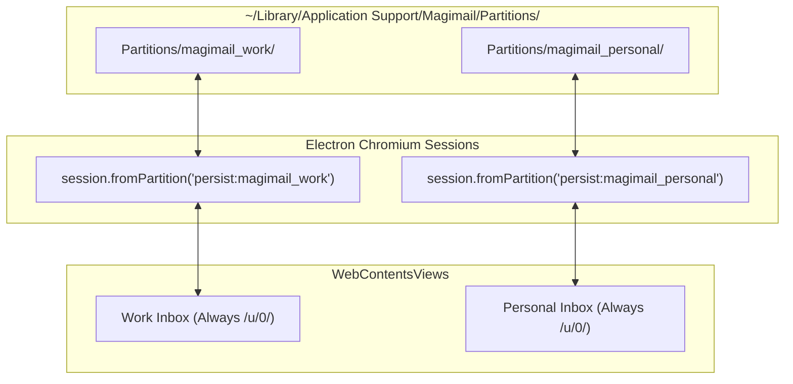
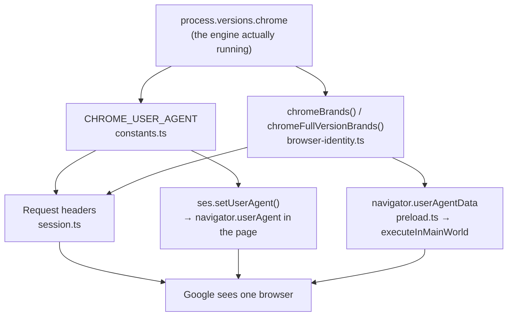

# Session isolation, partitions and browser identity

## Multi-partition session sandboxing

Every account runs in its own Chromium session partition. `account-store.ts` names partitions
`persist:magimail_<accountId>`; the default account uses `persist:magimail_personal`
(`DEFAULT_PARTITION` in `apps/magimail/src/constants.ts`). A new account's id comes from
`newAccountId()` in `packages/core`, shared by both apps: `account_` plus a random uuid, so it is
unique across the two apps without coordination and carries neither the created time nor the order.
Accounts already on disk keep the id they were saved with.



Within its own `persist:` partition, every account is always `/u/0/`. Sharing one session, as
ordinary Chrome does, makes Google index accounts `/u/0/`, `/u/1/` and so on by login order; a
session expiring reorders them and breaks the mapping from tab to account. A partition also carries
its own authentication lifecycle, so logging out of one Google account leaves the others signed in.

### Each app holds its own accounts

Magimail and Magical keep separate accounts files and separate partition prefixes,
`persist:magimail_<accountId>` and `persist:magical_<accountId>`. Signing into an account in one app
leaves the other signed out of it, so the user signs in twice.

### Cookie encryption at rest

Session cookies on disk are encrypted using macOS Keychain. Packaged builds flip the
`enableCookieEncryption` Electron build fuse in `electron-builder.json`, which activates Chromium's
OSCrypt layer.

Chromium derives an encryption key from an entry in the user's login keychain named
`<Product Name> Safe Storage` (`Magimail Safe Storage` and `Magical Safe Storage`). Cookie values in
the SQLite `Cookies` database are stored encrypted in the `encrypted_value` column, leaving the
plaintext `value` column empty.

Chromium seals the cookies. The apps seal the JSON files they write themselves, under a key of their
own; see [Local cache files](#local-cache-files).

## Browser identity and authentication

Google refuses sign-in from browsers it regards as insecure, with _"This browser or app may not be
secure"_. What it checks is consistency: the header, the JavaScript and the engine name have to
agree, or the page will not load.

The apps present one identity on every surface Google can observe: branded Chrome, at the version of
the Chromium the app ships. Sending a Safari User-Agent to the accounts hosts and Chrome everywhere
else does not work: the split lives only in the request headers while the page's JavaScript reports
Chrome, and feature detection, error-stack formats, `window.chrome` and Client Hints support all
identify Blink, which no header work settles.



### Version derivation

Every version is read from `process.versions.chrome`, which Electron exposes in the main process and
in preloads alike. Nothing has to be updated when Electron is upgraded, and there is no second copy
to fall out of step with the first.

The one hand-written version is `CHROMIUM_VERSION_FALLBACK`. It is used only where there is no
Electron `process`, which means unit tests, so it never reaches Google.
`packages/core/tests/browser-identity.test.ts` runs the installed Electron binary with
`ELECTRON_RUN_AS_NODE=1` and fails if the fallback has fallen behind it, because a pinned version
goes stale silently.

### What is sent, and what is deliberately not

| Surface                                                           | Value                                                                                  | Source                          |
| :---------------------------------------------------------------- | :------------------------------------------------------------------------------------- | :------------------------------ |
| `User-Agent` header                                               | `Chrome/<major>.0.0.0`, platform frozen at `10_15_7` as Chrome's UA reduction requires | `CHROME_USER_AGENT`             |
| `navigator.userAgent`                                             | identical: `ses.setUserAgent()` governs both                                           | `CHROME_USER_AGENT`             |
| `Sec-CH-UA`, `Sec-CH-UA-Full-Version-List`                        | GREASE + `Chromium` + `Google Chrome`, on HTTPS only                                   | `chromeBrands()`                |
| `navigator.userAgentData`                                         | the same two lists, installed in the page's main world                                 | `chromeBrands()`                |
| `Sec-CH-UA-Mobile`, `-Platform`                                   | `?0`, `"macOS"`                                                                        | fixed; true of every build      |
| `Sec-CH-UA-Platform-Version`                                      | **not sent**                                                                           | None                            |
| `navigator.vendor`, `.webdriver`, `platformVersion`, architecture | **not touched**                                                                        | Chromium's own, already correct |

Two values are left out on purpose:

- **`Sec-CH-UA-Platform-Version` is not sent.** It is high-entropy, so Chrome states it only when a
  server asks via `Accept-CH`, and the main process has no honest value for it. Saying nothing cannot
  contradict the real value the page reports.
- **`navigator.vendor` and `navigator.webdriver` are not overridden.** Chromium already reports
  `"Google Inc."` and `false`. Patching a property that is already right only creates a new
  opportunity to disagree with it.

Electron's Chromium sends no `Sec-CH-UA` headers at all while still exposing
`navigator.userAgentData` to pages, so the low-entropy hints have to be supplied. It also advertises
itself as bare `Chromium` with no `Google Chrome` brand, which contradicts a Chrome User-Agent; both
lists add that entry at the engine's own version.

### Main-world identity patch

Account views run with `contextIsolation: true`. Anything a preload defines on `navigator` lands in
the isolated world, and the page never sees it. The identity patch therefore goes through
`contextBridge.executeInMainWorld`, which serialises the function and calls it in the page.
`applyMainWorldIdentity` consequently may not reference imports, module constants or any closure.
The brand lists are passed in as `args`, and a test asserts the function's source contains no such
reference.

### Verifying a change

Check anything that touches this file against a real page: compare the request headers with the main
world's values for the same load. Unit tests cover the brand lists and the version derivation, but
they cannot see what a page receives, and the failure is the two sides disagreeing, which no
single-sided assertion catches.

## Why neither app holds an OAuth client

The apps use no OAuth:

- **Magimail** reads unread counts and snippets from the authenticated feed
  (`/mail/u/X/feed/atom`) and triggers mutations through page actions.
- **Magical** reads events from the authenticated web endpoint (`sync.prefetcheventrange`) and
  dispatches RSVPs through response URLs.

So there is no OAuth client, no Google Cloud project, no consent screen and no API quota. Sign-in is
the user's ordinary Google sign-in, happening in Google's own pages, and no token ever reaches the
app. Nothing to leak, nothing to rotate, no quota to exhaust, and no verification to pass before
shipping a feature.

Using standard web sign-in aligns the client directly with standard web browser access. Rather than requiring OAuth consent and custom API token management, authentication happens directly within Google's standard first-party web login flows, inheriting the user's existing browser session security policies.

### What having no contract costs

If embedded sign-in is blocked, or the feed is retired, every install stops working at once and
there is nobody to appeal to. The only mitigation is speed: the User-Agent and partition strategy
stay documented where they can be changed quickly.

Adopting OAuth would move the risk rather than remove it. A verified client can have its verification
reviewed again, its scopes reclassified, or its consent screen rejected on a branding change, and an
administrator can still restrict embedded sign-in.

### Naming

Describe the apps as "a Mac client for Gmail" and "a Mac client for Google Calendar". Descriptive
use of the product name is fine. Use no Google logos or marks anywhere in the apps, the site or a
store listing.

## Local cache files

Every file an app writes and reads back on its own is encrypted under a key in the login keychain.
These files hold meeting titles, message subjects and snippets; as plaintext JSON, any process
running as the user could read them. `widget-cache.json`, `accounts.json` and `focus-filter.json`
stay plaintext, because each is read by the widget extension or the App Intents extension, a
separate sandboxed binary, so sealing them would mean both sides holding the same key. A keychain
item shared across bundles needs a keychain access group, and macOS kills a bundle claiming that
entitlement at exec unless it also carries a provisioning profile issued by Apple, so no packaged
build could reach the key and every file would fail closed. The key therefore sits in the login
keychain, which the Electron process reaches on its own, and the three extension-read files wait for
a provisioning profile. App Group entitlements are a different case and need no profile, which is
why `widget-cache.json`, `accounts.json` and `focus-filter.json` all live in the group container; see
[`building-and-signing.md`](building-and-signing.md).

### Sealed file format

`packages/core/src/secret-file.ts` reads and writes the format in the Electron process, and
`apps/<app>/swift/Sources/<App>HelperLib/SecretFile.swift` does the same in Swift. The layout is
pinned, because both sides open the same files:

```plain text
0    "MAGBOX"     6 bytes, ASCII
6    0x01         format version
7    nonce        12 random bytes
19   ciphertext   AES-256-GCM over the UTF-8 JSON
-16  tag          16 bytes
```

The file's own basename is the additional authenticated data, so one file's ciphertext cannot be
dropped into another's place and still open. A file that does not start with the header is legacy
plaintext JSON and is returned as it stands; every write is encrypted, so an existing install
converts each file the first time it writes it. Reading a legacy file needs no key, so a build that
cannot reach the keychain still starts.

The Swift half is one source file per app rather than a shared target, compiled into the helper, the
widget extension and the App Intents extension. The App Intents extension is built by a bare
`swiftc` invocation, which cannot consume a SwiftPM library without building and passing the module
by hand, so that file is named on the command line in each target that needs it.

The widget extensions do link a SwiftPM package — the brand artwork, from `packages/swift-brand` —
because xcodebuild resolves a local package for them.

Both test suites seal and open the same pinned vector, sealed under the name `settings.json` with a
key of the bytes `0x00` to `0x1f`, so the two implementations cannot drift apart without a test
failing. CI runs `swift test` for both helpers.

### Which files are sealed

| File                             | App      | What it holds                                                       |
| :------------------------------- | :------- | :------------------------------------------------------------------ |
| `settings.json`                  | both     | every preference the user has set                                   |
| `event-cache.json`               | Magical  | three days of meetings, tens of kilobytes of titles                 |
| `alert-state.json`               | Magical  | which alerts have already fired                                     |
| `atom-state/<accountId>.json`    | Magimail | the message ids the poller has already announced                    |
| `theme-preference.json`          | Magimail | the theme choice                                                    |
| `default-client-preference.json` | Magimail | whether the `mailto` prompt was dismissed for good                  |
| `unread-counts.json`             | Magimail | the last known unread counts, so a launch starts at the real number |

`widget-cache.json`, `accounts.json` and `focus-filter.json` are plaintext; [Local cache
files](#local-cache-files) says why. The unread counts are sealed in their own file rather than kept
in `accounts.json` for that reason: the App Intents extension reads the account list for the Focus
Filter picker and cannot decrypt, so the shared copy carries the account list and nothing else, and
counts left in an older copy are stripped on load.

### Key and where it lives

The key is 32 bytes in a generic password item in the login keychain, created on first use. Magimail
names its item `com.alexhaslam.magimail.localcache` and Magical `com.alexhaslam.magical.localcache`,
both under account `v1`. Two files describe the item for each app,
`native/Sources/KeychainBridge.swift` for Node and `SecretFile.swift` for Swift, and every field has
to match across them or each side creates a key of its own and neither opens the other's files.

Node cannot call `SecItem`, so the Electron process reaches the key through a
`@_cdecl("localcache_key")` bridge in each app's native addon. It crosses base64-encoded, because
the bridge returns a C string and a random key contains NUL bytes.

Every process fetches the key once and holds it for its life. The call crosses into `securityd`, a
settings write happens on every keystroke in the settings window, and WidgetKit gives a timeline
provider a few seconds in total. When two processes race to create the item, the one already on
disk wins: `SecItemAdd` reports `errSecDuplicateItem` and the loser re-reads rather than keeping the
key it just generated.

### Unpackaged builds write plaintext

`app.isPackaged` decides, and each app's `main.ts` passes it to `configureSecretFiles` before
anything reads a file. An unpackaged build writes plaintext and asks for no key unless it meets a
sealed file. A dev run shares `userData` with the installed app, so this is also what stops it
writing factory-fresh plaintext defaults over the packaged build's settings.

### When a file will not decrypt

A file that carries the `MAGBOX` header but does not decrypt is never read as plaintext, because a
file someone replaced would then open exactly as they intended. `readSecretFile` keeps the two cases
apart: it returns `null` when the file is absent, and throws `SecretFileUnreadableError` when the
file is present but yields nothing. What happens next depends on the file.

- **`settings.json` is neither read nor rewritten for the rest of the session.** Both apps fall back
  to defaults and log on every save that the file is left alone. The unreadable file still holds
  every preference the user set, and replacing it with defaults is the one outcome nothing recovers
  from.
- **Every other file is discarded and rebuilt**, each with a log line: the event cache refills on the
  next poll, an empty alert record risks repeating one banner, the poller takes the next feed as its
  baseline and announces nothing from it, the theme falls back to `system`, the `mailto` prompt
  returns once, and the unread counts fall back to zero until the first poll answers.

## Removing an app

macOS runs no code when a bundle is deleted and never clears an app's `~/Library` files, so an install
dragged to the Bin leaves its Google sessions, caches, preferences and login item on the machine for
good. The cleanup therefore runs from inside the app, before it is gone: **Remove All App Data and
Quit…** in the app menu, on its own above Quit.

`packages/core/src/app-removal.ts` holds the target list and the script; each app's
`src/remove-all-data.ts` supplies the paths, confirms first, and quits. The item is offered only on a
normal installed launch — `app.isPackaged`, default userData, not demo mode — because the files it
removes belong to the installed app, and a `--profile`, `--user-data-dir`, `<APP>_USER_DATA_DIR` or
demo run would be deleting the default install's accounts from the menu of a throwaway one.
`MAGIMAIL_REMOVE_ALL=1` and `MAGICAL_REMOVE_ALL=1` bypass the gate so an end-to-end test can drive
the flow from an unpackaged build.

### What is removed

`removalTargets` returns the paths in this order, dropping the ones that do not apply and any
repeat:

- `app.getPath('userData')`, holding `accounts.json`, the sealed cache files and `Partitions/`.
- `app.getPath('logs')`, which is `~/Library/Logs/<AppName>`; see [`logging.md`](logging.md).
- The App Group container, when the app resolves one: the widget snapshot, the extension logs, and
  the plaintext `accounts.json` and `focus-filter.json` the extensions read.
- `~/Library/Preferences/<bundleId>.plist`.
- `~/Library/Caches/<bundleId>`, `~/Library/WebKit/<bundleId>` and
  `~/Library/HTTPStorages/<bundleId>`, which Chromium keys by bundle id rather than by userData.
- `~/Library/Saved Application State/<bundleId>.savedState`.

The extension sandboxes are their own case. Each `.appex` writes inside
`~/Library/Containers/<bundleId>.<extension>`, and the app finds them by glob at the moment it
schedules the removal rather than listing known names: an extension creates its container only once
macOS has launched it, so a build whose Share extension has never run has none.

The removal empties each container: the staged share files, the extension's copy of the widget
snapshot and the timelines `chronod` writes all go. The container itself survives, because
`containermanagerd` owns `.com.apple.containermanagerd.metadata.plist` and denies its removal to
every other process. The empty skeleton outlives the removal, and a reinstall reuses it.

WidgetKit keeps a relevance index of its own under `~/Library/Caches/com.apple.chrono`, and that one is
left alone. Each file there mixes the widget kinds and usage scores of every app on the machine rather
than one, and holds no user content, so deleting an app's entries alone would damage the others'.

The login item is turned off (`setOpenAtLogin(false)`) before the shell starts. It is a registration
rather than a file, and one left in place has macOS launching a path that no longer exists.

### Deletion runs after the quit

`deferredRemovalShell` builds a `/bin/sh -c` body that takes the app's pid as `$1` and the paths as
`$2…`, polls `kill -0 "$1"` until it fails, then `shift`s and runs `rm -rf --` on each remaining
positional. The app schedules it and quits at once, and the child is spawned `detached` and `unref`ed
so it outlives the parent.

The wait is the point. Chromium flushes `Local State` and its singleton files _during_ shutdown, so a
delete in process races a browser still writing to the userData directory. Nothing is interpolated
into the script text either: the paths arrive as positional arguments and the preferences domain in
`REMOVAL_PREFS_DOMAIN`, so a path holding a space, a quote or `$(…)` is removed as itself and cannot
change what the shell runs.

`/usr/bin/defaults delete <bundleId>` follows the `rm`s, guarded by a non-empty
`REMOVAL_PREFS_DOMAIN` and with its failure ignored. Removing the plist alone is not enough, because
`cfprefsd` holds the domain in memory and writes it back; by the time this runs the file is already
gone, which is why the error is dropped rather than reported.

### The keychain is left alone

No keychain item is deleted. Clearing the bundle removes nothing from the login keychain, so the
items the apps put there already outlive an install — the `<Product Name> Safe Storage` cookie key
and each app's local cache key ([Key and where it lives](#key-and-where-it-lives)) — and a removal is
not the moment to guess at a list. `removalTargets` carries `keychainServicesToPreserve`, which names
the keychain services a removal leaves in place. No keychain item is deleted today.

### Notifications are cleared, not revoked

The main process sends `notify.clearAll` to the helper before the shell is spawned, so no banner or
scheduled alert survives pointing at an account whose data has gone. macOS offers no API to revoke
the authorisation itself, so the app's row in System Settings outlives the removal; see
[`notifications.md`](notifications.md).
