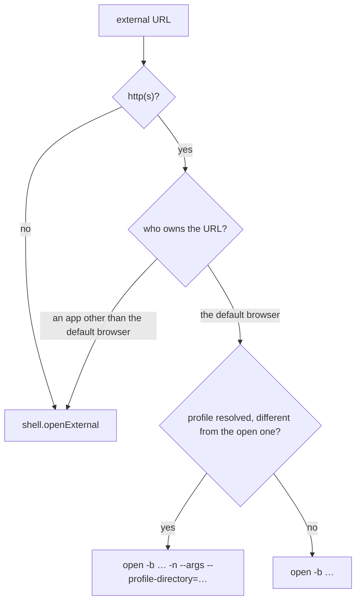

# Third-party desktop links

Event bodies, Google Tasks and emails frequently contain links to external productivity tools,
such as task managers (Todoist), issue trackers (Linear), notes (Notion), design tools (Figma)
and team chat (Slack).

Google wraps outbound links in tracking redirectors (`https://www.google.com/url?q=...`), and
invitations or emails forwarded through Microsoft 365 carry Outlook Safelinks. These tracking
redirectors break Apple Universal Links because macOS checks only the outer `google.com` or
`safelinks.protection.outlook.com` domain.

Both Magimail and Magical unwrap tracking redirectors via `@magimail/core` before dispatching
external URLs to macOS.

```mermaid
flowchart TD
  Trigger["External link click<br/>(email body, event description, task)"] --> Unwrap["unwrapRedirectors(url)<br/>(@magimail/core)"]
  Unwrap --> Route["openExternalUrl(url, account)<br/>(@magimail/core)"]
  Route --> Choice{"account.browser set<br/>and not system?"}
  Choice -->|no| Universal["shell.openExternal(unwrappedUrl)<br/>macOS LaunchServices"]
  Choice -->|yes| Direct["/usr/bin/open -b bundleId<br/>with --profile-directory"]
  Universal --> Resolution{"Desktop client installed<br/>for target domain?"}
  Resolution -->|Yes (Todoist, Notion, Linear, Figma, Slack)| App["Native Desktop Application<br/>(Apple Universal Links)"]
  Resolution -->|No / unknown domain| Browser["System Default Web Browser"]
  Direct --> Browser
```

## Redirector unwrapping in `@magimail/core`

`unwrapRedirectors` in `@magimail/core` (`packages/core/src/links.ts`) recursively strips known
tracking and protection wrappers up to three hops:

- **Google outbound redirectors**: URLs matching `google.com/url` or `*.google.com/url` extract the
  destination URL from the `q` or `url` query parameter.
- **Outlook Safelinks**: URLs matching `safelinks.protection.outlook.com` extract the target URL from
  the `url` query parameter.
- **Direct URLs**: URLs without tracking parameters or unrecognised hosts pass through untouched.

## Desktop app dispatch via Apple Universal Links

macOS routes HTTP and HTTPS URLs to installed native applications that register domain associations
via `apple-app-site-association` (Universal Links).

When `shell.openExternal(unwrappedUrl)` passes a clean URL — which is what happens unless an
account names a browser, see below — LaunchServices resolves it:

1. **Installed application**: macOS hands the link directly to the native desktop application
   (such as Todoist for `app.todoist.com`, Notion for `notion.so`, or Linear for `linear.app`).
   No browser tab or interstitial window opens.
2. **Missing application or unassociated domain**: macOS routes the destination URL directly to
   the user's default web browser without passing through Google's tracking redirect page.

Because Universal Links are maintained by macOS LaunchServices per installed application,
supporting external tools requires no per-app custom schemes or individual user settings.

## Browser and Chromium profile

Two Google accounts signed in to the same Chromium browser share nothing, and a Meet link that
lands in the wrong profile asks to be let in. Two settings answer which browser a link opens
in, and they are deliberately split by what varies:

| Setting                            | Where    | Answers                                    |
| :--------------------------------- | :------- | :----------------------------------------- |
| `openLinksIn` (`settings.json`)    | General  | Which browser leaves the app for the web   |
| `browserProfile` (`accounts.json`) | Accounts | Which Google session it opens that link in |

The browser is one answer for the machine — it is where someone works, and picking it twice for
two accounts of the same person would only invite them to disagree. The profile is the part that
differs per account, so it sits on the account's own row in Settings, and the row shows the
resulting choice (`Match email`, `Last used`, or a profile's name). The menu is greyed out when
the chosen browser keeps no profiles, which is what tells a user why Safari offers nothing.

### Resolving a profile

Profiles come from each browser's `Local State` (`profile.info_cache`), the one file Chrome,
Brave and Edge all write: directory name, display name, and the Google account signed in.
`profile.last_used` names the profile the browser is working in, which is the one its open
window shows.

An account's `browserProfile` is `_auto` (the default), `_none`, or a profile directory. The menu
lists **None** and the profiles; it never names the rule that chose. _Match email_ asked a user to
reason about a rule and then guess its outcome, where a profile's name states the outcome. So the
row reads `Alex` or `None`, and what it says is what happens:

| Stored                             | Menu shows   | Launch                         |
| :--------------------------------- | :----------- | :----------------------------- |
| `_auto`, address matches a profile | that profile | `-n --profile-directory=<dir>` |
| `_auto`, no match                  | `None`       | handed to the browser          |
| `_none`                            | `None`       | handed to the browser          |
| a directory                        | that profile | `-n --profile-directory=<dir>` |

The cost of naming outcomes instead of rules is that the automatic row can change on its own when
an account's address starts or stops matching a profile. `None` exists so that "let the browser
decide" is something the user can say, rather than the state they end up in after unticking.

`_auto` means the profile signed in as the account's address. Where no profile carries that
address the resolver returns `null`, which leaves `--profile-directory` off the launch line;
Chromium then does what it does with any URL and opens it in the profile it is already working
in. Naming `Default` there instead would send the link to a profile the user may never touch, and
would show as a second instance for no gain.

That address is the piece `accounts.json` did not carry. An account is a name, a colour and a
partition, which is enough to show a mailbox and not enough to know which Chromium profile belongs
to the same person. Both apps read it from the page instead, through the same two pieces in
`@magimail/core/account-email.ts`: `ACCOUNT_EMAIL_SCRIPT` finds it in Google's own account chip
(`Google Account: Name (someone@example.com)`, with the address in parentheses whatever the
interface language is), and `readAccountEmail` retries the read because a settled document is not
a painted one — the chip arrives after `did-stop-loading`. Google's answer is treated as input,
not fact: `isAccountEmail` decides whether it is an address before anything is written. Each app
then stores it on the account, once, and logs the id rather than the address.

Magimail's Atom feed also carries the address in its header, which the poller already downloads;
it is not read, so that one mechanism serves both apps and there is one place to fix if the chip
moves.

Safari has no supported flag or URL scheme for profile targeting, so it is offered as a browser
and nothing more.

### The owning app comes first

Before anything is launched, `openExternalUrl` asks LaunchServices which application would
open the URL. The answer is the app that claims the domain when one does, and the Mac's default
browser otherwise, so a reply that is not the default browser means a desktop app owns the link.
That one is opened through `shell.openExternal`, whatever profile the account names: starting a
browser by name is exactly what would take the link away from its app.



### Launching

`openExternalUrl` launches the browser itself when it has a profile to apply:
`/usr/bin/open -b <bundleId> -n --args --profile-directory="<dir>" <url>`. Chromium reads
`--profile-directory` only when it is starting, so `-n` is what makes the flag mean anything —
and the cost is a second instance. When the resolved profile is already the one the browser is
in there is nothing to gain from that, so the URL takes a plain `open -b` and lands in the
window that is open. When there is no profile at all, or the browser cannot be launched by
bundle id, the URL goes to `shell.openExternal` as before.

That last fallback is also why `openLinksIn` starts as `system` on an install that never chose.
`loadSettings` adopts the Mac's default browser only when it is one whose profiles we can
apply — so an account's profile works without a second step — and leaves `system` in place for
anything else, which keeps Universal Links working for a Safari or Firefox default. Once a
Chromium browser is adopted or chosen, links to a domain owned by a desktop app open in that
browser instead of the app: the profile is only reachable by starting the browser, and macOS
would otherwise route the URL to the app. A failed launch still falls back to
`shell.openExternal`, so a URL cannot be left unopened.

`getDefaultBrowser` reads the LaunchServices handler for `https`, and the General tab marks that
row `(default)`. It is not a separate choice: the row and the Mac's default are the same
browser, and a picker that lists one browser twice asks the user to choose between two names
for one thing. A default browser outside `SUPPORTED_BROWSERS` (Firefox, Arc) gets a row named by
macOS — `Firefox (default)` — which stores `system`, and the profile menu greys out with it.

## App-specific integration

- **Magimail**: Outbound links in `setWindowOpenHandler` and `will-navigate` in
  [`../magimail/overview.md`](../magimail/overview.md) unwrap redirectors and then call
  `openExternalUrl` with the account.
- **Magical**: Outbound links in event descriptions and tasks pass through `openExternalUrl` in
  `links.ts`. Magical also rewrites video conference links (Zoom and Microsoft Teams) to native
  custom schemes; see [`../magical/conference-links.md`](../magical/conference-links.md).
