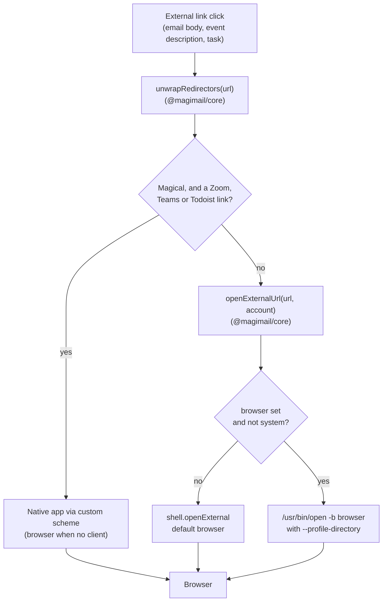

# Third-party links

Event bodies, Google Tasks and emails frequently contain links to external productivity tools,
such as task managers (Todoist), issue trackers (Linear), notes (Notion), design tools (Figma)
and team chat (Slack).

Google wraps outbound links in tracking redirectors (`https://www.google.com/url?q=...`), and
invitations or emails forwarded through Microsoft 365 carry Outlook Safelinks. Both hide the
destination from anything that tries to recognise it.

Both Magimail and Magical unwrap tracking redirectors via `@magimail/core` before routing a link.

## Redirector unwrapping in `@magimail/core`

`unwrapRedirectors` in `@magimail/core` (`packages/core/src/links.ts`) recursively strips known
tracking and protection wrappers up to three hops:

- **Google outbound redirectors**: URLs matching `google.com/url` or `*.google.com/url` extract the
  destination URL from the `q` or `url` query parameter.
- **Outlook Safelinks**: URLs matching `safelinks.protection.outlook.com` extract the target URL from
  the `url` query parameter.
- **Direct URLs**: URLs without tracking parameters or unrecognised hosts pass through untouched.

## Desktop apps

There is no table of apps a host belongs to. A host table cannot tell whether the app claims a
particular path, and `open -b <app> <url>` reports success when the app ignores the URL, so a
wrong entry loses the link silently.

Instead the default is the browser, and the desktop app is reached one of two ways:

- **The site hands off.** Slack, Linear, Notion and Figma open their desktop app from their own
  web page.
- **We rewrite the scheme.** Magical rewrites the links that appear in calendars and have a
  documented desktop scheme: Zoom and Teams meeting links, and Todoist tasks and projects
  (`app.todoist.com/app/task/<id>` to `todoist://task?id=<id>`, and the same for projects). It asks
  LaunchServices whether the scheme has a handler and falls back to the browser when it does not.
  `openTodoistLinksInApp` (General) turns the Todoist rewrite off, sending those links to the
  browser and profile instead.

Magimail has no app rewrites; every external link takes the browser route.

## The other app's own links

A Gmail address in a calendar event and a Calendar address in an email belong in the app that
already shows that data. `crossAppLink` in `@magimail/core` maps one app's web addresses to the
other's deep link:

| Link                                                   | Deep link                                    |
| :----------------------------------------------------- | :------------------------------------------- |
| `mail.google.com/mail/u/N/#inbox`                      | `magimail://inbox`                           |
| `mail.google.com/mail/u/N/#inbox/<thread>`             | `magimail://thread/<thread>`                 |
| `mail.google.com/mail/u/N/#search/<query>`             | `magimail://search?q=<query>`                |
| `mail.google.com/mail/u/N/#sent`, `#label/…`           | `magimail://search?q=in:sent`, `label:…`     |
| `mail.google.com/mail/?view=cm&to=…`                   | `magimail://compose?to=…`                    |
| `calendar.google.com/…/day/2026/11/5`                  | `magical://date?at=2026-11-05T00:00:00.000Z` |
| `calendar.google.com/…?eid=<eid>`                      | `magical://event?eid=<eid>&action=reveal`    |
| `calendar.google.com/…/r/search?q=<query>`             | `magical://search?q=<query>`                 |
| `calendar.google.com/calendar/render?action=TEMPLATE…` | `magical://quick-add?text=…&dates=…`         |
| `tasks.google.com/…`                                   | `magical://tasks`                            |

The `u/<n>` segment is the browser's sign-in order, not one of our account ids, so it is dropped
and the receiving app opens its active account. The day path becomes midnight, because the
calendar side either reveals an event, which is a moment, or opens a day, which is a date.

`openExternalUrl` uses the deep link only when the other app is installed, asked by bundle id.
`URLForApplicationToOpenURL` answers `nil` for a custom scheme even where the app is there, so
the scheme question would make every deep link look unowned.

## Browser and Chromium profile

Two Google accounts signed in to the same Chromium browser share nothing, and a Meet link that
lands in the wrong profile asks to be let in. An account can therefore name a Chromium profile,
and the app a browser, for every link that leaves it.

| Setting                            | Where    | Answers                          |
| :--------------------------------- | :------- | :------------------------------- |
| `openLinksIn` (`settings.json`)    | General  | Which browser opens a link       |
| `browserProfile` (`accounts.json`) | Accounts | Which Google session it opens in |

Google's own domains are ordinary links: a Drive or Docs link opens in the browser and keeps the
account's profile.

### Resolving a profile

Profiles come from each browser's `Local State` (`profile.info_cache`), the one file Chrome, Brave
and Edge all write: directory name, display name, and the Google account signed in. An account's
`browserProfile` is `_auto` (the default), `_none`, or a profile directory. Firefox and Safari are
offered as browsers alone, so links open in the window each already has.

`_auto` means the profile signed in as the account's address, and nothing more: where no profile
carries that address the answer is `null`, which leaves `--profile-directory` off the launch line
so the browser uses whatever window it already has. `accounts.json` did not carry an address at
all, so each app reads it from Google's account chip once the page settles
(`ACCOUNT_EMAIL_SCRIPT` and `readAccountEmail` in `account-email.ts`) and treats the answer as
input rather than fact before storing it.

### Launching

`/usr/bin/open -b <bundleId> -n --args --profile-directory="<dir>" <url>`, because Chromium reads
`--profile-directory` only when it is starting. When the resolved profile is already the open one
the flag is dropped and a plain `-b` reuses that window. A failed launch falls back to
`shell.openExternal`.

## App-specific integration

- **Magimail**: Outbound links in `setWindowOpenHandler` and `will-navigate` in
  [`../magimail/overview.md`](../magimail/overview.md) unwrap redirectors and then call
  `openExternalUrl` with the account.
- **Magical**: Outbound links in event descriptions and tasks pass through `openExternalUrl` in
  `links.ts`. Magical also rewrites video conference links (Zoom and Microsoft Teams) and Todoist
  tasks and projects to native custom schemes; see
  [`../magical/conference-links.md`](../magical/conference-links.md).
