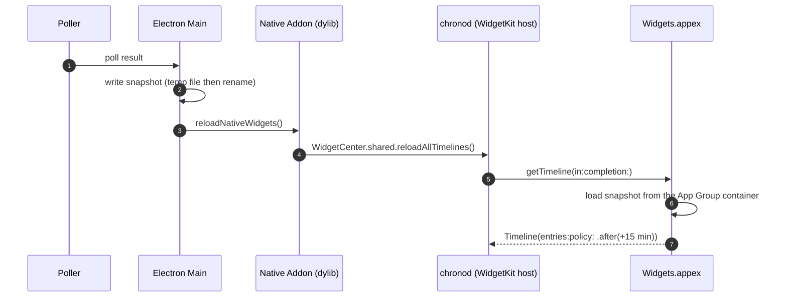

# Widgets

Both apps ship WidgetKit extensions, and both reach them the same way. A widget runs in an OS-hosted
sandbox with no channel to the app, so everything it draws passes through an App Group snapshot file
and every timeline reload has to originate in the Electron main process. The families, layouts, choice
of calendars and deep links are each app's own: Magimail's are in
[`../magimail/widgets.md`](../magimail/widgets.md), Magical's in
[`../magical/widgets.md`](../magical/widgets.md).

## Where a widget runs, and how it gets its data

A widget is a standalone macOS app extension bundle in `Contents/PlugIns/`. `chronod` launches it when
it feels like rendering, long after the poll that produced the data, so there is no live channel to
answer on. The app leaves a snapshot where the extension can find it and pokes WidgetKit to come and
re-read it:

The snapshot is written through a temporary file and `fs.renameSync`, so the extension never reads
partial JSON. Every field the extension reads is optional on its side: a snapshot written by an older
build is missing whatever that build did not write, and the extension reads an absent field as its
default rather than failing to decode the file.

## App Group container

The snapshot lives at
`~/Library/Group Containers/<TEAM_ID>.group.com.alexhaslam.<app>/widget-cache.json`, in a container
both sides are entitled for. The extension is sandboxed, and the group is the one shared location
both sides are entitled for.

The container resolution, the team-prefix rule and the signing story are in
[`process-model-and-ipc.md`](process-model-and-ipc.md) and [`building-and-signing.md`](building-and-signing.md).

## Timeline reload must come from the main process

`WidgetCenter` asks macOS `chronod` _which_ widgets to reload, and `chronod` accepts the call only
from the process whose executable matches `CFBundleExecutable`, so it goes through the native addon in
the main process rather than the Swift helper. When the host app is idle, a 15-minute policy on the
timeline refreshes the widget anyway, which is the backstop for when the app is not running to poke
it. [`process-model-and-ipc.md`](process-model-and-ipc.md) has the rule and the failure it prevents.

The app requests a widget reload only when the snapshot changed: it compares everything a widget
draws against the last snapshot it wrote, and asks WidgetKit only when the two differ. The update
timestamp is left out, because it moves on every poll and changes nothing on screen. Each app
compares the fields its own widgets draw: Magical includes Focus state and the silenced calendars, so
a Focus transition reloads the widget even when no event changed, and Magimail compares the accounts,
unread totals and recent threads.

WidgetKit rations reloads per widget and merges or ignores the ones that arrive too often. So the app
reloads a widget when what it draws changes, not on the poll interval: a poll that finds the same
mail produces no request, however often it runs.

## Building and verifying an extension

An `.appex` is built standalone (its own `xcodebuild` or `swiftc`), stamped with the version and the
build number, and signed before it is bundled into `Contents/PlugIns/` through `electron-builder.json`'s
`extraFiles`. `scripts/build-app.sh` builds every extension and refuses to package without it,
because `electron-builder` only _warns_ when a bundled artefact is missing, and an app installed
without its `.appex` shows no widgets in the gallery at all. The build-number stamping, and why macOS
needs it, are in
[`process-model-and-ipc.md`'s Extension build number](process-model-and-ipc.md#extension-build-number).

Verify a widget change by confirming that no `deny` for the container appears while the app polls,
and that the widget renders counts. The extension caches its binary, so run `killall MagimailWidgets`
after installing, or it keeps running the old one.

## Brand mark and the shared tokens

Each extension compiles the brand mark in by relative path from the app's `swift/Sources/…Lib/`, so the
widget, the popover and the menu bar cannot draw different marks. The mark, its box and the rule that
keeps it sharp across the extension boundary are in [`brand-and-icons.md`](brand-and-icons.md).

Values come from `Views.swift` in Magimail's extension, so the two apps' widgets sit next to each other
in Notification Center without reading as two products:

| Token       | Value                                      |
| :---------- | :----------------------------------------- |
| Card fill   | `Color.primary.opacity(0.06)`              |
| Hairline    | `Color.primary.opacity(0.08)`, 1pt border  |
| Card radius | 7pt                                        |
| Accent bar  | 3pt capsule, 4pt inset from top and bottom |
| Title       | 12.5pt semibold, 11.5pt in a compact card  |
| Metadata    | 10.5pt secondary                           |
| Eyebrow     | 9.5pt bold, 1pt letter spacing             |
| Background  | `.thinMaterial`                            |

**A feed takes a divided group and a discrete object takes a card.** Magimail draws a thread list as
one inset group divided by hairlines and draws an account as its own tile; Magical draws a day as a
set of cards with gaps between them rather than a feed. The accent bar is the only coloured thing on a
card; tinting the border and a fill as well turns a column of cards into a column of colour washes.
Both apps use `.font(.system(size:weight:))` throughout, with no bundled webfonts, and system SF
Symbols rather than branded icons.
