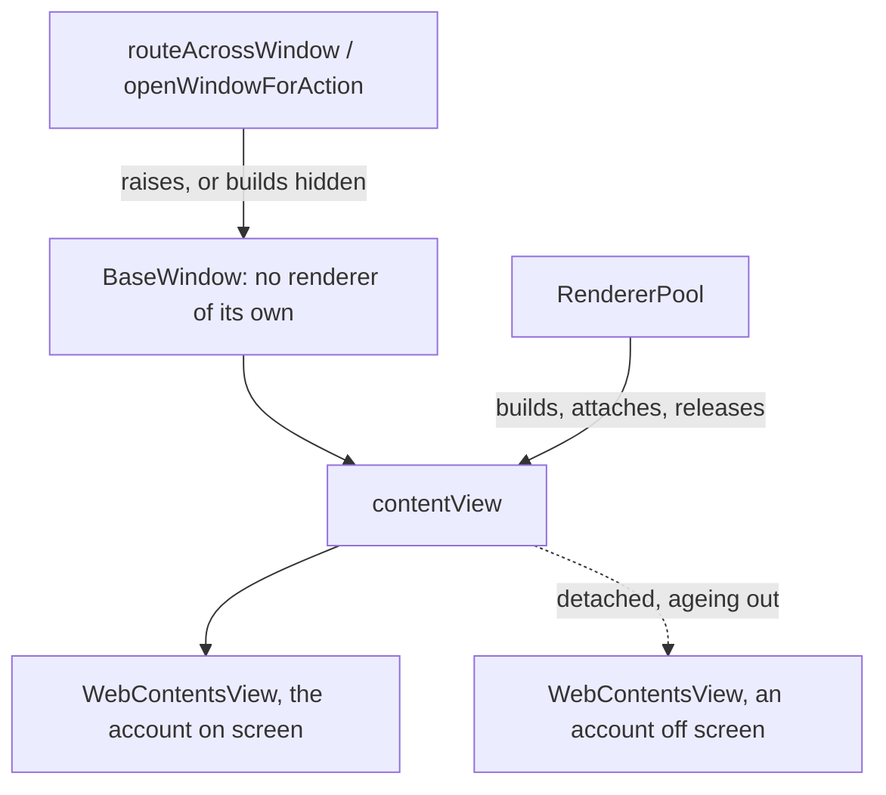
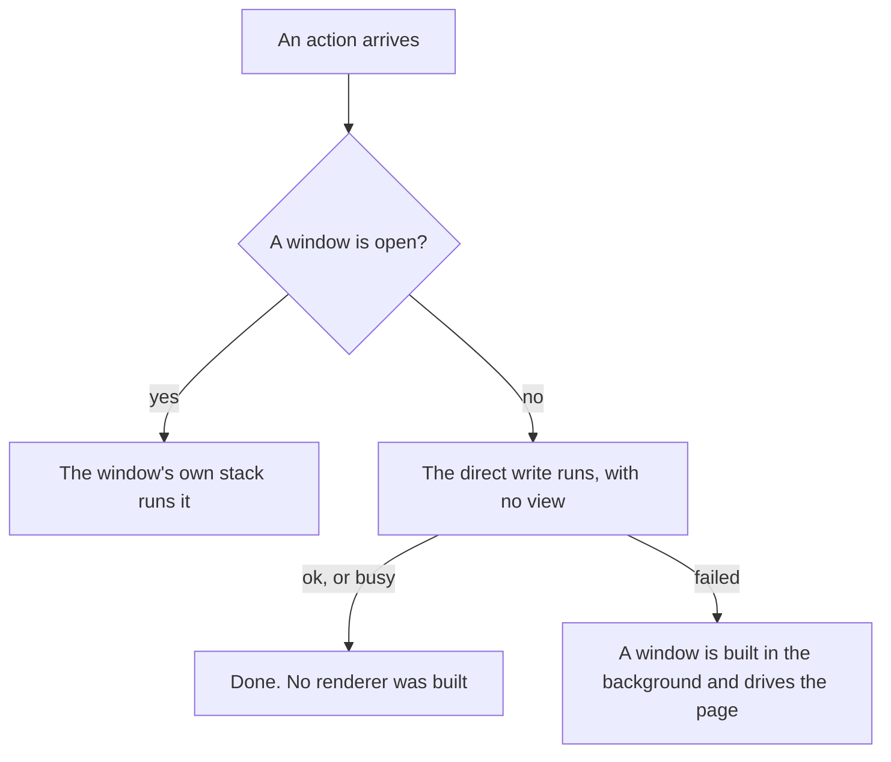

# Window and account-renderer lifecycle

Each app runs one main window and one `WebContentsView` per account, and both use the same `RendererPool` in `packages/core` to build, attach and release those views. Each app supplies only its own parts.

## Main window

`createMainWindowOptions` in `packages/core/src/window.ts` builds a hidden `BaseWindow` with `titleBarStyle: 'hiddenInset'` and sidebar vibrancy. It has no web engine of its own, so the shell starts no renderer where a `BrowserWindow` would.

Each account's page is a `WebContentsView` on that account's partition. Only the account on screen is attached, because a view is transparent until it paints. Both apps leave `backgroundThrottling` at its default: turning it off stops Electron's hidden-view patch from reaching `DelegatedFrameHost::WasShown`, so a view shown into a window that has been hidden with nothing attached can produce no frame at all ([#41276](https://github.com/electron/electron/issues/41276)). The cost is throttled timers in a view that is off screen or covered, which the pool only keeps for the five minutes before it releases them; the view on screen is never throttled.

## Account renderer lifetime

The pool builds a view when an account is first switched to. When an account leaves the screen it arms a timer for `inactiveAccountSuspendMinutes`, 5 minutes by default; switching back before it fires cancels the timer. When it fires, the pool remembers the view's URL, detaches the view, calls the app's `onRelease`, and closes the `WebContents`. That close is the only thing that returns renderer memory ([measurements](performance-optimisation.md#what-actually-reclaims-renderer-memory-measured)).

`SUSPEND_NEVER` (`0`, the Settings "Never") arms no timer. `suspendAllAccounts` releases every view; it runs on quit, and when the main window closes, so a closed window leaves no renderer per account behind and no timer to fire against a destroyed window.

The account on screen is spared the timer only while the window is visible, so a hidden or tray-only app holds no renderer. A window built hidden fires no `hide`, so the app calls `handleWindowHidden` itself.

### When an account view stops presenting

A `WebContentsView` on macOS can occasionally stop presenting frames to its window while its underlying renderer process continues running and handling DOM actions. Calling `webContents.reload()` reuses the same `WebContents` and compositor pipeline, leaving the window blank.

Tearing down the dead `WebContents` and constructing a replacement through `RendererPool.rebuildView` (which removes the view with `rememberUrl: true` and calls `attachOnly`) rebuilds the view on a fresh compositor surface while preserving the route the user was on. `reloadActiveView()` in Magimail drives that repair, from `Cmd+R` or the View menu.

Magical calls it too, from the Settings toggles that change Google's own layout and from the wake-from-sleep handler, but not from `Cmd+R`. A reload request there rebuilds the whole window (`reloadCalendar` in `apps/magical/src/main.ts`), on the same account and at the same bounds. A view rebuild is the cheaper repair, and the log shows why it is not enough on its own: on 29 October twenty of them ran in twenty seconds, each detaching, creating, attaching and navigating, and the window stayed blank until it was closed and rebuilt. A reload request is a user asking for the calendar back, so it does the repair that works, at the cost of a page reload and a blink of the window.

## RendererPool and its spec

The pool owns the views, their timers, the remembered URL and the window's visibility. It touches no DOM and imports Electron for types only, so it lives in `packages/core`. A `RendererPoolSpec` supplies the eight things it cannot read:

| Spec member       | What the app supplies                                                      |
| :---------------- | :------------------------------------------------------------------------- |
| `window`          | The window whose `contentView` the views attach to.                        |
| `accountFor`      | The account an id names, or undefined when it is not configured.           |
| `activeAccountId` | The account on screen, which a visible window spares from the timer.       |
| `createView`      | A view for an account that has none: partition, preload, `webPreferences`. |
| `attach`          | Adds the view to the window, if it is not there already.                   |
| `detach`          | Takes the view off the window, if it is there.                             |
| `onRelease`       | Releases what the app holds per view.                                      |
| `rememberUrl`     | The URL to remember for a released view, or undefined to remember none.    |

`rememberUrl` is the app's own policy. Magimail remembers a `https://mail.google.com` URL whole, query included. Magical drops the query from a Calendar URL, because its offline cache matches the exact URL and the date and view mode live in the path, and keeps an `accounts.google.com` URL whole, because the query names the service and where to continue to.

`onRelease` is where Magimail drops the injected stylesheet key and the account's unread report; its category banner is per window, not per view, so it is released once when every view goes. Magical holds nothing per view.

## Routing an action across the window boundary

An action can arrive with no window to serve it, because a banner outlives the window that scheduled it. `routeAcrossWindow` in `packages/core/src/window-route.ts` runs exactly one of three paths:

1. `window`, while a window is open.
2. `direct`, the write that needs no view, when there is none.
3. `openWindow`, only when `direct` returns `failed`, which builds a window in the background to drive the page.

`WindowRoute` is generic over the outcome union. Magimail's is `ok | failed`; Magical's adds `busy` for an action an open editor is holding. Only `failed` is shared, so it is the only verdict the module names.

`openWindowForAction` takes a `WindowActionTarget` (`getWindow`, `createWindow`, `focusApp`, `getManager`), because core cannot read an app's window or manager handle. `show: false` builds the window hidden, for an action that drives a page; the default raises it, for one that asks to look.

## Waking a suspended account for an action

A released account has no view, so `wakeForAction` builds one, points it at the remembered URL or the app's `loginUrl`, waits for the page, and returns it with a `release` the caller must call. A view that already had a page is awaited through `waitForReady` instead.

The view is attached for the length of the action through `attachForAction`, because a background account has no parent and a zero-sized viewport renders no control the action can find. `release` detaches it and re-arms its timer, except for the account on screen in a visible window, whose lifetime belongs to the switch and visibility rules.
