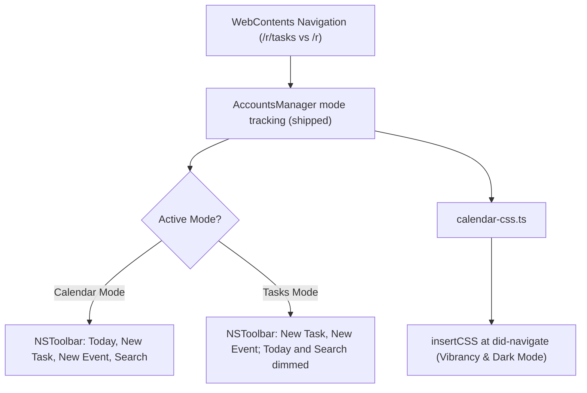

# Google Tasks UI

The Tasks poller ships; [`google-tasks.md`](../../docs/magical/google-tasks.md) owns it. This spec
covers the UI, which does not.

## Why Tasks is its own mode

Many people work in the Tasks sidebar inside Google Calendar, or go straight to
`https://calendar.google.com/calendar/u/<id>/r/tasks`. A wrapper that keeps the Calendar toolbar
while the user is in Tasks leaves `Day / Week / Month` segments and a `Today` button above a task
list where they do nothing, and Tasks' opaque white canvas clashes with dark mode and desktop
vibrancy. Magical treats Tasks as a distinct mode:

- **The toolbar follows the mode**: the native `NSToolbar`
  ([`native-ui.md`'s The toolbar](../../docs/shared/native-ui.md#toolbar)) dims the items that only
  mean something on the grid when the view switches to Tasks.
- **The app tracks the route**: `did-navigate-in-page` reports moves to `/r/tasks`.
- **Injected CSS themes the canvas** to high-contrast dark and translucent vibrancy, following
  [`design.md`'s Theming & dark mode](../../docs/shared/design.md#theming--dark-mode).
- **Tasks can be switched off**: a setting hides the integration.

## Tracking the route

Ships. `AccountsManager` reads the mode off each view's URL on `did-navigate` and
`did-navigate-in-page`, keeps it per account and emits `onModeChanged` for the account on screen;
[`overview.md`](../../docs/magical/overview.md#calendar-and-tasks-view-modes) owns it. The same mode
guards the actions that need the calendar grid, so reveal, RSVP, delete and complete leave `/r/tasks`
for the root rather than failing against a canvas with no controls on it.

What remains here is the part of the toolbar this mode does not yet carry: a task list selector and
an Active/Completed filter. Google Calendar is a single-page app, so moving between a Calendar view
and a Tasks view changes the client-side path rather than reloading the document: Calendar at `/r`,
`/r/day`, `/r/week`, `/r/month`; full-page Tasks at `/r/tasks`. The companion Tasks drawer
(`div[aria-label="Tasks"]`) is deliberately not tracked; it is the task sidebar's own surface, not a
view mode.

## Mode-aware toolbar

Ships. `native-toolbar.ts` pushes the mode over `toolbar_set_item_enabled` into the C++ N-API addon
(`magical_addon.mm`), the bridge
[`native-ui.md`'s The toolbar](../../docs/shared/native-ui.md#toolbar) owns. The item set does not
change between modes; the two items that only mean something on the grid are dimmed instead, so the
toolbar's shape stays steady across a switch.

| Item       | Calendar mode                                | Tasks mode                                               |
| :--------- | :------------------------------------------- | :------------------------------------------------------- |
| `navGroup` | `< Today >`, live                            | Dimmed: there is no period to move on the Tasks canvas   |
| `search`   | Google's event search                        | Dimmed: the search is an event search, not a task search |
| `addTask`  | Create menu's Task item, staying in the grid | The page's own "Add a task" entry, focused in place      |
| `addEvent` | Google Calendar's event composer             | Leaves for the grid, then opens the composer             |

**Both creation actions are always enabled.** They are the cross-mode capture: from either mode the
user can write a task or an event without first navigating, and only `addEvent` has to move — its
composer is a control the Tasks canvas does not draw. `< Today >` and Search dim because neither has
an answer to give there, not because the toolbar is being rebuilt.

## Theming the Tasks canvas

Theming, vibrancy and the anti-FOUC timing are
[`design.md`'s Theming & dark mode](../../docs/shared/design.md#theming--dark-mode); what follows is
what the Tasks canvas itself needs. Its DOM is built from Material Design components (`mwc-button`,
`tasks-task-list`). CSS injected at `did-navigate` does four things:

1. **Opaque canvas backgrounds come off**, so the window vibrancy shows through.
2. **Task cards keep an opaque surface**, so list text stays readable against the wallpaper.
3. **Google Tasks' CSS variables** (`--surface-color`, `--text-color`) are remapped onto Magical's
   theme tokens.
4. **Anti-FOUC**: `insertCSS` with `cssOrigin: 'user'` applies the styles, so a route transition
   never flashes white.

## Preferences

In SwiftUI Settings (`General → Features`), `Enable Google Tasks` toggles the integration. On, the
Tasks sidebar icon and the `/r/tasks` routes are reachable. Off, injected CSS hides the entry points
(`a[aria-label="Tasks"]`) and a direct navigation to `/r/tasks` redirects to the primary calendar
grid.

## Constraints

1. **Mode transitions stay clean**: a toolbar update never reloads the Chromium web view and never
   flashes unstyled chrome.
2. **Tasks stay inside the account's partition** (`persist:magical_<id>`), and no cookie crosses
   between accounts
   ([`sessions-and-security.md`'s Multi-partition session sandboxing](../../docs/shared/sessions-and-security.md#multi-partition-session-sandboxing)).
3. **No minified class names**: CSS rules and DOM observers anchor to semantic attributes
   (`[aria-label="Tasks"]`, `[role="list"]`), the rule in
   [`design.md`'s DOM selection & CSS hygiene](../../docs/shared/design.md#dom-selection--css-hygiene).
