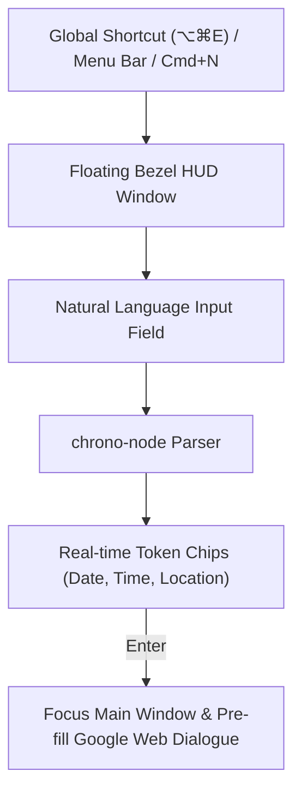

# Natural language Quick Add

Creating an event normally means opening a browser window or working through a multi-field dialogue:
title, date picker, start time, end time, location. Quick Add takes a typed phrase instead, in the
manner of Fantastical. `⌥⌘E` opens it from any macOS application, and `Cmd+N` does the same when
Magical is focused. It renders as a floating AppKit bezel HUD, so there is no browser canvas to
launch, and parses the phrase as the user types.



## Floating HUD

The window is created at startup as an invisible, ready-to-show `BaseWindow`:

- **Style**: borderless and rounded (`corner-radius: 16pt`), floating above all desktop spaces
  (`level: 'floating'`).
- **Vibrancy**: native macOS material (`vibrancy: 'hudWindow'`), the materials
  [`design.md`'s Window translucency & vibrancy](../../docs/shared/design.md#window-translucency--vibrancy-transparent-backgrounds)
  sets out.
- **Activation**: it takes focus only when invoked, and dismisses on `Esc` or on losing focus
  (`blur`).
- **Dimensions**: 520pt wide, growing from 64pt for a single input line to about 120pt once token
  chips and location suggestions appear.

`⌥⌘E` registers through Electron `globalShortcut.register('Option+Command+E', ...)` and is
configurable in SwiftUI Settings (`General → Shortcuts`). Without system accessibility permissions,
only the in-app `Cmd+N` works.

## Parsing with `chrono-node`

Text is parsed on every keystroke, debounced at 40ms, through a custom `chrono-node` pipeline:

| Input phrase                                        | Title           | Time range             | Location    | Platform                        |
| :-------------------------------------------------- | :-------------- | :--------------------- | :---------- | :------------------------------ |
| `"Sync with Sarah tomorrow 3pm-4pm at Zoom"`        | Sync with Sarah | Tomorrow 15:00 - 16:00 | Zoom        | Zoom video conference           |
| `"Lunch with Dave at Blue Bottle on Friday at 1pm"` | Lunch with Dave | Friday 13:00 - 14:00   | Blue Bottle | Physical venue                  |
| `"Design Sprint next Monday 10am for 2 hours"`      | Design Sprint   | Next Mon 10:00 - 12:00 | _None_      | _None_                          |
| `"All-hands Thursday 9am every week"`               | All-hands       | Thursday 09:00 - 10:00 | _None_      | Recurring (`RRULE:FREQ=WEEKLY`) |

Detected entities render as interactive token chips beneath the text entry field:

```plain text
┌────────────────────────────────────────────────────────┐
│ [ Work ▾ ] ✏️ Sync with Sarah tomorrow 3pm at Zoom     │
├────────────────────────────────────────────────────────┤
│ 📅 Tomorrow (Thu, 17 Sep)  ⏰ 15:00-16:00  🎥 Zoom     │
└────────────────────────────────────────────────────────┘
```

Clicking a chip adjusts that value inline, without rewriting the text prompt. An event whose phrase
states no duration lasts 60 minutes, or whatever the user set as their default duration in
Preferences.

## Dispatch on `Enter`

`Enter` is for events that need rich notes, attendees or attachments:

1. The HUD closes.
2. Magical's primary window comes forward, showing the selected account.
3. Synthetic parameters go into Google Calendar's creation canvas
   (`https://calendar.google.com/calendar/u/<id>/r/eventedit?...`).

`Enter` never commits. Pre-filling is a navigation that a human finishes by pressing save, while a
background write (driving Google's own save button or crafting a headless RPC mutation) would be the
only place the app writes to Google unprompted: a silent create is the highest-risk request it could
make, and it saves a single keypress. The headless path also needs hand-built Closure protobuf
sub-trees and client transaction IDs, which fail by silently corrupting a recurring series rather
than returning an error. `Cmd+Enter` is therefore not bound.

## Account routing

- **Header account picker**: shows the account the event will go to, with that account's own colour
  dot (`[ Work #039be5 ▾ ]`),
  [`design.md`'s Account colour language across surfaces](../../docs/shared/design.md#account-colour-language-across-surfaces).
- **Memory**: the account used last time is the default.
- **Override**: prefixing the text with an account nickname picks that account, so
  `"pers: Dentist Tuesday 9am"` goes to Personal.

## Constraints

1. **Pre-warmed window**: the window is created at startup and kept in memory; never construct a new
   browser window on a hotkey press.
2. **Read-only**: the HUD never writes to Google; it hands the pre-filled draft to the view and the
   human saves.
3. **Focus restoration**: dismissing with `Esc` returns macOS focus to the application the user was
   working in.
