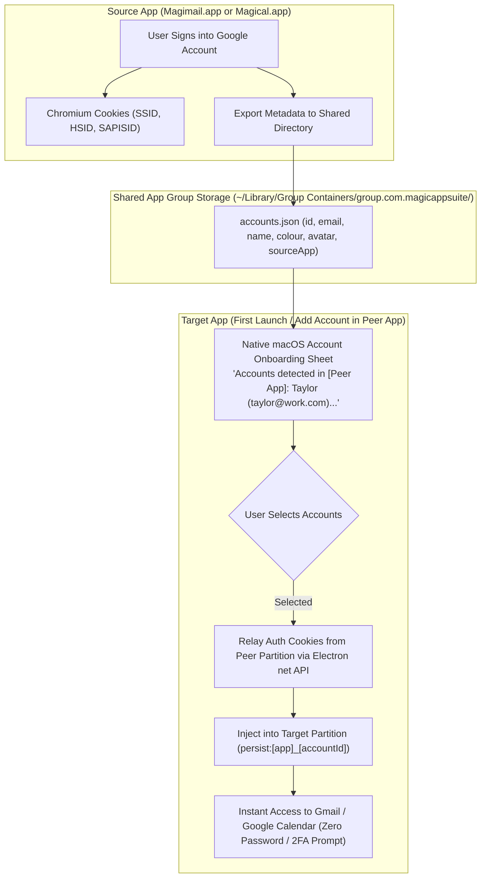

# Session cookie relay

Signing in once should be enough for both apps. Each app keeps its own accounts file and its own
`persist:` partition prefix
([`sessions-and-security.md`'s Multi-partition session sandboxing](../../docs/shared/sessions-and-security.md#multi-partition-session-sandboxing)),
so someone who has signed into Gmail in Magimail signs in a second time before Magical will show the
same account's calendar. The relay removes that second sign-in: either app onboards an account the
other already holds, and copies its session cookies across.

## How the relay works

1. **Whichever app the user installs first, the other imports from it.** Install Magimail then
   Magical, and Magical finds Magimail's accounts and offers to import them into Google Calendar in
   one click, and the reverse. Adding an account later through Settings → Add Account makes the peer
   app find it in the shared directory and offer an "Import from [Peer App]" button.
2. **Each app keeps its own Chromium profile folder on disk**, Magimail at
   `~/Library/Application Support/Magimail/Partitions/magimail_<accountId>/` and Magical at
   `~/Library/Application Support/Magical/Partitions/magical_<accountId>/`. The two folders cannot be
   one: Chromium takes exclusive `fcntl`/`flock` locks on its LevelDB and SQLite databases, so two
   Electron processes against identical paths collide on those locks (`EBUSY` / `LOCK_FAILURE`),
   corrupt the databases and crash. The cookies are copied rather than shared.
3. **One file holds the account metadata for the whole project**, at
   `~/Library/Group Containers/group.com.magicappsuite/accounts.json`, resolved the way
   [`process-model-and-ipc.md`'s The App Group container](../../docs/shared/process-model-and-ipc.md#app-group-container)
   describes. It records account identifiers, email addresses, display names, source colours, and
   which app last verified authentication.
4. **An onboarding sheet offers what it found.** Either app checks the shared directory when it first
   launches and again when the user clicks Add Account, then presents a native AppKit sheet listing
   the accounts with checkboxes:
   > _"Found accounts in Magical:_
   > _☑️ **Taylor Smith** (`taylor@work.com`): Work_
   > _☑️ **Taylor Smith** (`taylor@example.com`): Personal_
   > _[ Continue with Selected Accounts ] [ Set Up Manually ]"_
5. **The cookies move once, on confirmation.** The target app initialises its own partition and
   fetches the Google authentication cookies (`SSID`, `HSID`, `SAPISID`, `SID`, `APISID`) from the
   source app's session store, then injects them into the target partition with
   `session.cookies.set()`. Gmail or Google Calendar then loads already authenticated, with no
   password and no 2FA prompt.

## Why this is the one place cookies are handled

The poller never touches cookie values; Chromium attaches them from its own store. The relay reads
cookie values out of one partition and writes them into another, so it is the part of the project
where a mistake leaks a session. It wants review attention out of proportion to its size, and it
never logs a value it reads.

## Keeping the account colour in step

The colour language that ties an account to a dot on every surface is
[`design.md`'s Account colour language across surfaces](../../docs/shared/design.md#account-colour-language-across-surfaces).
A setting, `syncAccountColorWithCalendar`, keeps each account's dot matching its Google Calendar
colour. Every Google account has exactly one primary calendar (`"primary": true` or `id == email`),
which Google Calendar will not let the user delete.

Settings → Accounts carries the toggle in both apps
(`[x] Keep account colour in sync with Google Calendar`, on by default). Magical syncs through
`calendar-poller.ts`, reading the primary calendar's `backgroundColor` (Peacock `#039be5`, Tangerine
`#f4511e`) and writing it to the shared `accounts.json`. Magimail's account store watches that file
with `fs.watch` and updates its `AccountConfig.color` without a reload, so its `NSToolbar` segment
dot, menu bar popover dot and widget pills follow straight away. With the toggle off, the user picks
the account dot colour in Magimail through the standard macOS colour picker.
