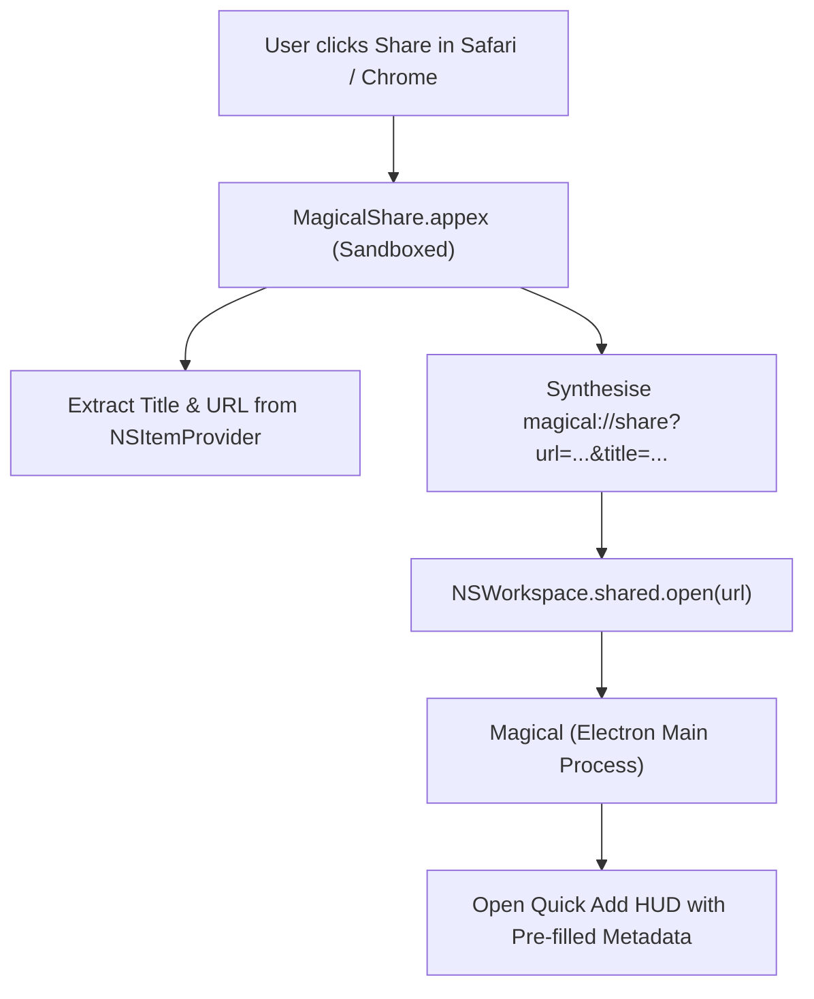

# Share sheet extension

Most of what needs scheduling turns up outside the calendar: a pull request to review, a ticket for a
sprint, a document to read, an event announced on a website. Scheduling one without a share extension
means copying the link, switching apps, opening a new event modal, pasting the URL and typing the
details by hand.

Magical joins the native macOS Share Sheet through an App Extension, `MagicalShare.appex`. It is
reachable from the Share menu in Safari, Chrome, Finder and third-party apps, accepts web URLs
(`public.url`) and plain text selections (`public.plain-text`), and formats the payload into a
`magical://share` URL that opens the Quick Add HUD ([`quick-add.md`](quick-add.md)) with the title
pre-filled and the shared link attached. The user then types `"tomorrow 3pm"`.



## Packaging

The mechanics every `.appex` shares (the App Group container, the sandbox temporary exceptions and
the build-number rule) are
[`process-model-and-ipc.md`'s Extension mechanics both apps share](../../docs/shared/process-model-and-ipc.md#extension-mechanics-both-apps-share).
This extension's own configuration:

- **Bundle identifier**: `com.alexhaslam.magical.share`
- **Product type**: `com.apple.product-type.app-extension`
- **Location**: `Magical.app/Contents/PlugIns/MagicalShare.appex`
- **Entitlements**: sandboxed, with `com.apple.security.app-sandbox`.

It activates for web links and text selections only, so it stays out of the Share menu for files it
could do nothing with:

```xml
<key>NSExtension</key>
<dict>
    <key>NSExtensionAttributes</key>
    <dict>
        <key>NSExtensionActivationRule</key>
        <dict>
            <key>NSExtensionActivationSupportsWebURLWithMaxCount</key>
            <integer>1</integer>
            <key>NSExtensionActivationSupportsText</key>
            <true/>
        </dict>
    </dict>
    <key>NSExtensionPointIdentifier</key>
    <string>com.apple.share-services</string>
    <key>NSExtensionPrincipalClass</key>
    <string>ShareViewController</string>
</dict>
```

## `magical://share` link

A custom URL scheme is one of the three channels an `.appex` has to the app
([`process-model-and-ipc.md`'s Reaching an app extension](../../docs/shared/process-model-and-ipc.md#reaching-an-app-extension)).
The extension hands the payload over as:

```plain text
magical://share?url=<encoded_url>&title=<encoded_title>&text=<encoded_text>
```

- **`url`**: the shared URL (`https://example.com/article`).
- **`title`**: the page or document title.
- **`text`**: the selected quote or snippet.

`share-handler.ts` in `apps/magical/src/main.ts` listens for `app.on('open-url', ...)`, parses the
query parameters, and calls
`openQuickAdd({ initialTitle: title, initialUrl: url, initialNotes: text })`. The HUD appears at once,
with the cursor in the natural language field, ready for the date and time.

## Constraints

1. **Non-blocking extension UI**: the extension extracts the payload, calls
   `NSWorkspace.shared.open()` and completes the share request immediately, without waiting for
   Electron to boot.
2. **The main process validates the URL scheme**: it accepts `http:` and `https:` only, before
   persisting the URL into a calendar event description.
3. **The extension stays inside its sandbox**: it never reaches for SQLite databases or Chromium
   partition stores on disk, because an `.appex` runs in a sandbox of its own with only the three
   channels
   [`process-model-and-ipc.md`'s Reaching an app extension](../../docs/shared/process-model-and-ipc.md#reaching-an-app-extension)
   lists.
